# Database design

PostgreSQL 16 (Azure PostgreSQL Flexible B1ms in staging/prod; Docker locally). Schema is owned by EF Core migrations in `src/api/SlateAi.Api/Data/Migrations/`; `AppDbContext` is the source of truth. **Update this document in the same PR as any migration.**

| | |
|---|---|
| Last migration | `LessonContentPerCurriculum` (T-147) |
| Data model in spec | `docs/spec.md` §4.3 (planned tables live there first) |
| Curriculum | The built-in one is not in the database: loaded from `data/curriculum/*.json` at startup (T-05). A class can instead follow a stored curriculum (`Curricula`, T-145, D-125). Rows reference competencies by string ID such as `M3.ADD.CARRY`, read in the class's curriculum |

## 1. Current schema (built)

```mermaid
erDiagram
    Teachers ||--o{ Classes : "main teacher"
    Teachers ||--o{ ClassTeachers : "signs in to"
    Classes ||--o{ ClassTeachers : "has teachers"
    Classes ||--o{ Children : has
    Classes ||--o{ Attendance : "register per day"
    Children ||--o{ Attendance : "marked in"
    Classes ||--o{ Lessons : "taught on a day"
    Classes ||--o{ MessageTemplates : "approves once"
    Children ||--o{ EveningMessages : "one per day absent"
    MessageTemplates ||--o{ EveningMessages : "filled from"
    Lessons ||--o{ EveningMessages : "slots from"
    Classes ||--o{ LessonAudios : "one per day and language, if ticked"
    LessonAudios ||--o{ EveningMessages : "approved clip goes with"
    EveningMessages ||--o{ ParentDeliveries : "queued for each family number"
    CatchUpAssignments ||--o{ ParentDeliveries : "queued for each family number"
    WeeklyStarMessages ||--o{ ParentDeliveries : "queued for each family number"
    Children ||--o{ WeeklyStarMessages : "star for a full week"
    Classes ||--o| WeeklyStarApprovals : "star wording approved"
    AudioClips ||--o{ LessonAudios : "clip she listens to"
    Classes ||--o{ TodaysMessages : "one per day, if the lesson has exercises"
    TodaysMessages ||--o{ EveningMessages : "approved version goes with"
    Classes ||--o{ CatchUpPackages : "one per targets + language per week"
    CatchUpPackages ||--o{ CatchUpAssignments : "for"
    Children ||--o{ CatchUpAssignments : "one per week"
    CatchUpPackages ||--o{ AudioClips : "script audio"
    CatchUpAssignments ||--o| CheckResponses : "answered with"
    Children ||--o{ AbsenceReasons : "one per absent day"
    Children ||--o{ BuddyCards : "ticks per return day"
    Classes ||--o{ PacingDecisions : "one per week"
    Curricula |o--o{ Classes : "followed by (null = built-in)"
    Curricula ||--o{ CurriculumLessons : has
    CurriculumImports |o--o| Curricula : "drafts"
    CurriculumImports ||--o{ CurriculumImportPages : "the book, until the draft is written"
    CurriculumImports ||--o{ CurriculumImportSteps : "finished steps"
    Lessons ||--o{ PacingDecisions : "the nudge's lesson"

    Teachers {
        uuid Id PK
        varchar100 DisplayName
        varchar20 Phone "nullable"
        varchar200 PinHash "nullable"
        varchar500 GreetingAudioUrl "nullable"
        timestamptz ConsentAt "nullable"
        int FailedPinAttempts
        timestamptz PinLockedUntil "nullable"
    }
    Classes {
        uuid Id PK
        uuid TeacherId FK
        int Grade
        varchar5 Medium "e.g. kn"
        uuid CurriculumId FK "nullable: null = built-in"
    }
    Curricula {
        uuid Id PK
        varchar200 Title
        int Grade
        varchar50 Subject "e.g. maths"
        varchar5 Medium "e.g. kn"
        varchar20 Status "draft | published"
        jsonb Chapters
        timestamptz CreatedAt
        timestamptz PublishedAt "nullable"
        uuid ImportId "nullable, no FK"
    }
    CurriculumLessons {
        uuid CurriculumId PK,FK
        varchar100 CompetencyId PK
        int Sequence
        jsonb Competency
        varchar20 ReviewStatus "needs-review | reviewed"
        text_array Flags
        jsonb Extras "nullable"
    }
    CurriculumImports {
        uuid Id PK
        uuid ClientRequestId "unique"
        varchar200 Title
        int Grade
        varchar50 Subject
        varchar5 Medium
        varchar20 Book "textbook | workbook | nalikali"
        int Part "nullable"
        int PageCount
        varchar20 Status "queued | running | ready | failed"
        varchar20 Stage "nullable"
        int StepsDone
        int StepsTotal
        varchar200 Error "nullable"
        text_array Notes
        uuid CurriculumId FK "nullable"
        timestamptz CreatedAt
        timestamptz UpdatedAt
    }
    CurriculumImportPages {
        uuid ImportId PK,FK
        int Number PK
        bytea Pdf
    }
    CurriculumImportSteps {
        uuid ImportId PK,FK
        varchar50 Key PK
        jsonb Result
        timestamptz CreatedAt
    }
    Children {
        uuid Id PK
        uuid ClassId FK
        int RollNo "unique per class"
        varchar50 FirstName
        varchar5 HomeLanguage "kn, te, ta, en, hi"
        varchar20 ParentPhone "nullable"
        timestamptz ParentPhoneSetAt "nullable"
        varchar20 ParentPhone2 "nullable, Number 2"
        timestamptz ParentPhone2SetAt "nullable"
        timestamptz HomeLanguageSetAt "nullable"
        timestamptz ParentConsentAt "nullable"
        bool HasPhone
        varchar10 Consent "yes, no, nophone (default no)"
        timestamptz ConsentChangedAt "nullable"
        timestamptz ParentStoppedAt "nullable"
    }
    Attendance {
        uuid ClassId PK,FK
        date Date PK
        uuid ChildId PK,FK
        bool Present
        varchar10 Source "sats | manual"
        bool SourcePresent "nullable"
        timestamptz ReceivedAt "nullable"
        timestamptz CorrectedAt "nullable"
    }
    Lessons {
        uuid Id PK
        uuid ClassId FK
        date Date
        varchar10 Source "voice, photo, picked"
        text_array CompetencyIds
        text SummaryKn "nullable"
        text SummaryEn "nullable"
        text_array ExamplesUsed
        float Confidence "nullable"
        timestamptz MappingStartedAt "nullable"
        varchar20 Status "processing, mapped, low, unclear, confirmed"
    }
    ProcessedRequests {
        uuid ClientRequestId PK
        varchar100 Endpoint
        timestamptz CreatedAt
    }
    AiCalls {
        uuid Id PK
        timestamptz CreatedAt "indexed"
        varchar50 Purpose "prompt id or stt"
        varchar100 Model
        int PromptVersion "nullable"
        int InputTokens
        int OutputTokens
        int CacheReadTokens
        int LatencyMs
        varchar100 Verdict "nullable"
        varchar300 Error "nullable"
        uuid_array ChildIds "nullable, T-73"
    }
    MessageTemplates {
        uuid Id PK
        uuid ClassId FK
        varchar5 Language "unique per class"
        varchar20 Version
        varchar1000 Text "slots child, lesson, page"
        varchar100 PageFormat
        varchar100 PageFormatNoPart
        varchar10 Status "draft, approved"
        timestamptz ApprovedAt "nullable"
        uuid ApprovedByTeacherId FK "nullable"
    }
    EveningMessages {
        uuid Id PK
        uuid ClassId FK
        uuid ChildId FK
        date Date "unique with ChildId"
        uuid TemplateId FK
        uuid LessonId FK
        uuid LessonAudioId FK "nullable, set null, approved lesson audio"
        uuid TodaysMessageId FK "nullable, set null, approved today's message"
        varchar3 PictureFirst "nullable, child's first submit"
        varchar3 PictureSecond "nullable, second submit"
        timestamptz PictureAnsweredAt "nullable"
        varchar5 Language
        jsonb SlotValues "lesson, page"
        varchar30 Token "unique"
        timestamptz SentAt
        timestamptz ExpiresAt
    }
    ParentDeliveries {
        uuid Id PK
        uuid ClassId FK
        uuid ChildId FK
        uuid EveningMessageId FK "nullable, unique with Recipient"
        uuid CatchUpAssignmentId FK "nullable, unique with Recipient"
        uuid WeeklyStarMessageId FK "nullable, unique with Recipient"
        smallint Recipient "1 or 2: the family's number"
        varchar10 Status "pending, sent, skipped, failed"
        varchar10 Channel "demo, whatsapp; null while pending"
        varchar100 ProviderMessageId "nullable, sha256 of the wamid"
        int Attempts
        varchar40 LastError "nullable, code only"
        timestamptz CreatedAt
        timestamptz SentAt "nullable"
    }
    WeeklyStarMessages {
        uuid Id PK
        uuid ClassId FK
        uuid ChildId FK
        date WeekOf "Monday; unique with ChildId"
        varchar5 Language
        varchar20 Version "weekly-star.json she approved"
        varchar500 MessageText "with {child}, never the name"
        varchar500 BadgeText "with {child}"
        varchar30 Token UK
        timestamptz SentAt
        timestamptz ExpiresAt
    }
    WeeklyStarApprovals {
        uuid ClassId PK
        varchar20 Version
        timestamptz ApprovedAt
        uuid ApprovedByTeacherId FK
    }
    CatchUpPackages {
        uuid Id PK
        uuid ClassId FK
        date WeekOf "Monday"
        text_array TargetCompetencyIds "1-2, first = tested"
        varchar100 TargetKey "unique with ClassId, WeekOf, Language"
        varchar5 Language
        varchar20 Status "generating, ready, needsReview, approved, sent, failed"
        int ScriptVersion
        int PromptVersion "nullable"
        varchar20 Hint "nullable"
        varchar100 Verdict "nullable"
        text Script "nullable"
        text_array KeyWordsKn
        text GlossKn "nullable"
        text GlossEn "nullable"
        jsonb Activity
        jsonb CheckItem "options + correctIndex"
        jsonb Review "verifier checks, nullable"
        jsonb AudioSegments "playing order, nullable"
        timestamptz ApprovedAt "nullable"
        uuid ApprovedByTeacherId FK "nullable"
        int ApprovedScriptVersion "nullable"
        timestamptz SentAt "nullable"
        varchar500 AudioUrl "nullable"
        timestamptz CreatedAt
        timestamptz UpdatedAt
    }
    CatchUpAssignments {
        uuid Id PK
        uuid ClassId FK
        uuid ChildId FK "unique with WeekOf"
        uuid PackageId FK
        date WeekOf
        text_array MissedCompetencyIds
        jsonb CompressionRationale
        varchar30 Token "nullable, unique"
        timestamptz ScheduledAt "nullable"
        timestamptz SentAt "nullable"
        timestamptz OpenedAt "nullable"
        timestamptz ExpiresAt "nullable"
        timestamptz CreatedAt
    }
    AbsenceReasons {
        uuid Id PK
        uuid ClassId FK
        uuid ChildId FK "unique with Date"
        date Date
        varchar20 Category "unwell, travelOrWork, festival, neededAtHome, other"
        timestamptz CreatedAt
        timestamptz UpdatedAt
    }
    BuddyCards {
        uuid Id PK
        uuid ClassId FK
        uuid ChildId FK "unique with Date"
        date Date
        timestamptz HomeworkReturnedAt "nullable"
        timestamptz DoneAt "nullable"
        timestamptz UpdatedAt
    }
    ClassTeachers {
        uuid ClassId PK
        uuid TeacherId PK
    }
    PacingDecisions {
        uuid Id PK
        uuid ClassId FK "unique with WeekOf"
        date WeekOf
        uuid LessonId FK
        varchar10 Decision "recap, skip"
        timestamptz DecidedAt
        timestamptz UpdatedAt
    }
    CheckResponses {
        uuid AssignmentId PK,FK
        int ChoiceId
        bool Correct
        varchar20 Outcome "caughtUp, needsBuddy"
        uuid ClientRequestId
        timestamptz AnsweredAt
        int Attempts "1 or 2, default 1"
    }
    AudioClips {
        uuid Id PK
        varchar20 Kind "script, disclosure, greeting, lesson"
        varchar5 Language
        uuid PackageId FK "nullable, cascade"
        uuid TeacherId FK "nullable, cascade, greeting only"
        varchar64 TextHash "nullable, unique with Kind, Language"
        text Transcript "nullable, lesson clips"
        varchar50 ContentType "audio/ogg"
        bytea Bytes
        float Seconds
        timestamptz CreatedAt
    }
    LessonAudios {
        uuid Id PK
        uuid ClassId FK "cascade"
        date Date "unique with ClassId, Language"
        varchar5 Language
        uuid ClipId FK "nullable, set null"
        varchar12 Status "generating, ready, approved, failed"
        varchar60 Verdict "nullable"
        timestamptz ApprovedAt "nullable"
        uuid ApprovedByTeacherId "nullable"
        uuid ApprovedClipId FK "nullable, set null"
        timestamptz CreatedAt
        timestamptz UpdatedAt
    }
    TodaysMessages {
        uuid Id PK
        uuid ClassId FK "cascade"
        date Date "unique with ClassId"
        text[] CompetencyIds
        varchar12 Status "generating, ready, approved, failed"
        int Version
        int ApprovedVersion "nullable"
        timestamptz ApprovedAt "nullable"
        uuid ApprovedByTeacherId FK "nullable"
        varchar60 Verdict "nullable"
        jsonb Sections "concept, activity, picture, video, note"
        timestamptz CreatedAt
        timestamptz UpdatedAt
    }
    LessonLinks {
        uuid CurriculumId PK "Guid.Empty = built-in"
        varchar100 CompetencyId PK "curriculum ID"
        varchar500 Url "https only"
        timestamptz UpdatedAt
    }
    LessonContents {
        uuid CurriculumId PK "Guid.Empty = built-in"
        varchar100 CompetencyId PK "curriculum ID"
        varchar700 Description "English, how the book teaches it"
        text_array Examples "1-4 worked examples"
        varchar10 Source "textbook, written, edited"
        timestamptz UpdatedAt
        timestamptz EditedAt "nullable, set by the admin page"
    }
    AppSettings {
        varchar100 Key PK "e.g. demo.school-date"
        varchar200 Value "on / off"
        timestamptz UpdatedAt
    }
```



### Tables

**`Teachers`** — one per teacher login (D-40, T-47). `Phone` is the 10-digit national number, unique. `PinHash` is a PBKDF2 hash (`PasswordHasher`) of the 4–6 digit PIN; the demo teacher's comes from `Demo:TeacherPin` and the co-teachers' from `Demo:CoTeacherPin` via the seeder, never stored in clear. `FailedPinAttempts` / `PinLockedUntil`: 5 wrong PINs lock sign-in for 15 minutes. `ConsentAt` is the first-run gate: null → Welcome. It is set once by saving the greeting with the voice-consent tick (`POST /api/me/greeting`, T-61), or by `POST /api/me/welcome` when she continues without a greeting because the microphone is blocked (D-34). `GreetingAudioUrl` is `/api/audio/{id}` of the teacher's own recorded greeting (an `AudioClips` row of kind `greeting`), played first in every parent message (FR-09); null until she records one.

**`Classes`** — `Grade` (3 for the demo) and `Medium` (language of instruction, `kn`). FK `TeacherId → Teachers` (cascade). Index on `TeacherId`. `CurriculumId` (nullable, migration `ClassCurricula`, T-145, D-125) is the published `Curricula` row the class follows; null is the built-in curriculum from `data/curriculum/*.json`. It is set on `/admin/curriculum` (T-147), which refuses a curriculum missing any lesson ID the class has used in `Lessons`, `TodaysMessages`, `CatchUpPackages` or `CatchUpAssignments`. FK `CurriculumId → Curricula` restrict, so a curriculum a class follows can't be deleted. `TeacherId` is the class's **main teacher**: the name, greeting and `{teacher}` families see (D-79); who can sign in to the class is `ClassTeachers`.

**`ClassTeachers`** — which teachers can sign in to a class (D-79): composite PK `(ClassId, TeacherId)`, FKs to `Classes` and `Teachers` (cascade), index on `TeacherId`. `AuthStore.GetMeAsync` takes the teacher's class from here (their own class first), and the class goes into the session cookie as before. The migration `ClassTeachers` adds one row per existing class for its main teacher; the seeder adds the demo class's main teacher and the co-teachers in `data/seed/demo-class.json` (`coTeachers`).

**`Children`** — `RollNo` is unique within a class (`IX_Children_ClassId_RollNo`). `HomeLanguage` (`kn`, `en`, `te`, `ta` or `hi`) is the language of everything the family gets: evening message, today's message, lesson audio, catch-ups. It can be changed on `/admin/children`, which sets `HomeLanguageSetAt` (migration `HomeLanguageSetAt`, T-122, D-113); what was made before keeps its language, and the demo Reset puts a changed language back on the re-created child. `HasPhone = false` children still get the return-day buddy card (FR-12). `ParentPhone` is E.164; seeded values are fictional and never dialled. `ParentPhoneSetAt` is set when a number is saved on `/admin/children` (migration `ParentPhoneSetAt`, T-118, D-110): only then does WhatsApp use it, and it is the only number WhatsApp dials (D-114); clearing sets both null. `ParentPhone2` / `ParentPhone2SetAt` are the family's optional Number 2, with the same rules (migration `SecondParentPhone`, T-140, D-122); the seed has none, and every message goes to each saved number. The demo Reset puts both saved numbers back on the re-created children. FK `ClassId → Classes` (cascade). `Consent` is the family's paper form as the teacher recorded it (D-39): `yes`, `no` or `nophone`; a form not back is `no` (column default). Nothing is sent unless `yes`. In the MVP it comes from `data/seed/demo-class.json`; the seeder keeps it in step until `ConsentChangedAt` is set (the T8 editing screen is roadmap, D-70). `ParentStoppedAt` is the family's "Stop these messages" (D-19), separate from consent; every send path refuses a stopped child (migration `EveningMessages`).

**`Attendance`** — one row per child per school day. Composite PK `(ClassId, Date, ChildId)`, which also serves "register for a class on a date" lookups; extra index on `ChildId`. FKs to `Classes` and `Children` (cascade, so deleting a child removes their attendance: FR-15). Provenance (D-27, D-69): `Present` is the effective value everything reads (ledger, missed lessons). `Source` is `sats` when the row came from the SATS feed (simulated in the MVP) and `manual` when the teacher marked the day before SATS arrived (existing rows default to `manual`). `SourcePresent` is what SATS said (null until it arrives) and `ReceivedAt` when it arrived; both are kept even when her marking wins. `CorrectedAt` is set on a SATS row only while it differs from SATS (putting it back clears it), and on manual rows when she marked them. Rules live in `Features/Attendance/RegisterMerge.cs`; nothing is written back to SATS. Timestamps are stored in UTC.
- A `POST /api/classes/{id}/attendance` writes the **full register** for that date: every child in the class gets a row, absent ones with `Present = false`. A correction deletes and rewrites the date.
- **No rows for a date = not a school day** (holiday, Dasara break). Such days never count as absences.

**`Lessons`** — what was taught on a day: one row per class per day (D-55; "Change" overwrites it; a new note can replace a confirmed row until today's message is approved or tonight's message has gone, which sets it back to processing, D-104). Only rows with `Status = confirmed` reach the ledger and missed lessons (T2 §3); picking from the list (FR-04) writes `Source = picked`, `Status = confirmed` directly. T-07 PR B adds `Transcript`, `ExamplesUsed`, `Confidence` and the capture endpoint. `CompetencyIds` is a Postgres `text[]` of curriculum IDs (1–3, validated against the curriculum in code, never trusted from the LLM). FK `ClassId → Classes` (cascade). **Unique** index `(ClassId, Date)` (migration `LessonOnePerDay`). Writes are idempotent by `clientRequestId` (`ProcessedRequests`, endpoint `lesson`) under a per-class-and-date advisory lock. Voice notes (T-07 PR 2b, migration `LessonVoiceMapping`): the upload sets `Status = processing` and `MappingStartedAt`; the background worker stores A1's ranked `CompetencyIds`, `SummaryKn`/`SummaryEn` (D-56), `ExamplesUsed` and `Confidence`, and `Status` `mapped` / `low` (< 0.7) / `unclear`, but only if the lesson is still processing that note. A note still processing after 2 minutes reads as `unclear`. **Neither the transcript nor the audio is stored** (her recording stays on her phone until she confirms).

**`MessageTemplates`** — the evening message the teacher approves once (FR-20, D-21): one row per class and language (unique `(ClassId, Language)`), created as `draft` from `data/seed/evening-message.json` on first use. When that file's `version` changes, the rows take the new text and go back to `draft` (a change needs approval again, D-49). Approval sets every language to `approved` with `ApprovedAt` / `ApprovedByTeacherId` (FK → Teachers), idempotent by `clientRequestId` (`ProcessedRequests`, endpoint `message-template-approve`) under a per-class advisory lock; approving a stale version is refused (409). FK `ClassId → Classes` (cascade).

**`EveningMessages`** — one row per family message sent on a day of absence (FR-20), written by the 6 pm job or the send endpoint (`Features/EveningMessages/EveningSender.cs`). **Unique `(ChildId, Date)`**: the send is idempotent, so the job can run every minute after 6 pm and a lesson confirmed late still goes once. `SlotValues` holds the code-filled `lesson` and `page` (never the child's name); the parent view re-renders the text from the template. `Token` (128-bit random, base64url, unique) is the only key to `GET /api/p/{token}`, which answers 410 after `ExpiresAt` (14 days). Listens are not tracked (D-36). FKs: `ChildId → Children` (cascade, FR-15), `ClassId`, `TemplateId`, `LessonId`. Index `(ClassId, Date)` for Today's tonight card. `LessonAudioId` (nullable, `SetNull`) points at the **approved** `LessonAudios` row whose clip goes with this message (T-62); null is the plain message. It is set only by code at send time from `IEveningStore.GetApprovedLessonAudioAsync`. `TodaysMessageId` (nullable, `SetNull`, migration `TodaysMessage`) points at the day's **approved** `TodaysMessages` row (D-91, T-88), set only by code at send time when `ApprovedVersion = Version` and the family's language is in it, and re-checked inside the insert transaction under the message's advisory lock; when set, `LessonAudioId` is null (its concept clip replaces the lesson clip). `PictureFirst` and `PictureSecond` (varchar 3 since migration `TodaysPictureSumAnswers`, was varchar 1 from `TodaysAnswer`; nullable) are the child's submits on today's picture question: `>`, `<` or `=` (T-90), or for a sum the number chosen from its three, e.g. `686` (D-116, T-128); `PictureAnsweredAt` the last one: a second tap is taken only after a first that isn't the answer; code scores them against the message's picture and works out the level (`TodaysLevel`, D-95).

**`CatchUpPackages`** — one catch-up per (targets, home language) per school week (FR-07; migration `CatchUpPackages`, T-09). Unique `(ClassId, WeekOf, Language, TargetKey)`, so `POST catchups/generate` can be re-run safely (advisory lock `catchups:{classId}:{week}` around the write). `TargetCompetencyIds` comes from A2, most important first; the learning check tests the first. **Numbers are made by code** (`Features/CatchUps/Practice/`, seeded by class + week + targets + language so a regenerate keeps them): `Activity` holds the activity sum (kind, question, numbers, answer) plus A3's instruction and household-object option; `CheckItem` holds the check's question, three options, **`correctIndex`** and answer plus A3's prompt. `correctIndex` is shown to the teacher (T3) but never sent to a parent's browser (P3, T-15). A3's words: `Script` (spoken, family's language, no names, D-50), `KeyWordsKn` (3, from the lesson's textbook words), `GlossKn` / `GlossEn`. `Status`: `generating` → `ready` (passed the verifier), `needsReview` (the verifier failed twice; the words are kept and `Review` holds each check's result with numbers, e.g. "about 104 seconds, limit 90") or `failed` (nothing usable after two tries); then `approved` / `sent` (T-14). `Review` (migration `CatchUpVerifier`, T-10) is `{ passed, attempts, checks[{ name, passed, detail }] }`. A package still `generating` after 5 minutes reads as failed (restart mid-way). `ScriptVersion` goes up on every generation; approval is bound to it (T3). **Nothing reaches a parent unless `Status = approved`** (guardrail 3, T-14). Approval (migration `CatchUpApproval`, T-14) records `ApprovedAt`, `ApprovedByTeacherId` (FK → Teachers) and `ApprovedScriptVersion`; it is allowed only from `ready` at the current `ScriptVersion` (409 otherwise), so a regenerated version needs a new tick. Sending (`CatchUpSender`, the 6 pm job or `POST /api/packages/{id}/send`) requires `approved` **and** `ApprovedScriptVersion = ScriptVersion`, then sets `SentAt` and status `sent`. Approve, regenerate and send take a per-package advisory lock (`package:{id}`); view reads are untracked so a request waiting on the lock sees what the other one committed (found by the Db test). No buddy content: buddy sums come from code (T-16). FK `ClassId` (cascade).

**`LessonAudios`** — the optional "Also send today's lesson as audio" (T-62, migration `LessonAudio`): one row per class, day and language (unique `(ClassId, Date, Language)`), created when the teacher ticks the box for each language among tonight's families and removed when she unticks (only before the messages are sent). `Status` is `generating` (the clip is being made), `ready` (made and checked; she must listen and approve), `approved` or `failed` (`Verdict` says why, e.g. `fallback:numbers`, `error:voice`). `ClipId` is the shared `lesson` clip she hears; `ApprovedClipId`, `ApprovedAt`, `ApprovedByTeacherId` record exactly what she approved (guardrail 3): only an `approved` row whose `ApprovedClipId` is still `ClipId` is ever attached to a message, so "Try again" (which clears the approval) needs approving again. FK `ClassId → Classes` (cascade); `ClipId` and `ApprovedClipId` set null. The demo Reset deletes the class's rows.

**`TodaysMessages`** — today's message (D-91, T-88, migration `TodaysMessage`): one row per class and day (unique `(ClassId, Date)`), started by code when she confirms a lesson that has the book's exercise list (D-93) and someone is due tonight's message. `Status` is `generating`, `ready` (she checks it), `approved` or `failed` (`Verdict`, e.g. `fallback:numbers`). `Sections` (jsonb, never a name or child ID) holds the concept text and its shared `lesson` clip ID per language, the activity steps per language, the picture question (`kind`, `a`, `b`, `answer`, all by code), the video (T-94: the lesson's link from `LessonLinks`, copied in by code when a fresh draft is written) and her note (T-89), each with `removed`. `Version` goes up on every new draft and every edit; `ApprovedVersion`, `ApprovedAt`, `ApprovedByTeacherId` record what she approved (guardrail 3), and any edit clears them. Once an `EveningMessages` row points at it, it is read only. Approve and edits take the advisory lock `todays:{ClassId}:{Date}` and record their `clientRequestId` in `ProcessedRequests`. FK `ClassId → Classes` (cascade). The demo Reset deletes the class's rows.

**`AudioClips`** — every playable audio segment (migration `AudioClips`, T-11), kept in Postgres for the MVP behind `IAudioStore` (Azure Blob can replace it). Ogg Opus at 24 kbps, encoded from Sarvam's 16 kHz WAV (~3 KB a second). `Kind = script` rows belong to a package (`PackageId`, cascade, so deleting a package or its class removes the audio; a regenerate replaces the old clip). `Kind = disclosure` rows are shared and keyed by `(Kind, Language, TextHash)` (filtered unique index; SHA-256 of the wording in `data/seed/disclosure.json`), so each language's disclosure is synthesised once and a changed wording makes a new clip (D-18). `lesson` rows are the optional daily lesson audio (T-62): shared and keyed `(Kind, Language, TextHash)` like the disclosure, where the hash is SHA-256 of prompt version, language and the sorted competency ids (a "Try again" clip gets its own hash, so it never replaces a clip another class may have approved); `Transcript` keeps the words spoken so the teacher can read what she approves and the family can read along. `greeting` is the teacher's own recording (T0 step 1, T-61, migration `GreetingClips`): `TeacherId` (FK `Teachers`, cascade, indexed) says whose, there is at most one per teacher and recording again replaces it, the language is `kn`. The phone sends 16 kHz mono WAV (the server has no ffmpeg) and `OpusEncoding.FromWav` makes the Ogg Opus, so a ten-second greeting is about 30 KB. A class uses its **main teacher's** greeting: `GET /api/audio/{id}` treats a greeting as belonging to the class that teacher is the main teacher of (her own always plays), and families fetch it through `GET /api/p/{token}/greeting`. It is added to a catch-up's segments when the catch-up is generated and never changes afterwards. The audio is only stored: it never goes to speech-to-text or an LLM. Served by `GET /api/audio/{id}` with range support. `CatchUpPackages.AudioSegments` lists a package's segments in playing order (greeting when recorded → disclosure → script) with seconds and total size; `AudioUrl` points at the script clip.

**`CatchUpAssignments`** — one child's catch-up for a week (unique `(ChildId, WeekOf)`): the package, `MissedCompetencyIds` (curriculum IDs; the spec's `MissedLessonIds` became competency IDs because A2 works on them) and `CompressionRationale` (A2's targets and dropped lessons with reasons, `source` ai/rule and verdict: T3's "Why this"). Children without consent or a phone get one too (buddy-card path); the consent filter applies at send (T-14). The send step gives a `Token` (128-bit, unique), `ScheduledAt`, `SentAt` and `ExpiresAt` (+14 days) only to assignments whose child has consent `yes` and no `ParentStoppedAt`; the others stay on the buddy-card path. `OpenedAt` is not written: opens are never counted (D-20). The parent page (`/api/p/{token}`, T-15) shows the lesson only while the package is approved or sent at its approved version, the link hasn't expired and the child isn't stopped. FKs `ChildId` (cascade, FR-15), `PackageId` (cascade), `ClassId`.

**`ParentDeliveries`** — the outbox for families' phones (T-40, FR-16, migration `ParentDelivery`). A row is added **in the same transaction** as the `EveningMessages` row (`EveningStore.AddMessagesAsync`) or the catch-up token (`CatchUpStore.SendAsync`) it carries, so only what passed guardrail 3 is ever queued. Exactly one of `EveningMessageId` / `CatchUpAssignmentId` / `WeeklyStarMessageId` is set (check constraint `CK_ParentDeliveries_OneSource`, three sources since migration `WeeklyStarMessages`, T-125). Each message is queued once per family number: `Recipient` is 1 or 2 (migration `SecondParentPhone`, T-140, D-122), and each source is unique with `Recipient`, so a repeated send queues nothing new and each number is sent, retried and failed on its own. Evenings the demo video story fills in after the fact (T-70) are not queued. `DeliveryDispatcher` (run every minute by the 6 pm job and by the demo's Send messages now) claims a pending row with a conditional update on `Attempts`, so two runs never send it twice, then re-checks stop, consent and link expiry and sends it over `Delivery:Channel`: `demo` marks it `skipped`; `whatsapp` sends the approved template to the row's number, `Children.ParentPhone` or `ParentPhone2` by `Recipient`, read at send time and used only when saved on `/admin/children` (D-114; otherwise `skipped`, `no-recipient`) and stores the SHA-256 of the `wamid` as `ProviderMessageId` (`sha256:…`): the raw wamid is base64 that contains the recipient's number, so it is never stored, logged or returned. A temporary failure stays `pending` until `Delivery:MaxAttempts` (3), then `failed`; `LastError` is a short code (`http-502`, `graph-131026`, `stopped`, `no-recipient`). **No names, numbers or message text are stored here**; they are looked up at send time. Index on `Status`. FKs: `ChildId` (cascade, FR-15), `EveningMessageId`, `CatchUpAssignmentId` and `WeeklyStarMessageId` (cascade), `ClassId`.

**`WeeklyStarMessages`** — the weekly star sent to one family for one finished week (T-125, D-118, migration `WeeklyStarMessages`): the child was present on every school day of it (`StarRules`). **Unique `(ChildId, WeekOf)`**, so the 6 pm job (Saturday, or Sunday for a week whose Saturday had no school) and the demo's Send messages now send it once; advisory lock `weekly-star:{classId}:{week}` around the write, which also re-checks the approval (guardrail 3). `MessageText` and `BadgeText` are the approved wording in the family's `Language` with `{child}` still in it; the page fills the name when it opens, so **no name is stored**. `Version` is the `data/seed/weekly-star.json` version she approved. `Token` (unique, 22 characters) opens `/p/{token}` for 14 days, like the other family links. The `ParentDeliveries` row is added in the same transaction. FKs: `ChildId` (cascade, FR-15), `ClassId`.

**`WeeklyStarApprovals`** — her one approval of the weekly star wording (T-125, guardrail 3): PK `ClassId`, the `Version` approved, when and by whom. It counts only while `Version` equals the file's: a new version asks her again (D-49). Kept by the demo reset, like `MessageTemplates`. FKs: `ClassId`, `ApprovedByTeacherId` (cascade).

**`CheckResponses`** — the family's picture tap on P3, scored by code (FR-11): `ChoiceId` is the position shown (0–2), `Correct` compares it with the package's stored correct index, `Outcome` is `caughtUp` or `needsBuddy`. Primary key `AssignmentId`, so one row per assignment holding the **latest** of at most two submits (D-108, migration `CheckResponseAttempts`): the second replaces `ChoiceId`, `Correct`, `Outcome`, `ClientRequestId` and `AnsweredAt` and sets `Attempts` to 2; a third is refused (409). Replays are caught by `ProcessedRequests` (`catchup-answer`). The family never sees the outcome (D-20); the ledger does. FK `AssignmentId` (cascade, so a deleted child's answers go too).

**`AbsenceReasons`** — why a child was away, as the family tapped it from the evening message (FR-21, D-23, T-45): the category only, never symptoms, a transcript or audio. Unique `(ChildId, Date)`, where `Date` is the evening message's day; a later tap replaces the category (the family may correct it), and replays are caught by `ProcessedRequests` (endpoint `parent-reason`). Only the teacher sees it: T6 Week counts per category (T-46, index `(ClassId, Date)`). FKs `ChildId` (cascade, FR-15), `ClassId`.

**`BuddyCards`** — the teacher's two ticks on a return-day buddy card (T5, FR-12, D-22, T-16): `HomeworkReturnedAt` ("Brought homework") and `DoneAt` ("Buddy time done"; Undo clears it). Unique `(ChildId, Date)`; rows appear on the first tap. The card itself is not stored: the buddy (D-59), the 3 sums (code, guardrail 4), the textbook key words and the page are computed by `BuddyCardBuilder` from attendance, confirmed lessons, catch-up targets and the curriculum, so a register correction changes the card. Replays are caught by `ProcessedRequests` (endpoint `buddy-card`). FKs `ChildId` (cascade, FR-15), `ClassId`.

**`PacingDecisions`** — the teacher's answer to a week's pacing nudge (T6, FR-13, T-46): `recap` or `skip` for the nudge's `LessonId`; unique `(ClassId, WeekOf)`, Change replaces it (advisory lock `pacing:{classId}:{week}`, replays via `ProcessedRequests`, endpoint `pacing-decision`). The nudge itself is computed from attendance each time; a stored decision shows only while it still names the nudge's lesson. A `recap` shows a reminder card on Today all the following week. FKs `ClassId` (cascade), `LessonId`.

**`LessonContents`** — one description and 1–4 worked examples per lesson of a curriculum (T-141, D-123, migration `LessonContents`; per curriculum since `LessonContentPerCurriculum`, T-147: composite key `(CurriculumId, CompetencyId)`, where `CurriculumId` is a published `Curricula` row or `Guid.Empty` for the built-in curriculum, which every row before T-147 became; no FK, because the built-in one has no row). Publishing a curriculum (T-147) writes its lessons' descriptions here with `Source = textbook`, under the curriculum's lock. Today's message reads the rows of the class's own curriculum, in English: what the child learns, how the book teaches it and the idea to remember. A9 builds today's message's spoken concept on them, and their numbers are allowed in it (never the picture question's answer or choices). Loaded at startup on every server from `data/lesson-content/grade3-maths.json` (`LessonContentLoader`, under the advisory lock `0x5EED_0141`): lessons without a row are added and rows with `EditedAt` null follow the file; `Source` is `textbook` or `written`. An edit on `/admin/lesson-links` sets `Source = edited` and `EditedAt`, and the file never overwrites it again; all blank removes the row. Rules in `LessonContentRules` (description ≤ 700, examples 1–4 of ≤ 200, no braces). The startup load and `/admin/lesson-links` work on the built-in curriculum only. Edits take the advisory lock `lesson-content:{CurriculumId}:{CompetencyId}` and record their `clientRequestId` in `ProcessedRequests` (`admin-lesson-content`). The demo Reset leaves it alone.

**`LessonLinks`** — one video link per lesson of a curriculum (T-94, D-106, migration `LessonLinks`; key `(CurriculumId, CompetencyId)` since `LessonContentPerCurriculum`, T-147, with `Guid.Empty` for the built-in curriculum, which every existing link became). A new today's message reads the links of the class's own curriculum; `/admin/lesson-links` sets the built-in one's, and a stored curriculum has none yet. Set on the admin page `/admin/lesson-links` (key rule of D-102); any absolute https URL up to 500 characters (`LessonLinkRules`). `CompetencyId` is a curriculum ID such as `M3.BRIDGE.COMPARE`; no FK. A fresh today's message copies the first of its lessons' links into its `Sections` video; later changes here don't touch existing drafts. Writes take the advisory lock `lesson-link:{CurriculumId}:{CompetencyId}` and record their `clientRequestId` in `ProcessedRequests` (`admin-lesson-link`). The demo Reset leaves it alone.

**`Curricula`** — a curriculum stored in the database (T-145, D-125, migration `ClassCurricula`), e.g. one made from a textbook by the importer (T-146). `Status` is `draft` (being made or reviewed; no class can follow it) or `published` (checked; never changes again, so the API caches its graph by `Id` for its life; a change is a new curriculum). `Chapters` is a jsonb array of `{ number, nameKn, nameEn }`. The built-in curriculum has no row here. Read by `Curriculum/CurriculumStore.cs` behind `ICurriculumStore`; every read goes through `CurriculumLoader`, so it gets the same checks as a file (IDs, prerequisites, no cycles, exercises). The demo Reset leaves it alone. Covered by `CurriculumDbTests`.

**`CurriculumLessons`** — the lessons of a `Curricula` row: composite PK `(CurriculumId, CompetencyId)`, so an ID is unique within a curriculum and two curricula can both have `M3.ADD.CARRY`. `Competency` is the lesson as jsonb, the same shape as a lesson in `data/curriculum/*.json` (names, prerequisites, chapter, sequence, examples, page, key words, practice, exercises); `Sequence` is copied out of it so rows read in teaching order. FK `CurriculumId → Curricula` (cascade). For a lesson made from a textbook (migration `TextbookImports`, T-146): `ReviewStatus` is `needs-review` until an admin checks it (T-147; default `reviewed`), `Flags` lists what the importer's checks dropped or couldn't find, and `Extras` (jsonb) holds what isn't part of the lesson itself: its PDF and printed pages, the description and examples in our own words, the book's other exercises as summaries, and its pictures **described, never copied** (D-125).

**`CurriculumImports`** — a textbook being turned into a draft curriculum (T-146, D-125, migration `TextbookImports`), uploaded on `/admin/curriculum`. `ClientRequestId` is unique, so a replayed upload returns the same import (the create runs under the advisory lock `curriculum-import-request:{ClientRequestId}`). `Status`: `queued` → `running` (the worker claims it with a conditional update, so only one run has it; `Stage` is outline, lessons, prerequisites or assemble; `StepsDone` of `StepsTotal` Claude calls) → `ready` with `CurriculumId` = the draft, or `failed` with a short `Error` (e.g. `error:Unavailable reading chapter 3`, `fallback:no-chapters`; never book text). A `running` or `queued` import whose `UpdatedAt` hasn't moved for 10 minutes reads as failed (`error:stale`; the queue is in memory). Retry puts a failed or stale one back to `queued`. `Notes` are about the whole book (renumbered chapters, no prerequisites). FK `CurriculumId → Curricula` set null. Discarding deletes the import, its pages and steps, and its draft unless it was published. The demo Reset leaves it alone.

**`CurriculumImportPages`** — the uploaded book, one single-page PDF per row (`Number` = PDF page), so Claude reads a few pages at a time. Deleted in the same transaction that writes the draft, and with the import (cascade): the book is not kept (D-125).

**`CurriculumImportSteps`** — each finished, checked step of an import (`Key` e.g. `outline:11-20`, `lessons:3:1`, `prerequisites`; `Result` jsonb). PK `(ImportId, Key)`; Try again skips steps that are here, so it carries on where it stopped. FK `ImportId` (cascade). Covered by `TextbookImportDbTests`.

**`AppSettings`** — server-wide switches set on an admin page, by key (T-134, migration `AppSettings`). Today only `demo.school-date` (`on`/`off`): whether the demo teacher can act as a past school day (D-120), set on `/admin/demo`; **a missing row is off**. Writes take the advisory lock on the key and record their `clientRequestId` in `ProcessedRequests` (`admin-school-date`). The API keeps the value in memory after the first read (`SchoolDateSwitch`) and updates it on write. No FKs; the demo Reset leaves it alone. Covered by `StartupDbTests.The_school_date_switch_starts_off_and_keeps_what_the_admin_page_saves`.

**`ProcessedRequests`** — idempotency store shared by all write endpoints. A client-generated `ClientRequestId` (from the offline outbox) is inserted in the same transaction as the write it guards; a replay finds it and does nothing. `Endpoint` records which endpoint used it (`attendance` today). No FK; rows are small and can be pruned after the outbox retention period.

**`AiCalls`** — one row per Claude or Sarvam call, successful or not, written by `Ai/LoggedLlmClient` and `Speech/LoggedSpeechToText` (CLAUDE.md: every call is logged). `Purpose` is the prompt ID (e.g. `a1-lesson-mapping`) with its `PromptVersion`, or `stt`. The caller sets `Verdict` after validating the output (e.g. `valid`, `fallback:low-confidence`); `Error` holds the failure kind (`Refused`, `Truncated`, `Unavailable`, `NotConfigured`, `Rejected`). **Never stores prompt text, transcripts or names.** `ChildIds` (T-73, migration `AiCallChildIds`) lists the children a call was about, by ID only: set from `Ai/AiCallScope` for A2 (the children sharing one request), for A3, A4 and the voice of a catch-up (its assigned children), and for A9 and the voice of today's message (the children whose families get it, T-127, D-115); null for class-level calls. The demo panel turns the IDs into first names from the demo roster; deleting a child removes their ID (`array_remove`, FR-15). No FKs: it is an audit log that outlives the rows it describes. Index on `CreatedAt` for the "Under the hood" panel (T-18) and cost totals.

**`DataProtectionKeys`** — ASP.NET Core data-protection key ring (`PersistKeysToDbContext`), so teacher session cookies survive restarts and deploys (T-47). Managed by the framework; holds no personal data.

### Delete behaviour

Every FK is `ON DELETE CASCADE` except `MessageTemplates.ApprovedByTeacherId`, `Classes.CurriculumId` (restrict, T-145) and `CurriculumImports.CurriculumId` (set null, T-146): Teacher → Classes → Children / Attendance / Lessons / MessageTemplates / EveningMessages / CatchUpPackages / CatchUpAssignments → CheckResponses, and Child → Attendance / EveningMessages / AbsenceReasons / BuddyCards / CatchUpAssignments → CheckResponses, and Child / EveningMessages / CatchUpAssignments / WeeklyStarMessages → ParentDeliveries, and Child → WeeklyStarMessages. Deleting a child (FR-15, T-13: `DELETE /api/classes/{id}/children/{childId}`, idempotent by `ProcessedRequests`, endpoint `child-delete`) removes every row about them through these cascades; children have no audio or transcripts of their own (lessons store none; catch-up audio is per package and has no names, D-50). Future child-linked tables must cascade too, and any per-child audio blob must be deleted in code. Covered by `ChildDeleteDbTests`.

## 2. Concurrency and idempotency

| Concern | Mechanism | Where |
|---|---|---|
| Offline replay of the same write | `ProcessedRequests` row checked inside the write transaction | `Features/Attendance/AttendanceStore.cs` |
| Replay racing its original, or two corrections for the same day | `pg_advisory_xact_lock(hashtextextended('attendance:{classId}:{date}', 0))` for the transaction | same |
| Two app instances migrating at once (slot swap) | session `pg_advisory_lock(0x5EED_0002)` around `MigrateAsync` | `Data/DatabaseStartup.cs` |
| Two instances seeding at once | `pg_advisory_xact_lock(0x5EED_0001)` around the seed | `Data/Seed/DemoSeeder.cs` |
| Two approvals / an approval racing a regenerate or send | `pg_advisory_xact_lock(hashtextextended('package:{id}', 0))`; status + version re-read inside the lock | `Features/CatchUps/CatchUpStore.cs` |
| Two catch-up generates for the same week | `pg_advisory_xact_lock(hashtextextended('catchups:{classId}:{week}', 0))` + unique `(ClassId, WeekOf, Language, TargetKey)` and `(ChildId, WeekOf)` | `Features/CatchUps/CatchUpStore.cs` |
| Two picture answers racing (a retry while the first is in flight) | `pg_advisory_xact_lock(hashtextextended('answer:{assignmentId}', 0))` + primary key `AssignmentId` | `Features/Parent/ParentStore.cs` |
| A reason tap racing its retry, or a late replay after a newer tap | `pg_advisory_xact_lock(hashtextextended('reason:{childId}:{date}', 0))` + `ProcessedRequests` + unique `(ChildId, Date)` | `Features/Parent/ParentStore.cs` |
| A replayed textbook upload racing its original | `pg_advisory_xact_lock(hashtextextended('curriculum-import-request:{clientRequestId}', 0))` + unique `ClientRequestId` | `Features/TextbookImport/TextbookImportStore.cs` |
| Two runs of the same import (a retry while it is still queued) | conditional `UPDATE … SET Status = 'running' WHERE Status = 'queued'`; only the run that changed the row goes on | same |
| An edit of a draft racing its publish, or two edits of one curriculum | `pg_advisory_xact_lock(hashtextextended('curriculum:{id}', 0))`; the draft is read and checked inside the lock; `ProcessedRequests` (`admin-curriculum-lesson`, `admin-curriculum-lesson-remove`, `admin-curriculum-publish`) | `Features/Curricula/CurriculumAdminStore.cs` |
| Two changes of a class's curriculum racing | `pg_advisory_xact_lock(hashtextextended('class-curriculum:{classId}', 0))` + `ProcessedRequests` (`admin-class-curriculum`); the lesson IDs the class has used are read inside the lock | same |
| Two pacing decisions for the same week racing | `pg_advisory_xact_lock(hashtextextended('pacing:{classId}:{week}', 0))` + `ProcessedRequests` + unique `(ClassId, WeekOf)` | `Features/Week/WeekStore.cs` |
| Two taps on the same buddy card racing | `pg_advisory_xact_lock(hashtextextended('buddy:{childId}:{date}', 0))` + `ProcessedRequests` + unique `(ChildId, Date)` | `Features/Buddy/BuddyStore.cs` |
| The 6 pm job and a manual send racing | `pg_advisory_xact_lock(hashtextextended('evening:{classId}:{date}', 0))` + unique `(ChildId, Date)` | `Features/EveningMessages/EveningStore.cs` |
| Two delivery runs (the minute job and Send messages now) taking the same message | conditional `UPDATE … SET Attempts = n + 1 WHERE Status = 'pending' AND Attempts = n`; only the run that changed the row sends | `Features/Delivery/DeliveryStore.cs` |

All of these are covered by the `Category=Db` test suite (`tests/api/SlateAi.Api.Tests/Db/`), which runs in CI.

## 3. The ledger is a query, not a table

`GET /api/classes/{id}/ledger` (FR-05) reads `Children`, `Attendance` and `Lessons` for the class (`Features/Ledger/LedgerStore.cs`) and computes everything in code (`LedgerBuilder`, `AbsenceSpells`):

- **Missed lessons**: lessons whose `Date` is a day the child has `Present = false`.
- **Absence spells**: runs of consecutive absent *school days* (dates with a register), with the day the child came back.
- **Return speed** (D-20/D-24): a **spell** is consecutive absent school days (a holiday with no register neither breaks nor lengthens it); it **belongs to the school week (Mon–Sat) it started in**; a child still away counts in the total by the days so far and is never "back within 2 school days" until they return; "back within 2" = returned and length ≤ 2 (Rahul, 23 Oct). Buckets 1 / 2 / 3 / 4+ days and the headline come from the same list of spells, so they always reconcile (B-09). The ledger's `returnSpeed` field keeps a rolling 7-day window; T6 uses `GET /api/classes/{id}/week/{date}` (`Features/Week/WeekBuilder.cs`), which also counts reasons (one per child absent that week: latest, else "not given") and the pacing nudge (the confirmed lesson with the most children absent that day, if ≥ 5, D-60).

A missed lesson's `status` is **learning only** (B-08, T-13), from the child's catch-up for that week (the assignment whose `MissedCompetencyIds` include one of the lesson's competencies): `caughtUp` / `needsBuddy` from `CheckResponses` once answered (FR-11), else `sent` when the link went out, else `missed`. The family's **`channel`** is a separate per-child field: `stopped` (`Children.ParentStoppedAt`, FR-19), else `noPhone` / `noConsent` from `Consent`, else null. The ledger also returns this school week (`weekOf`, Monday to today IST): the week's confirmed lessons, `daysAwayThisWeek` and a per-child `history` (away with the lessons, reason from `AbsenceReasons`, catch-up sent with its language, picture answer, stop), all in `LedgerBuilder`. Nothing is stored for the ledger itself, so it can't drift from attendance.

**The weekly star (FR-24, D-118, T-125) is a query too.** `Features/Stars/StarRules.cs` lists the children present on **every** school day of a week from `Attendance` (a day with no register is not a school day; a register day without the child's row loses it), or every day so far in the current week. Nothing is counted: no term total, no catch-up star (D-118 replaced D-81). The result is `stars` on `GET week`. Only the messages sent to families are stored (`WeeklyStarMessages`).

## 4. Planned tables (not built yet)

From `docs/spec.md` §4.3. Types are indicative; the migration decides.

| Table / column | Task | Notes |
|---|---|---|
| `Lessons` + `Transcript`, `ExamplesUsed`, `Confidence` | T-07 | Confidence < 0.7 → teacher picks from the chapter list |
| `textbookPage` on competencies | T-05 (D-22) | In `data/curriculum/*.json`, not a table |

## 5. Privacy

- Personal data is limited to `Teachers.DisplayName`, `Teachers.Phone`, `Children.FirstName` (first name only) and `Children.ParentPhone` / `ParentPhone2`. None of it is ever sent to Claude or Sarvam (guardrail 1, NFR-05); AI inputs use IDs and `{child}` / `{teacher}` placeholders. WhatsApp gets the child's and teacher's first names only in the final send to the family (T-40), to a number saved on `/admin/children` (`ParentPhone` / `ParentPhone2` with their `SetAt`, D-114, D-122); seeded numbers are never dialled.
- The demo seed (`data/seed/demo-class.json`) is fictional, with placeholder phone numbers that must never be messaged.
- Logs record counts and IDs, never names.
- Deleting a child removes all their rows by cascade; audio in blob storage is deleted in code (T-19).
- Health data (D-23): store only the reason category (e.g. "unwell"), never symptoms.

## 6. Working with the schema

```bash
dotnet ef migrations add <Name> -p src/api/SlateAi.Api   # after changing an entity or AppDbContext
dotnet test --filter Category=Db                          # Postgres tests (Docker); CI runs them on every PR
```

Migrations run on startup (`Database:MigrateOnStartup`), under the advisory lock above. The demo seed runs after migrations when `Database:SeedOnStartup` is on, and only inserts missing rows; **children are inserted only with a new class**, so a child the teacher deleted (FR-15) doesn't come back on the next start or deploy (T-13). The demo Reset (T-18) re-seeds on purpose.
