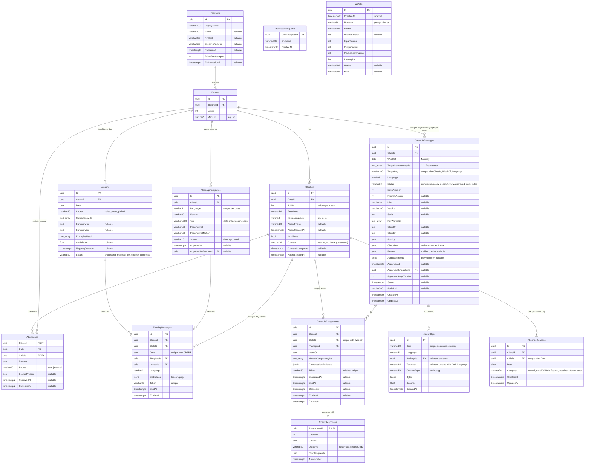

# Database design

PostgreSQL 16 (Azure PostgreSQL Flexible B1ms in staging/prod; Docker locally). Schema is owned by EF Core migrations in `src/api/SlateAi.Api/Data/Migrations/`; `AppDbContext` is the source of truth. **Update this document in the same PR as any migration.**

| | |
|---|---|
| Last migration | `20261023053444_AbsenceReasons` (T-45) |
| Data model in spec | `docs/spec.md` §4.3 (planned tables live there first) |
| Curriculum | Not in the database: loaded from `data/curriculum/*.json` at startup (T-05); rows reference competencies by string ID such as `M3.ADD.CARRY` |

## 1. Current schema (built)



### Tables

**`Teachers`** — one per teacher login (D-40, T-47). `Phone` is the 10-digit national number, unique. `PinHash` is a PBKDF2 hash (`PasswordHasher`) of the 4–6 digit PIN; the demo teacher's comes from `Demo:TeacherPin` via the seeder, never stored in clear. `FailedPinAttempts` / `PinLockedUntil`: 5 wrong PINs lock sign-in for 15 minutes. `ConsentAt` is the first-run gate: null → Welcome; for now the Welcome's Start sets it, and it moves to the voice-consent tick when T0 step 1 is built. `GreetingAudioUrl` is the teacher's own recorded greeting, played first in every parent message (FR-09).

**`Classes`** — `Grade` (3 for the demo) and `Medium` (language of instruction, `kn`). FK `TeacherId → Teachers` (cascade). Index on `TeacherId`.

**`Children`** — `RollNo` is unique within a class (`IX_Children_ClassId_RollNo`). `HomeLanguage` picks the catch-up audio language. `HasPhone = false` children still get the return-day buddy card (FR-12). FK `ClassId → Classes` (cascade). `Consent` is the family's paper form as the teacher recorded it (D-39): `yes`, `no` or `nophone`; a form not back is `no` (column default). Nothing is sent unless `yes`. In the MVP it comes from `data/seed/demo-class.json`; the seeder keeps it in step until `ConsentChangedAt` is set (the T8 editing screen is roadmap, D-70). `ParentStoppedAt` is the family's "Stop these messages" (D-19), separate from consent; every send path refuses a stopped child (migration `EveningMessages`).

**`Attendance`** — one row per child per school day. Composite PK `(ClassId, Date, ChildId)`, which also serves "register for a class on a date" lookups; extra index on `ChildId`. FKs to `Classes` and `Children` (cascade, so deleting a child removes their attendance: FR-15). Provenance (D-27, D-69): `Present` is the effective value everything reads (ledger, missed lessons). `Source` is `sats` when the row came from the SATS feed (simulated in the MVP) and `manual` when the teacher marked the day before SATS arrived (existing rows default to `manual`). `SourcePresent` is what SATS said (null until it arrives) and `ReceivedAt` when it arrived; both are kept even when her marking wins. `CorrectedAt` is set on a SATS row only while it differs from SATS (putting it back clears it), and on manual rows when she marked them. Rules live in `Features/Attendance/RegisterMerge.cs`; nothing is written back to SATS. Timestamps are stored in UTC.
- A `POST /api/classes/{id}/attendance` writes the **full register** for that date: every child in the class gets a row, absent ones with `Present = false`. A correction deletes and rewrites the date.
- **No rows for a date = not a school day** (holiday, Dasara break). Such days never count as absences.

**`Lessons`** — what was taught on a day: one row per class per day (D-55; "Change" overwrites it). Only rows with `Status = confirmed` reach the ledger and missed lessons (T2 §3); picking from the list (FR-04) writes `Source = picked`, `Status = confirmed` directly. T-07 PR B adds `Transcript`, `ExamplesUsed`, `Confidence` and the capture endpoint. `CompetencyIds` is a Postgres `text[]` of curriculum IDs (1–3, validated against the curriculum in code, never trusted from the LLM). FK `ClassId → Classes` (cascade). **Unique** index `(ClassId, Date)` (migration `LessonOnePerDay`). Writes are idempotent by `clientRequestId` (`ProcessedRequests`, endpoint `lesson`) under a per-class-and-date advisory lock. Voice notes (T-07 PR 2b, migration `LessonVoiceMapping`): the upload sets `Status = processing` and `MappingStartedAt`; the background worker stores A1's ranked `CompetencyIds`, `SummaryKn`/`SummaryEn` (D-56), `ExamplesUsed` and `Confidence`, and `Status` `mapped` / `low` (< 0.7) / `unclear`, but only if the lesson is still processing that note. A note still processing after 2 minutes reads as `unclear`. **Neither the transcript nor the audio is stored** (her recording stays on her phone until she confirms).

**`MessageTemplates`** — the evening message the teacher approves once (FR-20, D-21): one row per class and language (unique `(ClassId, Language)`), created as `draft` from `data/seed/evening-message.json` on first use. When that file's `version` changes, the rows take the new text and go back to `draft` (a change needs approval again, D-49). Approval sets every language to `approved` with `ApprovedAt` / `ApprovedByTeacherId` (FK → Teachers), idempotent by `clientRequestId` (`ProcessedRequests`, endpoint `message-template-approve`) under a per-class advisory lock; approving a stale version is refused (409). FK `ClassId → Classes` (cascade).

**`EveningMessages`** — one row per family message sent on a day of absence (FR-20), written by the 6 pm job or the send endpoint (`Features/EveningMessages/EveningSender.cs`). **Unique `(ChildId, Date)`**: the send is idempotent, so the job can run every minute after 6 pm and a lesson confirmed late still goes once. `SlotValues` holds the code-filled `lesson` and `page` (never the child's name); the parent view re-renders the text from the template. `Token` (128-bit random, base64url, unique) is the only key to `GET /api/p/{token}`, which answers 410 after `ExpiresAt` (14 days). Listens are not tracked (D-36). FKs: `ChildId → Children` (cascade, FR-15), `ClassId`, `TemplateId`, `LessonId`. Index `(ClassId, Date)` for Today's tonight card.

**`CatchUpPackages`** — one catch-up per (targets, home language) per school week (FR-07; migration `CatchUpPackages`, T-09). Unique `(ClassId, WeekOf, Language, TargetKey)`, so `POST catchups/generate` can be re-run safely (advisory lock `catchups:{classId}:{week}` around the write). `TargetCompetencyIds` comes from A2, most important first; the learning check tests the first. **Numbers are made by code** (`Features/CatchUps/Practice/`, seeded by class + week + targets + language so a regenerate keeps them): `Activity` holds the activity sum (kind, question, numbers, answer) plus A3's instruction and household-object option; `CheckItem` holds the check's question, three options, **`correctIndex`** and answer plus A3's prompt. `correctIndex` is shown to the teacher (T3) but never sent to a parent's browser (P3, T-15). A3's words: `Script` (spoken, family's language, no names, D-50), `KeyWordsKn` (3, from the lesson's textbook words), `GlossKn` / `GlossEn`. `Status`: `generating` → `ready` (passed the verifier), `needsReview` (the verifier failed twice; the words are kept and `Review` holds each check's result with numbers, e.g. "about 104 seconds, limit 90") or `failed` (nothing usable after two tries); then `approved` / `sent` (T-14). `Review` (migration `CatchUpVerifier`, T-10) is `{ passed, attempts, checks[{ name, passed, detail }] }`. A package still `generating` after 5 minutes reads as failed (restart mid-way). `ScriptVersion` goes up on every generation; approval is bound to it (T3). **Nothing reaches a parent unless `Status = approved`** (guardrail 3, T-14). Approval (migration `CatchUpApproval`, T-14) records `ApprovedAt`, `ApprovedByTeacherId` (FK → Teachers) and `ApprovedScriptVersion`; it is allowed only from `ready` at the current `ScriptVersion` (409 otherwise), so a regenerated version needs a new tick. Sending (`CatchUpSender`, the 6 pm job or `POST /api/packages/{id}/send`) requires `approved` **and** `ApprovedScriptVersion = ScriptVersion`, then sets `SentAt` and status `sent`. Approve, regenerate and send take a per-package advisory lock (`package:{id}`); view reads are untracked so a request waiting on the lock sees what the other one committed (found by the Db test). No buddy content: buddy sums come from code (T-16). FK `ClassId` (cascade).

**`AudioClips`** — every playable audio segment (migration `AudioClips`, T-11), kept in Postgres for the MVP behind `IAudioStore` (Azure Blob can replace it). Ogg Opus at 24 kbps, encoded from Sarvam's 16 kHz WAV (~3 KB a second). `Kind = script` rows belong to a package (`PackageId`, cascade, so deleting a package or its class removes the audio; a regenerate replaces the old clip). `Kind = disclosure` rows are shared and keyed by `(Kind, Language, TextHash)` (filtered unique index; SHA-256 of the wording in `data/seed/disclosure.json`), so each language's disclosure is synthesised once and a changed wording makes a new clip (D-18). `greeting` is reserved for T0's recorded greeting. Served by `GET /api/audio/{id}` with range support. `CatchUpPackages.AudioSegments` lists a package's segments in playing order (greeting when recorded → disclosure → script) with seconds and total size; `AudioUrl` points at the script clip.

**`CatchUpAssignments`** — one child's catch-up for a week (unique `(ChildId, WeekOf)`): the package, `MissedCompetencyIds` (curriculum IDs; the spec's `MissedLessonIds` became competency IDs because A2 works on them) and `CompressionRationale` (A2's targets and dropped lessons with reasons, `source` ai/rule and verdict: T3's "Why this"). Children without consent or a phone get one too (buddy-card path); the consent filter applies at send (T-14). The send step gives a `Token` (128-bit, unique), `ScheduledAt`, `SentAt` and `ExpiresAt` (+14 days) only to assignments whose child has consent `yes` and no `ParentStoppedAt`; the others stay on the buddy-card path. `OpenedAt` is not written: opens are never counted (D-20). The parent page (`/api/p/{token}`, T-15) shows the lesson only while the package is approved or sent at its approved version, the link hasn't expired and the child isn't stopped. FKs `ChildId` (cascade, FR-15), `PackageId` (cascade), `ClassId`.

**`CheckResponses`** — the family's picture tap on P3, scored by code (FR-11): `ChoiceId` is the position shown (0–2), `Correct` compares it with the package's stored correct index, `Outcome` is `caughtUp` or `needsBuddy`. Primary key `AssignmentId`, so one answer per assignment: the first counts (D-62), later taps and replays change nothing. The family never sees the outcome (D-20); the ledger does. FK `AssignmentId` (cascade, so a deleted child's answers go too).

**`AbsenceReasons`** — why a child was away, as the family tapped it from the evening message (FR-21, D-23, T-45): the category only, never symptoms, a transcript or audio. Unique `(ChildId, Date)`, where `Date` is the evening message's day; a later tap replaces the category (the family may correct it), and replays are caught by `ProcessedRequests` (endpoint `parent-reason`). Only the teacher sees it: T6 Week counts per category (T-46, index `(ClassId, Date)`). FKs `ChildId` (cascade, FR-15), `ClassId`.

**`ProcessedRequests`** — idempotency store shared by all write endpoints. A client-generated `ClientRequestId` (from the offline outbox) is inserted in the same transaction as the write it guards; a replay finds it and does nothing. `Endpoint` records which endpoint used it (`attendance` today). No FK; rows are small and can be pruned after the outbox retention period.

**`AiCalls`** — one row per Claude or Sarvam call, successful or not, written by `Ai/LoggedLlmClient` and `Speech/LoggedSpeechToText` (CLAUDE.md: every call is logged). `Purpose` is the prompt ID (e.g. `a1-lesson-mapping`) with its `PromptVersion`, or `stt`. The caller sets `Verdict` after validating the output (e.g. `valid`, `fallback:low-confidence`); `Error` holds the failure kind (`Refused`, `Truncated`, `Unavailable`, `NotConfigured`, `Rejected`). **Never stores prompt text, transcripts or names.** No FKs: it is an audit log that outlives the rows it describes. Index on `CreatedAt` for the "Under the hood" panel (T-18) and cost totals.

**`DataProtectionKeys`** — ASP.NET Core data-protection key ring (`PersistKeysToDbContext`), so teacher session cookies survive restarts and deploys (T-47). Managed by the framework; holds no personal data.

### Delete behaviour

Every FK is `ON DELETE CASCADE` except `MessageTemplates.ApprovedByTeacherId`: Teacher → Classes → Children / Attendance / Lessons / MessageTemplates / EveningMessages / CatchUpPackages / CatchUpAssignments → CheckResponses, and Child → Attendance / EveningMessages / AbsenceReasons / CatchUpAssignments → CheckResponses. Deleting a child (FR-15, T-13: `DELETE /api/classes/{id}/children/{childId}`, idempotent by `ProcessedRequests`, endpoint `child-delete`) removes every row about them through these cascades; children have no audio or transcripts of their own (lessons store none; catch-up audio is per package and has no names, D-50). Future child-linked tables must cascade too, and any per-child audio blob must be deleted in code. Covered by `ChildDeleteDbTests`.

## 2. Concurrency and idempotency

| Concern | Mechanism | Where |
|---|---|---|
| Offline replay of the same write | `ProcessedRequests` row checked inside the write transaction | `Features/Attendance/AttendanceStore.cs` |
| Replay racing its original, or two corrections for the same day | `pg_advisory_xact_lock(hashtextextended('attendance:{classId}:{date}', 0))` for the transaction | same |
| Two app instances migrating at once (slot swap) | session `pg_advisory_lock(0x5EED_0002)` around `MigrateAsync` | `Data/DatabaseStartup.cs` |
| Two instances seeding at once | `pg_advisory_xact_lock(0x5EED_0001)` around the seed | `Data/Seed/DemoSeeder.cs` |
| Two approvals / an approval racing a regenerate or send | `pg_advisory_xact_lock(hashtextextended('package:{id}', 0))`; status + version re-read inside the lock | `Features/CatchUps/CatchUpStore.cs` |
| Two catch-up generates for the same week | `pg_advisory_xact_lock(hashtextextended('catchups:{classId}:{week}', 0))` + unique `(ClassId, WeekOf, Language, TargetKey)` and `(ChildId, WeekOf)` | `Features/CatchUps/CatchUpStore.cs` |
| Two picture answers racing (a retry while the first is in flight) | `pg_advisory_xact_lock(hashtextextended('answer:{assignmentId}', 0))` + primary key `AssignmentId` | `Features/Parent/ParentStore.cs` |
| A reason tap racing its retry, or a late replay after a newer tap | `pg_advisory_xact_lock(hashtextextended('reason:{childId}:{date}', 0))` + `ProcessedRequests` + unique `(ChildId, Date)` | `Features/Parent/ParentStore.cs` |
| The 6 pm job and a manual send racing | `pg_advisory_xact_lock(hashtextextended('evening:{classId}:{date}', 0))` + unique `(ChildId, Date)` | `Features/EveningMessages/EveningStore.cs` |

All of these are covered by the `Category=Db` test suite (`tests/api/SlateAi.Api.Tests/Db/`), which runs in CI.

## 3. The ledger is a query, not a table

`GET /api/classes/{id}/ledger` (FR-05) reads `Children`, `Attendance` and `Lessons` for the class (`Features/Ledger/LedgerStore.cs`) and computes everything in code (`LedgerBuilder`, `AbsenceSpells`):

- **Missed lessons**: lessons whose `Date` is a day the child has `Present = false`.
- **Absence spells**: runs of consecutive absent *school days* (dates with a register), with the day the child came back.
- **Return speed** (mentor review, D-20/D-24 pending): spells that started in the 7 days up to the latest school day, bucketed 1 / 2 / 3 / 4+ days, and how many were back within 2 school days.

A missed lesson's `status` is **learning only** (B-08, T-13), from the child's catch-up for that week (the assignment whose `MissedCompetencyIds` include one of the lesson's competencies): `caughtUp` / `needsBuddy` from `CheckResponses` once answered (FR-11), else `sent` when the link went out, else `missed`. The family's **`channel`** is a separate per-child field: `stopped` (`Children.ParentStoppedAt`, FR-19), else `noPhone` / `noConsent` from `Consent`, else null. The ledger also returns this school week (`weekOf`, Monday to today IST): the week's confirmed lessons, `daysAwayThisWeek` and a per-child `history` (away with the lessons, reason from `AbsenceReasons`, catch-up sent with its language, picture answer, stop), all in `LedgerBuilder`. Nothing is stored for the ledger itself, so it can't drift from attendance.

## 4. Planned tables (not built yet)

From `docs/spec.md` §4.3. Types are indicative; the migration decides.

| Table / column | Task | Notes |
|---|---|---|
| `Lessons` + `Transcript`, `ExamplesUsed`, `Confidence` | T-07 | Confidence < 0.7 → teacher picks from the chapter list |
| `BuddyCards.HomeworkReturnedAt` | T-16 (D-22) | "Brought homework" tap |
| `textbookPage` on competencies | T-05 (D-22) | In `data/curriculum/*.json`, not a table |

## 5. Privacy

- Personal data is limited to `Teachers.DisplayName`, `Teachers.Phone`, `Children.FirstName` (first name only) and `Children.ParentPhone`. None of it is ever sent to Claude, Sarvam or WhatsApp templates (guardrail 1, NFR-05); AI inputs use IDs and `{child}` / `{teacher}` placeholders.
- The demo seed (`data/seed/demo-class.json`) is fictional, with placeholder phone numbers that must never be messaged.
- Logs record counts and IDs, never names.
- Deleting a child removes all their rows by cascade; audio in blob storage is deleted in code (T-19).
- Health data (D-23): store only the reason category (e.g. "unwell"), never symptoms.

## 6. Working with the schema

```bash
dotnet ef migrations add <Name> -p src/api/SlateAi.Api   # after changing an entity or AppDbContext
dotnet test --filter Category=Db                          # Postgres tests (Docker); CI runs them on every PR
```

Migrations run on startup (`Database:MigrateOnStartup`), under the advisory lock above. The demo seed runs after migrations when `Database:SeedOnStartup` is on, and only inserts missing rows; **children are inserted only with a new class**, so a child the teacher deleted (FR-15) doesn't come back on the next start or deploy (T-13). The demo Reset (T-18) re-seeds on purpose.
