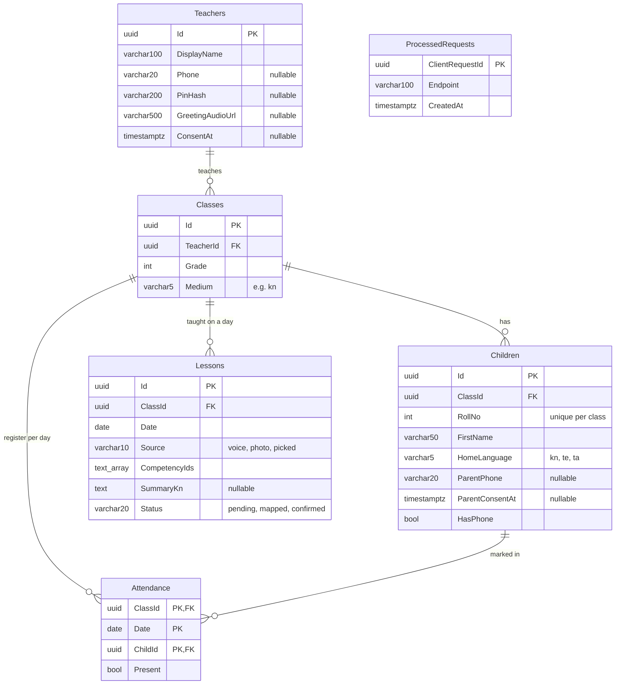
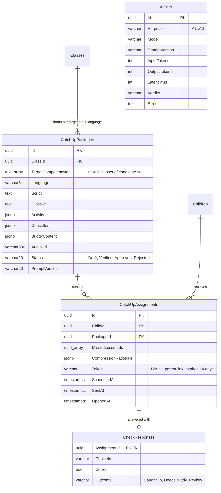

# Database design

PostgreSQL 16 (Azure PostgreSQL Flexible B1ms in staging/prod; Docker locally). Schema is owned by EF Core migrations in `src/api/SlateAi.Api/Data/Migrations/`; `AppDbContext` is the source of truth. **Update this document in the same PR as any migration.**

| | |
|---|---|
| Last migration | `20261019144249_AttendanceLessonsIdempotency` (T-06) |
| Data model in spec | `docs/spec.md` §4.3 (planned tables live there first) |
| Curriculum | Not in the database: loaded from `data/curriculum/*.json` at startup (T-05); rows reference competencies by string ID such as `M3.ADD.CARRY` |

## 1. Current schema (built)



### Tables

**`Teachers`** — one per teacher login. `PinHash` for the seeded PIN login (`POST /api/auth/pin`, not built yet). `GreetingAudioUrl` is the teacher's own recorded greeting, played first in every parent message (FR-09).

**`Classes`** — `Grade` (3 for the demo) and `Medium` (language of instruction, `kn`). FK `TeacherId → Teachers` (cascade). Index on `TeacherId`.

**`Children`** — `RollNo` is unique within a class (`IX_Children_ClassId_RollNo`). `HomeLanguage` picks the catch-up audio language. `HasPhone = false` children still get the return-day buddy card (FR-12). FK `ClassId → Classes` (cascade).

**`Attendance`** — one row per child per school day. Composite PK `(ClassId, Date, ChildId)`, which also serves "register for a class on a date" lookups; extra index on `ChildId`. FKs to `Classes` and `Children` (cascade, so deleting a child removes their attendance: FR-15).
- A `POST /api/classes/{id}/attendance` writes the **full register** for that date: every child in the class gets a row, absent ones with `Present = false`. A correction deletes and rewrites the date.
- **No rows for a date = not a school day** (holiday, Dasara break). Such days never count as absences.

**`Lessons`** — what was taught on a day. Minimal in T-06 so the ledger can join on it; T-07 adds `Transcript`, `ExamplesUsed`, `Confidence` and the capture endpoint. `CompetencyIds` is a Postgres `text[]` of curriculum IDs (1–3, validated against the curriculum in code, never trusted from the LLM). FK `ClassId → Classes` (cascade). Index `(ClassId, Date)`.

**`ProcessedRequests`** — idempotency store shared by all write endpoints. A client-generated `ClientRequestId` (from the offline outbox) is inserted in the same transaction as the write it guards; a replay finds it and does nothing. `Endpoint` records which endpoint used it (`attendance` today). No FK; rows are small and can be pruned after the outbox retention period.

### Delete behaviour

Every FK is `ON DELETE CASCADE`: Teacher → Classes → Children / Attendance / Lessons, and Child → Attendance. Deleting a child (FR-15, T-19) removes their attendance automatically; future child-linked tables must cascade too, and audio blobs must be deleted in code.

## 2. Concurrency and idempotency

| Concern | Mechanism | Where |
|---|---|---|
| Offline replay of the same write | `ProcessedRequests` row checked inside the write transaction | `Features/Attendance/AttendanceStore.cs` |
| Replay racing its original, or two corrections for the same day | `pg_advisory_xact_lock(hashtextextended('attendance:{classId}:{date}', 0))` for the transaction | same |
| Two app instances migrating at once (slot swap) | session `pg_advisory_lock(0x5EED_0002)` around `MigrateAsync` | `Data/DatabaseStartup.cs` |
| Two instances seeding at once | `pg_advisory_xact_lock(0x5EED_0001)` around the seed | `Data/Seed/DemoSeeder.cs` |

All four are covered by the `Category=Db` test suite (`tests/api/SlateAi.Api.Tests/Db/`), which runs in CI.

## 3. The ledger is a query, not a table

`GET /api/classes/{id}/ledger` (FR-05) reads `Children`, `Attendance` and `Lessons` for the class (`Features/Ledger/LedgerStore.cs`) and computes everything in code (`LedgerBuilder`, `AbsenceSpells`):

- **Missed lessons**: lessons whose `Date` is a day the child has `Present = false`.
- **Absence spells**: runs of consecutive absent *school days* (dates with a register), with the day the child came back.
- **Return speed** (mentor review, D-20/D-24 pending): spells that started in the 7 days up to the latest school day, bucketed 1 / 2 / 3 / 4+ days, and how many were back within 2 school days.

Statuses beyond `missed` (sent · caught up · needs buddy · stopped by family) will come from the planned `CatchUpAssignment`, `CheckResponse` and `Child.ParentStoppedAt` below. Nothing is stored for the ledger itself, so it can't drift from attendance.

## 4. Planned tables (not built yet)

From `docs/spec.md` §4.3. Types are indicative; the migration decides.



| Table / column | Task | Notes |
|---|---|---|
| `Lessons` + `Transcript`, `ExamplesUsed`, `Confidence` | T-07 | Confidence < 0.7 → teacher picks from the chapter list |
| `AiCalls` | T-07 | Every LLM call logged (NFR-06); IDs only, no names or prompts with personal data |
| `CatchUpPackages` | T-08–T-11 | **Nothing reaches a parent unless `Status = Approved`** (guardrail 3, enforced in the API, T-14) |
| `CatchUpAssignments` | T-14 | `Token` is the only key on the public parent page |
| `CheckResponses` | T-15 | Scored by code (FR-11); no spoken-answer fields (T-42 dropped, D-26) |
| `Children.ParentStoppedAt` | T-15 (D-19 proposed) | Send endpoint refuses stopped children |
| `MessageTemplates`, `EveningMessages` | T-44 (FR-20, D-21) | Template approved once; send refused unless Approved + lesson confirmed + consent (guardrail 3) |
| `AbsenceReasons` | T-45 (FR-21, D-23) | Category only; no transcript or audio kept |
| `BuddyCards.HomeworkReturnedAt` | T-16 (D-22) | "Brought homework" tap |
| `textbookPage` on competencies | T-05 (D-22) | In `data/curriculum/*.json`, not a table |

## 5. Privacy

- Personal data is limited to `Teachers.DisplayName`, `Teachers.Phone`, `Children.FirstName` (first name only) and `Children.ParentPhone`. None of it is ever sent to Claude, Sarvam or WhatsApp templates (guardrail 1, NFR-05); AI inputs use IDs and `{child}` / `{teacher}` placeholders.
- The demo seed (`data/seed/demo-class.json`) is fictional, with placeholder phone numbers that must never be messaged.
- Logs record counts and IDs, never names.
- Deleting a child removes all their rows by cascade; audio in blob storage is deleted in code (T-19).
- Health data (D-23): store only the reason category (e.g. "unwell"), never symptoms.

## 6. Working with the schema

```bash
dotnet ef migrations add <Name> -p src/api/SlateAi.Api   # after changing an entity or AppDbContext
dotnet test --filter Category=Db                          # Postgres tests (Docker); CI runs them on every PR
```

Migrations run on startup (`Database:MigrateOnStartup`), under the advisory lock above. The demo seed runs after migrations when `Database:SeedOnStartup` is on, and only inserts missing rows.
