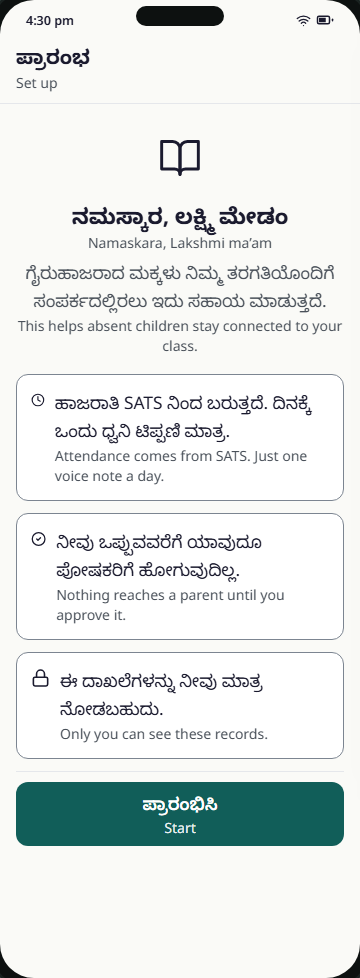
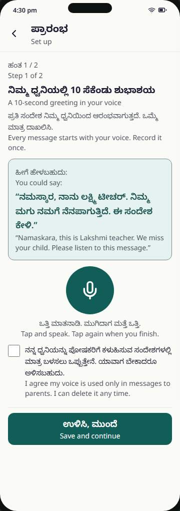
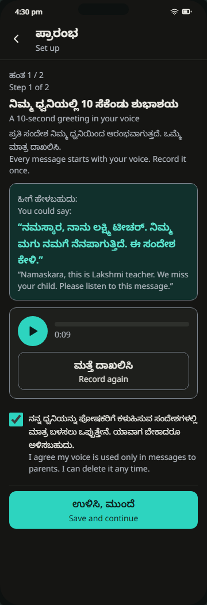
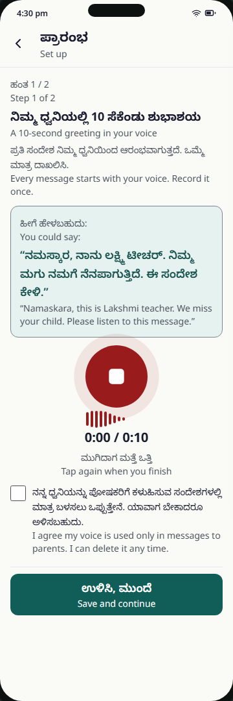
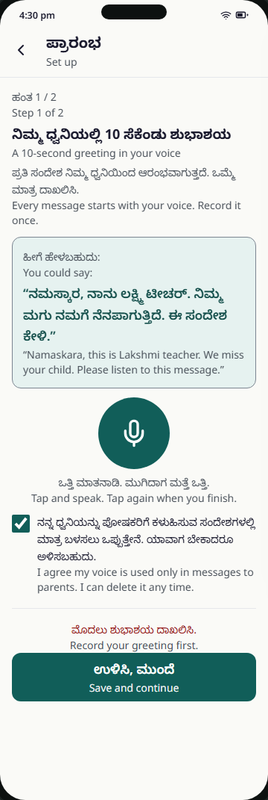
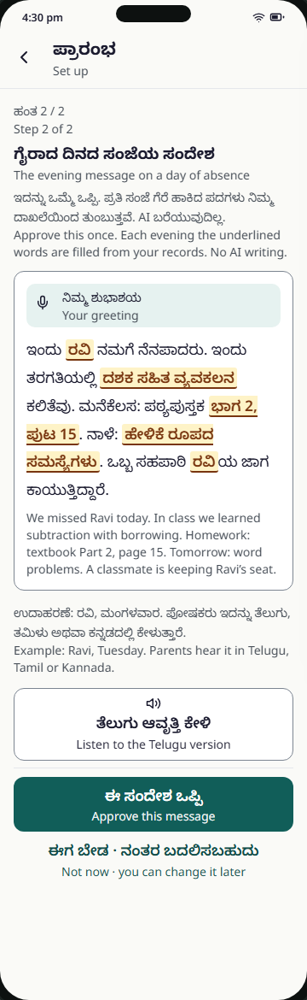
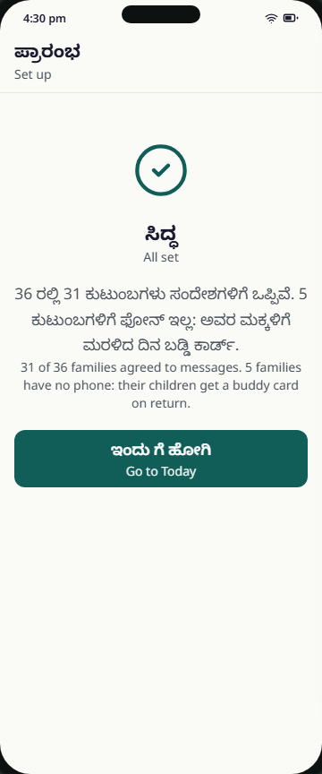

# T0 Set up

> **MVP scope (D-70):** Welcome is built. Build only: one Kannada greeting (record / play / record again) + consent tick, then approve the evening template. Per-language greetings, delete / withdraw, consent version and setup offline state are roadmap. See [mvp-build-flow.md](mvp-build-flow.md).

Spec: FR-09 (greeting), FR-15 (consent), FR-20 (evening template), FR-02 (mic gesture) · Tier: MVP · Task: T-44, T-19, T-11 · Prototype: prototype/index.html (step 1) · PNG: screenshots/T0-setup-greeting-360-light.png
Decisions: D-21, D-27, D-29, D-31, D-04, D-17, D-34 (mic permission denied), D-38 (offline, greeting deleted), D-39 (family consent on T8), D-40 (reached after T9 sign-in), D-44 (consent version), D-48 (no {tomorrow}), D-49 (template changed in Settings), D-50 (no names in the computer voice), D-52 (greeting per language)

Four steps, once, straight after the first [T9 Sign in](T9-sign-in.md) (D-40; Welcome shows until `ConsentAt` is set): Welcome → Step 1 of 2 greetings (Kannada, then one card per other home language in her class) + voice consent → Step 2 of 2 evening-message template → All set. No bottom nav until set-up is done. Everything here can be changed later in [T10 Settings](T10-settings.md) (D-49, D-51). "All set" links to [T8 Families and consent](T8-families.md) ("Review families"), where she records each family's paper consent form (D-39).

## 1. User voice

- Says: "I'll record it once if it means parents hear me, not a machine. But I won't type messages every evening."
- Unsaid: Is my voice going to be used for something else? Will an officer see these records? Will the app say things to parents in my name that I never checked?

## 2. Who does what

- Human: Lakshmi records a ≤ 10 s Kannada greeting, plays it back, re-records or deletes it if needed; for each other home language in her class (Telugu, Tamil in the seed) she listens to a native speaker, reads a short line written in Kannada letters and records it, or skips it for now (D-52); ticks voice consent (Consent version 1, D-44); listens to the Telugu sample and approves the evening template (or "Not now"). If the microphone is blocked she can continue without a greeting and record it later (D-34). On "All set" she can open T8 to review the families' consent (D-39).
- AI: none. The template is fixed text with slots filled by code (D-21, FR-20: "No AI writing"). Mode: none.
- Code (no AI): mic state machine and 10 s auto-stop; stores one greeting per language (`kn`, `te`, `ta`) with its status (recorded / skipped / none), `Teacher.ConsentAt` and the consent version (D-44, D-52); lists only the home languages present in her class roster (D-47); stores `MessageTemplate.Status = Approved`, `ApprovedAt`, `ApprovedByTeacherId`; renders the filled example from the seed (Ravi, Tuesday) and the Telugu sample from pre-synthesised segments; counts families marked Yes and families marked No phone from the consent recorded on T8 (D-39); keeps the greeting on the phone and uploads it later when offline (D-38).

## 3. Always / never

- Always: show the template as a filled example with marked slots, not `{child}` syntax (A-20). Let her hear the parent-language version before approving (A-21). Say plainly that nothing reaches a parent until she approves.
- Always: allow "Not now". With no approved template, no evening message is sent (FR-20: send endpoint 409).
- Always: if she skips a language, her Kannada greeting plays, then a computer voice introduces her in that language. Never voice cloning (D-52).
- Never: send the greeting audio or the teacher's name to Claude or Sarvam (guardrail 1). Never say a name in the computer voice: the audio says “your child”; names appear only in written text and in her own greeting (D-50). Name the buddy in the template (D-29: "a classmate is keeping Ravi’s seat"). Promise anything about officers (A-29).
- Never: let "Save and continue" pass without a recorded greeting and the consent tick, except when the mic is blocked or she deleted the greeting (then she continues without a greeting and no tick is needed, D-34); say what is missing instead of disabling silently (A-19).
- Uncertainty: none (no AI on this screen). A recording under 1 s is not saved (same rule as T1).
- If it goes wrong: a bad greeting reaches every family → she can play it back, "Record again" or "Delete" before saving (consent text: withdrawing deletes the recordings, D-44). After a delete, messages go without her voice until she records a new one, and the banner says so (D-38). An unapproved template → no evening messages, never a silent default.

## 4. States

| State | What the user sees | Copy (en) |
|---|---|---|
| Welcome (`0`) | Book icon, greeting, 3 promise cards (SATS, approval, privacy), sticky Start. No Back.  | "Namaskara, Lakshmi ma’am" · "Start" |
| Greeting (`1`) | "Step 1 of 2", Kannada suggested words in a panel, 96 px mic; section "For families who speak other languages (in your class)" with one card each for Telugu and Tamil (line in Kannada letters, transliteration · meaning, "Listen first", "Record" / "Record again", "Skip for now"; Delete once recorded); consent tick in the sticky footer above "Save and continue" (D-52). Back visible.  Dark:  | "A 10-second greeting in your voice" |
| Recording (`1rec`) | Mic turns error-red with pulse and a stop square; waveform; timer "0:04 / 0:10"; hint.  | "Tap again when you finish" |
| Recorded (`1done`) | Player card (play, progress bar, 0:09) with two ghost buttons, "Record again" and "Delete" (trash icon); consent ticked. No PNG | "Record again" · "Delete" |
| Offline (`1off`) | Warning banner (cloud-off icon) above "Step 1 of 2"; the recorded greeting card stays usable; "Save and continue" still works (D-38). No PNG | "No network. Your greeting is saved on the phone and will upload later." |
| Greeting deleted (`1del`) | After "Delete" on the recorded greeting: banner (trash icon, `role="status"`) above the mic; mic and idle hint return; polite announcement (D-38). No PNG | "Greeting deleted. Messages go without your voice until you record a new one." |
| Mic permission denied (`1deny`) | No mic button. Card with a warning-coloured alert icon, the text and a text button "Open settings". Consent row and "Save and continue" stay; she can continue without a greeting (D-34). No PNG | "The microphone is off for this app. Turn it on in Settings. You can continue without a greeting and record it later." · "Open settings" |
| Language card skipped | Card stays, with the note "Skipped: your Kannada greeting plays, then a computer voice introduces you in that language." (D-52). No PNG | "Skip for now" |
| Language card recorded | "Recorded" tag (check icon) on the card; buttons "Listen first", "Record again", Delete (trash icon, aria-label "Delete") (D-52). No PNG | "Record again" |
| Missing step (`1err`) | Error hint above the sticky button, `role="alert"`.  | "Record your greeting first." / "Tick the box to agree." |
| Evening message (`2`) | "Step 2 of 2", filled example with underlined slots, "Your greeting" chip, "Listen to the Telugu version", sticky "Approve this message" + "Not now · you can change it in Settings" (D-49). No "Tomorrow" slot (D-48).  | "Approve this message" |
| All set (`3`) | Large check, family counts from the T8 consent data, text button "Review families" (opens T8), primary "Go to Today". No Back (A-30, D-39).  | "All set" |
| Recording cancelled | Call, gesture cancel (`pointercancel`) or app switch stops recording; nothing saved; polite announcement | "Recording stopped. Nothing was sent." |
| Loading / Empty | none: content is static; counts come with the seed | — |

## 5. Copy

kn and en from the prototype. te "—" for teacher-only strings. Reviewed by: needs review (all rows).

| Key | kn | te | ta | en | Reviewed by |
|---|---|---|---|---|---|
| `setup.title` (app bar, region label) | ಪ್ರಾರಂಭ | — | needs translation | Set up | needs review |
| `common.back` (aria-label) | ಹಿಂದೆ | — | needs translation | Back | needs review |
| `setup.welcome.heading` | ನಮಸ್ಕಾರ, {teacher} ಮೇಡಂ | — | needs translation | Namaskara, {teacher} ma’am | needs review |
| `setup.welcome.lead` | ಗೈರುಹಾಜರಾದ ಮಕ್ಕಳು ನಿಮ್ಮ ತರಗತಿಯೊಂದಿಗೆ ಸಂಪರ್ಕದಲ್ಲಿರಲು ಇದು ಸಹಾಯ ಮಾಡುತ್ತದೆ. | — | needs translation | This helps absent children stay connected to your class. | needs review |
| `setup.welcome.sats` | ಹಾಜರಾತಿ SATS ನಿಂದ ಬರುತ್ತದೆ. ದಿನಕ್ಕೆ ಒಂದು ಧ್ವನಿ ಟಿಪ್ಪಣಿ ಮಾತ್ರ. | — | needs translation | Attendance comes from SATS. Just one voice note a day. | needs review |
| `setup.welcome.approval` | ನೀವು ಒಪ್ಪುವವರೆಗೆ ಯಾವುದೂ ಪೋಷಕರಿಗೆ ಹೋಗುವುದಿಲ್ಲ. | — | needs translation | Nothing reaches a parent until you approve it. | needs review |
| `setup.welcome.privacy` | ಈ ದಾಖಲೆಗಳನ್ನು ನೀವು ಮಾತ್ರ ನೋಡಬಹುದು. | — | needs translation | Only you can see these records. | needs review |
| `setup.welcome.start` | ಪ್ರಾರಂಭಿಸಿ | — | needs translation | Start | needs review |
| `setup.step1.progress` | ಹಂತ 1 / 2 | — | needs translation | Step 1 of 2 | needs review |
| `setup.greeting.heading` | ನಿಮ್ಮ ಧ್ವನಿಯಲ್ಲಿ 10 ಸೆಕೆಂಡು ಶುಭಾಶಯ (ಕನ್ನಡ) | — | needs translation | A 10-second greeting in your voice (Kannada) | needs review |
| `setup.greeting.lead` | ಪ್ರತಿ ಸಂದೇಶ ನಿಮ್ಮ ಧ್ವನಿಯಿಂದ ಆರಂಭವಾಗುತ್ತದೆ. ಒಮ್ಮೆ ಮಾತ್ರ ದಾಖಲಿಸಿ. | — | needs translation | Every message starts with your voice. Record it once. | needs review |
| `setup.greeting.suggestLabel` | ಹೀಗೆ ಹೇಳಬಹುದು: | — | needs translation | You could say: | needs review |
| `setup.greeting.suggestion` | “ನಮಸ್ಕಾರ, ನಾನು {teacher} ಟೀಚರ್. ನಿಮ್ಮ ಮಗು ನಮಗೆ ನೆನಪಾಗುತ್ತಿದೆ. ಈ ಸಂದೇಶ ಕೇಳಿ.” | — | needs translation | “Namaskara, this is {teacher} teacher. We miss your child. Please listen to this message.” | needs review |
| `setup.greeting.idleHint` | ಒತ್ತಿ ಮಾತನಾಡಿ. ಮುಗಿದಾಗ ಮತ್ತೆ ಒತ್ತಿ. | — | needs translation | Tap and speak. Tap again when you finish. | needs review |
| `mic.record` (aria-label) | ದಾಖಲಿಸಿ | — | needs translation | Record | needs review |
| `mic.stop` (aria-label) | ದಾಖಲಿಸುವುದನ್ನು ನಿಲ್ಲಿಸಿ | — | needs translation | Stop recording | needs review |
| `mic.recHint` | ಮುಗಿದಾಗ ಮತ್ತೆ ಒತ್ತಿ | — | needs translation | Tap again when you finish | needs review |
| `mic.timer` | 0:{ss} / 0:{limit} | — | 0:{ss} / 0:{limit} | 0:{ss} / 0:{limit} | needs review |
| `setup.greeting.play` (aria-label) | ನಿಮ್ಮ ಶುಭಾಶಯ ಕೇಳಿ | — | needs translation | Play your greeting | needs review |
| `setup.greeting.again` | ಮತ್ತೆ ದಾಖಲಿಸಿ | — | needs translation | Record again | needs review |
| `setup.greeting.delete` | ಅಳಿಸಿ | — | needs translation | Delete | needs review |
| `setup.greeting.deleted` | ಶುಭಾಶಯ ಅಳಿಸಲಾಗಿದೆ. ಹೊಸದನ್ನು ದಾಖಲಿಸುವವರೆಗೆ ಸಂದೇಶಗಳು ನಿಮ್ಮ ಧ್ವನಿ ಇಲ್ಲದೆ ಹೋಗುತ್ತವೆ. | — | needs translation | Greeting deleted. Messages go without your voice until you record a new one. | needs review |
| `setup.greeting.offline` | ನೆಟ್‌ವರ್ಕ್ ಇಲ್ಲ. ನಿಮ್ಮ ಶುಭಾಶಯ ಫೋನಿನಲ್ಲಿ ಉಳಿದಿದೆ, ನಂತರ ಅಪ್‌ಲೋಡ್ ಆಗುತ್ತದೆ. | — | needs translation | No network. Your greeting is saved on the phone and will upload later. | needs review |
| `setup.greeting.micDenied` | ಈ ಆಪ್‌ಗೆ ಮೈಕ್ರೊಫೋನ್ ಆಫ್ ಆಗಿದೆ. ಸೆಟ್ಟಿಂಗ್ಸ್‌ನಲ್ಲಿ ಆನ್ ಮಾಡಿ. ಶುಭಾಶಯ ಇಲ್ಲದೆಯೂ ಮುಂದುವರಿಯಬಹುದು; ನಂತರ ದಾಖಲಿಸಿ. | — | needs translation | The microphone is off for this app. Turn it on in Settings. You can continue without a greeting and record it later. | needs review |
| `mic.openSettings` | ಸೆಟ್ಟಿಂಗ್ಸ್ ತೆರೆಯಿರಿ | — | needs translation | Open settings | needs review |
| `setup.otherLangs.heading` | ಬೇರೆ ಭಾಷೆಯ ಕುಟುಂಬಗಳಿಗೆ (ನಿಮ್ಮ ತರಗತಿಯಲ್ಲಿ) | — | needs translation | For families who speak other languages (in your class) | needs review |
| `setup.otherLangs.lead` | ನಿಮಗೆ ಆ ಭಾಷೆ ಬರಬೇಕಿಲ್ಲ: ಕನ್ನಡ ಅಕ್ಷರದಲ್ಲಿ ಬರೆದ ಸಾಲನ್ನು ಓದಿ. ಬಿಟ್ಟರೆ, ಕಂಪ್ಯೂಟರ್ ಧ್ವನಿ ನಿಮ್ಮನ್ನು ಪರಿಚಯಿಸುತ್ತದೆ. | — | needs translation | You don’t need to know the language: read the line written in Kannada letters. If you skip, a computer voice introduces you. | needs review |
| `greet.lang.title` | {language} ಕುಟುಂಬಗಳಿಗೆ | — | needs translation | For {language} families | needs review |
| `greet.line.te` (read aloud by the teacher; not translated) | ನಮಸ್ಕಾರಂ, ನೇನು {teacher} ಟೀಚರ್ · Namaskaram, nenu {teacher} teacher | — | — | Hello, I am {teacher} teacher (meaning) | needs review |
| `greet.line.ta` (read aloud by the teacher; not translated) | ವಣಕ್ಕಂ, ನಾನ್ {teacher} ಟೀಚರ್ · Vanakkam, naan {teacher} teacher | — | — | Hello, I am {teacher} teacher (meaning) | needs review |
| `greet.listenFirst` | ಮೊದಲು ಕೇಳಿ | — | needs translation | Listen first | needs review |
| `greet.record` | ದಾಖಲಿಸಿ | — | needs translation | Record | needs review |
| `greet.recordAgain` | ಮತ್ತೆ ದಾಖಲಿಸಿ | — | needs translation | Record again | needs review |
| `greet.skip` | ಈಗ ಬೇಡ | — | needs translation | Skip for now | needs review |
| `greet.delete` (aria-label) | ಅಳಿಸಿ | — | needs translation | Delete | needs review |
| `greet.recorded` (tag) | ದಾಖಲಾಗಿದೆ | — | needs translation | Recorded | needs review |
| `greet.skipped` | ಬಿಟ್ಟಿದ್ದೀರಿ: ನಿಮ್ಮ ಕನ್ನಡ ಶುಭಾಶಯದ ನಂತರ ಕಂಪ್ಯೂಟರ್ ಧ್ವನಿ ನಿಮ್ಮನ್ನು ಆ ಭಾಷೆಯಲ್ಲಿ ಪರಿಚಯಿಸುತ್ತದೆ. | — | needs translation | Skipped: your Kannada greeting plays, then a computer voice introduces you in that language. | needs review |
| `announce.deleted` | ಅಳಿಸಲಾಗಿದೆ | — | needs translation | Deleted | needs review |
| `setup.consent.voice` | ನನ್ನ ಧ್ವನಿಯನ್ನು ಪೋಷಕರಿಗೆ ಕಳುಹಿಸುವ ಸಂದೇಶಗಳಲ್ಲಿ ಮಾತ್ರ ಬಳಸಲು ಒಪ್ಪುತ್ತೇನೆ. ಯಾವಾಗ ಬೇಕಾದರೂ ಒಪ್ಪಿಗೆ ಹಿಂಪಡೆಯಬಹುದು; ಆಗ ನನ್ನ ಧ್ವನಿಮುದ್ರಣಗಳು ಅಳಿಯುತ್ತವೆ. (ಒಪ್ಪಿಗೆ ಆವೃತ್ತಿ 1) | — | needs translation | I agree my voice is used only in messages to parents. I can withdraw this any time, and my recordings are then deleted. (Consent version 1) | needs review |
| `setup.error.noGreeting` | ಮೊದಲು ಶುಭಾಶಯ ದಾಖಲಿಸಿ. | — | needs translation | Record your greeting first. | needs review |
| `setup.error.noConsent` | ಒಪ್ಪಿಗೆಗೆ ಗುರುತು ಹಾಕಿ. | — | needs translation | Tick the box to agree. | needs review |
| `setup.greeting.save` | ಉಳಿಸಿ, ಮುಂದೆ | — | needs translation | Save and continue | needs review |
| `announce.recording` | ದಾಖಲಿಸುತ್ತಿದೆ | — | needs translation | Recording | needs review |
| `announce.greetingSaved` | ಶುಭಾಶಯ ಉಳಿಸಲಾಗಿದೆ | — | needs translation | Greeting saved | needs review |
| `announce.greetingDeleted` | ಶುಭಾಶಯ ಅಳಿಸಲಾಗಿದೆ | — | needs translation | Greeting deleted | needs review |
| `announce.recCancelled` | ದಾಖಲಿಸುವುದು ನಿಂತಿತು. ಏನೂ ಕಳುಹಿಸಿಲ್ಲ. | — | needs translation | Recording stopped. Nothing was sent. | needs review |
| `setup.step2.progress` | ಹಂತ 2 / 2 | — | needs translation | Step 2 of 2 | needs review |
| `setup.template.heading` | ಗೈರಾದ ದಿನದ ಸಂಜೆಯ ಸಂದೇಶ | — | needs translation | The evening message on a day of absence | needs review |
| `setup.template.lead` | ಇದನ್ನು ಒಮ್ಮೆ ಒಪ್ಪಿ. ಪ್ರತಿ ಸಂಜೆ ಬಣ್ಣ ಹಚ್ಚಿದ ಪದಗಳು ಮಾತ್ರ ನಿಮ್ಮ ದಾಖಲೆಯಿಂದ ಬದಲಾಗುತ್ತವೆ. ಈ ಸಂದೇಶವನ್ನು AI ಬರೆಯುವುದಿಲ್ಲ. | — | needs translation | Approve this once. Only the highlighted words change each evening, filled from your records. No AI writes this message. | needs review |
| `setup.template.greetingChip` | ನಿಮ್ಮ ಶುಭಾಶಯ (ಕುಟುಂಬದ ಭಾಷೆಯಲ್ಲಿ) | — | needs translation | Your greeting (in the family’s language) | needs review |
| `template.evening.body` (shown to parents; slots underlined) | ಇಂದು {child} ನಮಗೆ ನೆನಪಾದರು. ಇಂದು ತರಗತಿಯಲ್ಲಿ {lesson} ಕಲಿತೆವು. ಮನೆಕೆಲಸ: ಪಠ್ಯಪುಸ್ತಕ {page}. ಒಬ್ಬ ಸಹಪಾಠಿ {child}ಯ ಜಾಗ ಕಾಯುತ್ತಿದ್ದಾರೆ. | ఈ రోజు {child} మాకు గుర్తొచ్చాడు. ఈ రోజు తరగతిలో {lesson} నేర్చుకున్నాం. ఇంటి పని: పాఠ్యపుస్తకం {page}. ఒక సహవిద్యార్థి {child} సీటు కాపాడుతోంది. (from the P0 bubble) | needs translation | We missed {child} today. In class we learned {lesson}. Homework: textbook {page}. A classmate is keeping {child}’s seat. (no `{tomorrow}`, D-48) | needs review |
| `template.audioNote` | ಧ್ವನಿಯಲ್ಲಿ ಮಗುವಿನ ಹೆಸರು ಹೇಳುವುದಿಲ್ಲ (“ನಿಮ್ಮ ಮಗು”); ಹೆಸರು ಬರಹದಲ್ಲಿ ಮಾತ್ರ. ಪೋಷಕರು ಇದನ್ನು ತೆಲುಗು, ತಮಿಳು ಅಥವಾ ಕನ್ನಡದಲ್ಲಿ ಕೇಳುತ್ತಾರೆ. | — | needs translation | The audio says “your child”, not the name; the name is only in the written text. Parents hear it in Telugu, Tamil or Kannada. (D-50) | needs review |
| `setup.template.listenTe` | ತೆಲುಗು ಆವೃತ್ತಿ ಕೇಳಿ | — | needs translation | Listen to the Telugu version | needs review |
| `setup.template.approve` | ಈ ಸಂದೇಶ ಒಪ್ಪಿ | — | needs translation | Approve this message | needs review |
| `setup.template.notNow` | ಈಗ ಬೇಡ · ನಂತರ ಸೆಟ್ಟಿಂಗ್ಸ್‌ನಲ್ಲಿ ಬದಲಿಸಬಹುದು | — | needs translation | Not now · you can change it in Settings (D-49) | needs review |
| `setup.done.heading` | ಸಿದ್ಧ | — | needs translation | All set | needs review |
| `setup.done.summary` | {total} ರಲ್ಲಿ {agreed} ಕುಟುಂಬಗಳು ಸಂದೇಶಗಳಿಗೆ ಒಪ್ಪಿವೆ (ಕಾಗದದ ಒಪ್ಪಿಗೆ ಪತ್ರ). {noPhone} ಕುಟುಂಬಗಳಿಗೆ ಫೋನ್ ಇಲ್ಲ: ಅವರ ಮಕ್ಕಳಿಗೆ ಮರಳಿದ ದಿನ ಬಡ್ಡಿ ಕಾರ್ಡ್. | — | needs translation | {agreed} of {total} families agreed to messages (paper consent form). {noPhone} families have no phone: their children get a buddy card on return. | needs review |
| `setup.done.reviewFamilies` | ಕುಟುಂಬಗಳನ್ನು ನೋಡಿ | — | needs translation | Review families | needs review |
| `setup.done.goToday` | ಇಂದು ಗೆ ಹೋಗಿ | — | needs translation | Go to Today | needs review |

Slot values (lesson names, pages) come from `data/curriculum/*.json` (`NameKn`, `NameEn`, `TextbookPage`), not from locale files.

## 6. Tokens and sizes

- Page `bg-canvas`; cards `bg-surface border border-border rounded-md`; suggestion card `bg-panel border border-border` with `text-primary-strong` (rule 1: no `primary` text on `panel`).
- Screen title `text-title`; headings `text-title`; body `text-body`; hints and English captions `text-caption text-ink-muted` (never below 14 px Latin / 16 px Indic).
- Mic `size-target-mic rounded-full bg-primary text-on-primary`; recording `bg-error text-on-error` with pulse, off under `prefers-reduced-motion`.
- Primary button `min-h-target-primary w-full bg-primary text-on-primary rounded-md` in a sticky footer; "Record again", "Delete" (trash icon) and "Listen to the Telugu version" `min-h-target` ghost (`border-border bg-surface`), 8 px apart; "Not now", "Open settings" and "Review families" text buttons `text-primary-strong min-h-target`.
- Offline and greeting-deleted banners `bg-surface border border-border border-l-4 border-l-warning`, icon (cloud-off / trash) 18 px, text `text-ink`, `role="status"`. Mic-denied card: alert icon `text-warning`, text `text-ink` (rule 2).
- Error hint `text-error text-caption`, `role="alert"`. Consent row ≥ 48 px, checkbox 24 px with `accent-color: primary`.
- Slots in the example: underline + `bg-status-needs-buddy-bg text-status-needs-buddy` (prototype `.slot`); meaning is also carried by the underline, not colour alone.
- Focus ring: global 3 px `focus` with 2 px offset.

## 7. Acceptance checklist

- [ ] Every state above is built and reachable (10 prototype states + language card skipped / recorded + recording cancelled)
- [ ] One primary action per step; works with one thumb at 360 px; primary button sticky and never hidden by the keyboard (A-19, A-29)
- [ ] Status shown as icon + word, never colour alone
- [ ] Targets ≥ 48 px; 8 px apart; mic 96 px
- [ ] AI label: none needed; the template step says "No AI writing" (FR-20)
- [ ] Every Indic text has a `lang` attribute; strings exist in kn, en, te, ta; English captions carry `lang="en"` (A-24)
- [ ] axe: 0 serious/critical, in light and dark
- [ ] Mic: tap to start, tap to stop; press-and-hold also works; Enter/Space toggles; `aria-pressed` reflects recording; label switches Record / Stop recording (A-01, A-06, D-31)
- [ ] Timer shows elapsed vs 0:10; auto-stops at 10 s; `pointercancel` and `visibilitychange` (app switch) cancel and announce "Recording stopped. Nothing was sent." (A-05)
- [ ] Polite live region announces Recording, Greeting saved, Recording stopped (A-02)
- [ ] "Save and continue" with no greeting shows "Record your greeting first."; with no tick shows "Tick the box to agree."; both `role="alert"` (A-19)
- [ ] Template shows a filled example with underlined slots, no `{child}` syntax (A-20); the buddy is not named (D-29)
- [ ] "Listen to the Telugu version" plays code-filled, pre-synthesised audio; "Not now" saves nothing and no evening message is sent until approved (A-21, FR-20)
- [ ] `POST …/message-template/approve` records `ApprovedAt` and `ApprovedByTeacherId`, accepts `clientRequestId` and is idempotent
- [ ] Greeting upload and consent write accept `clientRequestId`; replays create one greeting
- [ ] Greeting audio and the teacher's name are never sent to Claude; `{teacher}` placeholder only (guardrail 1, NFR-05)
- [ ] Family counts on "All set" are computed in code from the consent recorded on T8 (Yes count, No phone count) (guardrail 4, D-39)
- [ ] "Review families" opens T8 Families and consent (D-39)
- [ ] "Delete" on the recorded greeting removes it on the phone and the server, shows the greeting-deleted banner, brings back the mic and announces "Greeting deleted" (D-38)
- [ ] Offline: a recorded greeting stays in the Dexie outbox with `clientRequestId`; the banner says it will upload later; "Save and continue" still moves on; replay creates one greeting (D-38, NFR-02)
- [ ] Mic permission denied (`NotAllowedError`): no mic button; the warning text and "Open settings" show; "Save and continue" passes without a greeting (D-34)
- [ ] Step 1 shows one language card per home language present in the class roster other than Kannada (Telugu and Tamil in the seed); none when all families speak Kannada (D-52, D-47)
- [ ] Each language card: "Listen first" plays a native speaker; "Record" uses the same 10 s recorder; after recording, "Record again" and Delete (aria-label "Delete") replace "Skip for now"; the "Recorded" tag shows icon + word (D-52)
- [ ] "Skip for now" stores the language as skipped; at send time her Kannada greeting plays, then a pre-made computer-voice introduction in that language; no voice cloning anywhere (D-52)
- [ ] The consent tick sits in the sticky footer directly above "Save and continue" and is visible without scrolling at 360 px (D-52)
- [ ] Consent write stores `ConsentAt` and consent version 1 (D-44)
- [ ] Template has no `{tomorrow}` slot (D-48); the note under it says the audio says “your child”, never the name (D-50)
- [ ] "Not now" reads "Not now · you can change it in Settings"; the template is reachable later at T10 Settings → Evening message (D-49)
- [ ] Back hidden on Welcome and on All set; focus moves to the step heading on each step change (A-30, A-04)

Open items:
- Mic permission denied: no greeting, so no voice-consent tick is needed; "Save and continue" passes (resolved 21 Oct in the prototype).
- Greeting deleted during setup: setup can finish without a greeting; messages go without her voice until she records one (resolved 21 Oct in the prototype).
- `{tomorrow}` removed (D-48). Still open: does `{lesson}` use the curriculum name or a parent-friendly name field, and where do home-language (te, ta) lesson names come from?
- te template is gendered (గుర్తొచ్చాడు, masculine; కాపాడుతోంది, feminine classmate). Fixed text with a `{child}` slot needs a gender-neutral form or a per-child variant.
- `MessageTemplate` in spec §4.3 still lists a `{buddy}` slot; D-29 removed the buddy's name. Update the data model.
- Resolved (D-39): per-family opt-in is recorded on [T8 Families and consent](T8-families.md); the "All set" counts come from it.
- Resolved (D-49, D-51): the template and greetings are re-opened in [T10 Settings](T10-settings.md); "Not now" points there.
- The meaning line under each language card is hard-coded Kannada in the prototype (not a K() call); needs a `greet.line.*.meaning` key.
