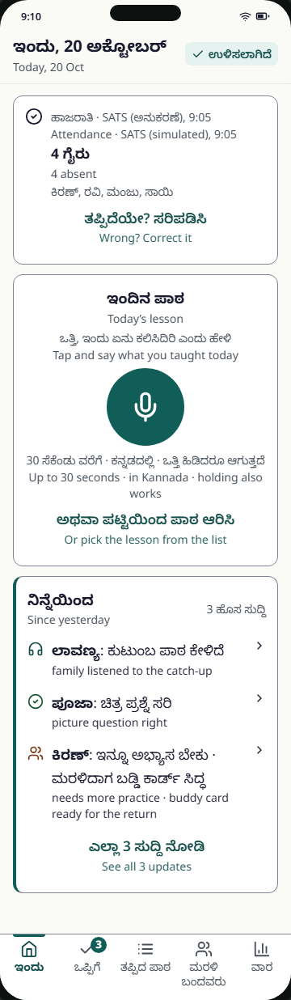
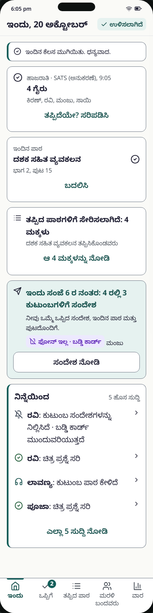
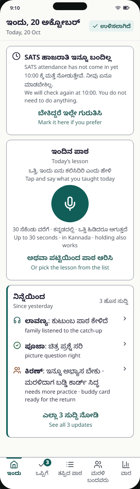
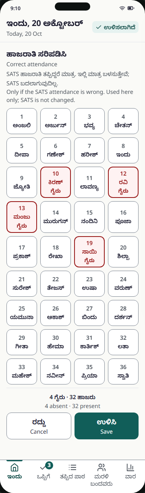
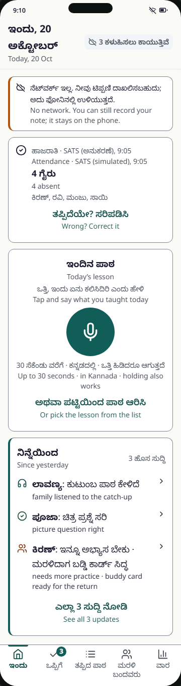
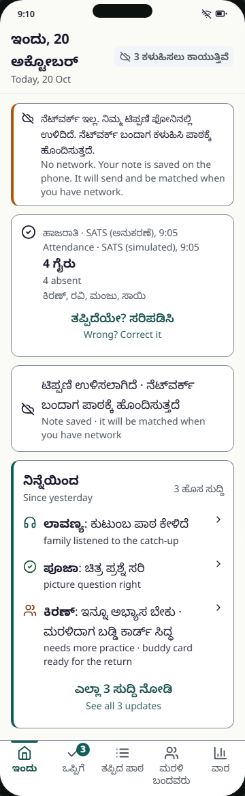
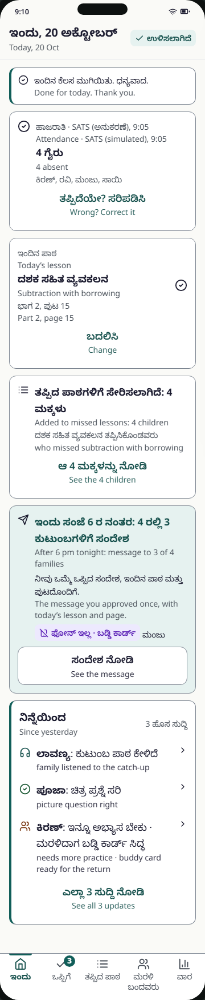
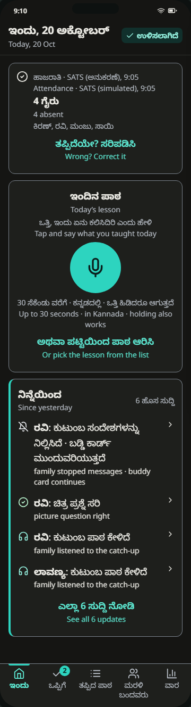
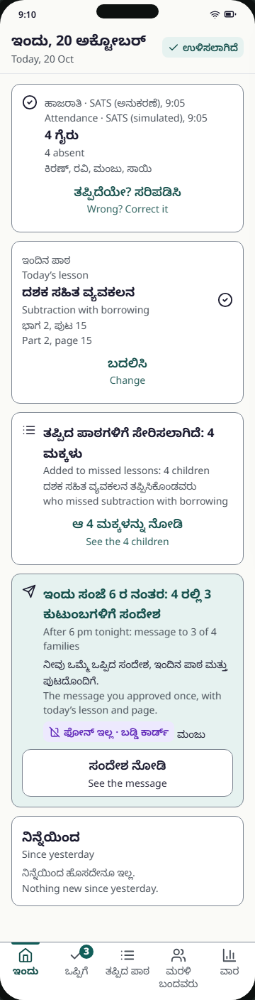

# T1 Today

Spec: FR-01, FR-02, FR-05, FR-20 (tonight card), NFR-01, NFR-02 · Tier: MVP · Task: T-12 (screen), T-06 (attendance API), T-07 (lesson upload), T-44 (tonight count) · Prototype: prototype/index.html (steps 2, 3; step 5 for "done") · PNG: screenshots/T1-today-from-sats-360-light.png
Decisions: D-03, D-21, D-27, D-31, D-17, D-33 (lesson card lists every confirmed lesson), D-34 (mic blocked, sending), D-39 (tonight counts only families marked Yes)

One screen that follows her day, top to bottom: attendance (from SATS) → today's lesson (mic, or the confirmed lesson with Change) → "Added to missed lessons" → tonight's message → "Since yesterday". App bar carries the sync badge. This card also owns the bottom nav spec (§8).

## 1. User voice

- Says: "Attendance is already in SATS. Don't make me mark it twice. Let me say what I taught and get back to the class."
- Unsaid: Is this timing me? Does this tell the officer who was absent? Did something already go to parents that I haven't seen?

## 2. Who does what

- Human: checks the absent list; corrects it only if wrong, or marks absentees if SATS hasn't arrived; taps the mic and speaks ≤ 30 s in Kannada; or picks the lesson from the list (the only way when the mic is blocked, D-34); taps Change if the confirmed lesson is wrong.
- AI: none on this screen. The recorded note goes to T2, where Claude (A1) maps it. Mode: none here.
- Code (no AI): simulated SATS feed and its arrival time; draft-then-save attendance corrections; offline outbox (Dexie) and sync badge count; mic state machine, 30 s auto-stop, < 1 s "too short" rule; upload after stop with the 3-second rule (still uploading after 3 s → kept in the outbox, D-34); "Added to missed lessons" count (absent children × confirmed lessons); tonight's count (absent ∩ consent Yes on T8 ∩ not stopped by the family, D-39); "Since yesterday" events from the ledger; nav badge count.

## 3. Always / never

- Always: show attendance provenance: source (SATS (simulated) / marked by you), time, and "corrected by you" when edited (FR-01, A-13, D-27).
- Always: keep her voice note on the phone until the server has it; say so in every offline or slow state (NFR-02).
- Always: state the arithmetic for tonight: "message to 3 of 4 families" plus each absent child whose family is marked No phone (or No) on T8, named with a tag (A-26, D-39).
- Never: write corrections back to SATS; never scrape SATS with her login (D-27).
- Never: show seconds taken or anything that times her (A-28). Never say "sent" before anything has been sent (A-11).
- Never: send child names or the teacher's name to Claude or Sarvam; the audio upload carries class and date IDs only (guardrail 1).
- Uncertainty: no AI here. Recording < 1 s → not uploaded, inline "Too short" hint. SATS not in → offer manual marking; system checks again at 10:00.
- If it goes wrong: wrong attendance → wrong missed lessons and wrong evening messages. Limited by: visible source and list of names, one-tap "Wrong? Correct it", draft with Cancel, and Change on the lesson card until the 6 pm send.

## 4. States

| State | What the user sees | Copy (en) |
|---|---|---|
| From SATS (`default`) | Attendance card: check icon, "Attendance · SATS (simulated), 9:05", "4 absent", names, "Wrong? Correct it". Lesson card with mic below.  Kannada only:  | "Attendance · SATS (simulated), 9:05" |
| SATS not in yet (`waiting`) | Clock icon card: not in yet, will check at 10:00, "Mark it here if you prefer".  | "SATS attendance has not come in yet" |
| Correcting (`correct`) | Heading, hint, 4-column roll + first-name grid (D-03), absent tiles in error style with the word "absent"; sticky count "4 absent · 32 present", Cancel / Save. Same grid for manual marking with "Mark attendance here" and all present by default.  | "Correct attendance" / "Mark attendance here" |
| Corrected by teacher (`corrected`) | Attendance card as From SATS, with " · corrected by you" after the source line and the corrected absent list. No PNG | "Attendance · SATS (simulated), 9:05 · corrected by you" |
| Offline (`offline`) | Warning banner, Wi-Fi-off in status bar, badge "3 waiting to send"; mic still works.  | "No network. You can still record your note; it stays on the phone." |
| Lesson not yet recorded (`nolesson`) | Lesson card: title, prompt, 96 px mic, hint, "Or pick the lesson from the list". Same layout as From SATS; no separate PNG | "Tap and say what you taught today" |
| Recording | Mic error-red with stop square and pulse, waveform, "0:12 / 0:30", "Tap again when you finish" | "Tap again when you finish" |
| Too short | Inline error hint under the mic, `role="alert"` | "Too short. Tap, speak, then tap again." |
| Recording cancelled | Call, `pointercancel` or app switch stops it; nothing saved | "Recording stopped. Nothing was sent." |
| Mic blocked (`micblocked`) | Lesson card without the mic: title, warning-coloured alert icon and text, primary "Pick from the list" (opens the pick sheet), text button "Open settings" (D-34). No PNG | "The microphone is off for this app. Turn it on in Settings, or pick today’s lesson from the list." · "Pick from the list" · "Open settings" |
| Sending note (`sending`) | Right after she stops recording: lesson card with a small spinner, the sending line and the 3-second rule; `role="status"`. Then T2 opens (Processing). Real flow: stop → sending → confirm (D-34). No PNG | "Sending your note…" · "If it takes more than 3 seconds, it is saved on the phone and sent when there is network." |
| Note saved, matching | Small card "Note saved" with "Open" (to T2) if she goes back to Today while A1 runs | "Note saved" |
| Note queued offline (`queued`) | Banner (queued variant) + card with cloud-off icon.  | "Note saved · it will be matched when you have network" |
| Done for today (`done`) | Success banner; lesson card listing every confirmed lesson with its page ("Today’s lessons" when more than one) and one Change; "Added to missed lessons: 4 children" with the lessons joined by " + "; tonight's card (panel) counting only families marked Yes, with each absent No phone (or No) child listed with a tag (Manju: "No phone · buddy card") and "See the message"; Since yesterday (D-33, D-39).  Dark:  | "Done for today. Thank you." |
| No updates yet (`noupdates`) | Since-yesterday card with empty line.  | "Nothing new since yesterday." |
| Error (save failed online) | Not designed. Outbox retries; badge keeps the count | see Open items |
| Loading | Not designed. Use cached snapshot from IndexedDB; no spinner over attendance | — |

## 5. Copy

kn and en from the prototype. te "—" (teacher UI). Reviewed by: needs review (all rows).

| Key | kn | te | ta | en | Reviewed by |
|---|---|---|---|---|---|
| `today.title` | ಇಂದು, {date} | — | needs translation | Today, {date} | needs review |
| `today.region` (aria-label) | ಇಂದು | — | needs translation | Today | needs review |
| `sync.saved` | ಉಳಿಸಲಾಗಿದೆ | — | needs translation | Saved | needs review |
| `sync.waiting` | {n} ಕಳುಹಿಸಲು ಕಾಯುತ್ತಿವೆ | — | needs translation | {n} waiting to send | needs review |
| `today.offline.canRecord` | ನೆಟ್‌ವರ್ಕ್ ಇಲ್ಲ. ನೀವು ಟಿಪ್ಪಣಿ ದಾಖಲಿಸಬಹುದು; ಅದು ಫೋನಿನಲ್ಲಿ ಉಳಿಯುತ್ತದೆ. | — | needs translation | No network. You can still record your note; it stays on the phone. | needs review |
| `today.offline.noteQueued` | ನೆಟ್‌ವರ್ಕ್ ಇಲ್ಲ. ನಿಮ್ಮ ಟಿಪ್ಪಣಿ ಫೋನಿನಲ್ಲಿ ಉಳಿದಿದೆ. ನೆಟ್‌ವರ್ಕ್ ಬಂದಾಗ ಕಳುಹಿಸಿ ಪಾಠಕ್ಕೆ ಹೊಂದಿಸುತ್ತದೆ. | — | needs translation | No network. Your note is saved on the phone. It will send and be matched when you have network. | needs review |
| `today.done` | ಇಂದಿನ ಕೆಲಸ ಮುಗಿಯಿತು. ಧನ್ಯವಾದ. | — | needs translation | Done for today. Thank you. | needs review |
| `today.attendance.source.sats` | ಹಾಜರಾತಿ · SATS (ಅನುಕರಣೆ), {time} | — | needs translation | Attendance · SATS (simulated), {time} | needs review |
| `today.attendance.source.manual` | ಹಾಜರಾತಿ · ನೀವು ಗುರುತಿಸಿದ್ದು | — | needs translation | Attendance · marked by you | needs review |
| `today.attendance.corrected` | ನೀವು ಸರಿಪಡಿಸಿದ್ದು | — | needs translation | corrected by you | needs review |
| `today.attendance.absentCount` | {n} ಗೈರು | — | needs translation | {n} absent | needs review |
| `today.attendance.noneAbsent` | — | — | — | — | needs review |
| `today.attendance.correctAction` | ತಪ್ಪಿದೆಯೇ? ಸರಿಪಡಿಸಿ | — | needs translation | Wrong? Correct it | needs review |
| `today.attendance.waiting.title` | SATS ಹಾಜರಾತಿ ಇನ್ನೂ ಬಂದಿಲ್ಲ | — | needs translation | SATS attendance has not come in yet | needs review |
| `today.attendance.waiting.body` | {time} ಕ್ಕೆ ಮತ್ತೆ ನೋಡುತ್ತೇವೆ. ನೀವು ಏನೂ ಮಾಡಬೇಕಿಲ್ಲ. | — | needs translation | We will check again at {time}. You do not need to do anything. | needs review |
| `today.attendance.waiting.markHere` | ಬೇಕಿದ್ದರೆ ಇಲ್ಲೇ ಗುರುತಿಸಿ | — | needs translation | Mark it here if you prefer | needs review |
| `today.attendance.edit.titleCorrect` | ಹಾಜರಾತಿ ಸರಿಪಡಿಸಿ | — | needs translation | Correct attendance | needs review |
| `today.attendance.edit.titleManual` | ಹಾಜರಾತಿ ಇಲ್ಲೇ ಗುರುತಿಸಿ | — | needs translation | Mark attendance here | needs review |
| `today.attendance.edit.hintCorrect` | SATS ಹಾಜರಾತಿ ತಪ್ಪಿದ್ದರೆ ಮಾತ್ರ. ಇಲ್ಲಿ ಮಾತ್ರ ಬಳಸುತ್ತೇವೆ; SATS ಬದಲಾಗುವುದಿಲ್ಲ. | — | needs translation | Only if the SATS attendance is wrong. Used here only; SATS is not changed. | needs review |
| `today.attendance.edit.hintManual` | ಎಲ್ಲರೂ ಹಾಜರು. ಗೈರಾದ ಮಕ್ಕಳನ್ನು ಮಾತ್ರ ಒತ್ತಿ. | — | needs translation | Everyone is present. Tap only the children who are absent. | needs review |
| `today.attendance.grid` (aria-label) | ಗೈರಾದ ಮಕ್ಕಳು | — | needs translation | Absent children | needs review |
| `today.attendance.tile` (aria-label) | {roll} {name}, {state} | — | needs translation | {roll} {name}, {state} | needs review |
| `today.attendance.absent` (tile word, aria state) | ಗೈರು | — | needs translation | absent | needs review |
| `today.attendance.present` (aria state) | ಹಾಜರು | — | needs translation | present | needs review |
| `today.attendance.edit.count` | {absent} ಗೈರು · {present} ಹಾಜರು | — | needs translation | {absent} absent · {present} present | needs review |
| `common.cancel` | ರದ್ದು | — | needs translation | Cancel | needs review |
| `common.save` | ಉಳಿಸಿ | — | needs translation | Save | needs review |
| `announce.attDiscarded` | ಬದಲಾವಣೆ ರದ್ದು | — | needs translation | Changes discarded | needs review |
| `announce.attSaved` | ಹಾಜರಾತಿ ಉಳಿಸಲಾಗಿದೆ | — | needs translation | Attendance saved | needs review |
| `today.lesson.title` | ಇಂದಿನ ಪಾಠ | — | needs translation | Today’s lesson | needs review |
| `today.lesson.prompt` | ಒತ್ತಿ, ಇಂದು ಏನು ಕಲಿಸಿದಿರಿ ಎಂದು ಹೇಳಿ | — | needs translation | Tap and say what you taught today | needs review |
| `today.lesson.hint` | 30 ಸೆಕೆಂಡು ವರೆಗೆ · ಕನ್ನಡದಲ್ಲಿ · ಒತ್ತಿ ಹಿಡಿದರೂ ಆಗುತ್ತದೆ | — | needs translation | Up to 30 seconds · in Kannada · holding also works | needs review |
| `mic.record` / `mic.stop` (aria-label) | ದಾಖಲಿಸಿ / ದಾಖಲಿಸುವುದನ್ನು ನಿಲ್ಲಿಸಿ | — | needs translation | Record / Stop recording | needs review |
| `mic.recHint` | ಮುಗಿದಾಗ ಮತ್ತೆ ಒತ್ತಿ | — | needs translation | Tap again when you finish | needs review |
| `mic.timer` | 0:{ss} / 0:30 | — | 0:{ss} / 0:30 | 0:{ss} / 0:30 | needs review |
| `today.lesson.tooShort` | ತುಂಬಾ ಚಿಕ್ಕದು. ಒತ್ತಿ, ಮಾತನಾಡಿ, ಮತ್ತೆ ಒತ್ತಿ. | — | needs translation | Too short. Tap, speak, then tap again. | needs review |
| `today.lesson.pickInstead` | ಅಥವಾ ಪಟ್ಟಿಯಿಂದ ಪಾಠ ಆರಿಸಿ | — | needs translation | Or pick the lesson from the list | needs review |
| `announce.recording` | ದಾಖಲಿಸುತ್ತಿದೆ | — | needs translation | Recording | needs review |
| `announce.tooShort` | ತುಂಬಾ ಚಿಕ್ಕದು. ಮತ್ತೆ ಪ್ರಯತ್ನಿಸಿ. | — | needs translation | Too short. Try again. | needs review |
| `today.lesson.micBlocked` | ಈ ಆಪ್‌ಗೆ ಮೈಕ್ರೊಫೋನ್ ಆಫ್ ಆಗಿದೆ. ಸೆಟ್ಟಿಂಗ್ಸ್‌ನಲ್ಲಿ ಆನ್ ಮಾಡಿ, ಅಥವಾ ಇಂದಿನ ಪಾಠವನ್ನು ಪಟ್ಟಿಯಿಂದ ಆರಿಸಿ. | — | needs translation | The microphone is off for this app. Turn it on in Settings, or pick today’s lesson from the list. | needs review |
| `confirm.pickFromList` (shared with T2) | ಪಟ್ಟಿಯಿಂದ ಆರಿಸಿ | — | needs translation | Pick from the list | needs review |
| `mic.openSettings` (shared with T0) | ಸೆಟ್ಟಿಂಗ್ಸ್ ತೆರೆಯಿರಿ | — | needs translation | Open settings | needs review |
| `today.lesson.sending` | ನಿಮ್ಮ ಟಿಪ್ಪಣಿ ಕಳುಹಿಸುತ್ತಿದೆ… | — | needs translation | Sending your note… | needs review |
| `today.lesson.sendingRule` | 3 ಸೆಕೆಂಡಿಗಿಂತ ಹೆಚ್ಚಾದರೆ ಫೋನಿನಲ್ಲಿ ಉಳಿಸಿ ನೆಟ್‌ವರ್ಕ್ ಬಂದಾಗ ಕಳುಹಿಸುತ್ತದೆ. | — | needs translation | If it takes more than 3 seconds, it is saved on the phone and sent when there is network. | needs review |
| `announce.sending` | ನಿಮ್ಮ ಟಿಪ್ಪಣಿ ಕಳುಹಿಸುತ್ತಿದೆ | — | needs translation | Sending your note | needs review |
| `announce.recCancelled` | ದಾಖಲಿಸುವುದು ನಿಂತಿತು. ಏನೂ ಕಳುಹಿಸಿಲ್ಲ. | — | needs translation | Recording stopped. Nothing was sent. | needs review |
| `today.lesson.queued` | ಟಿಪ್ಪಣಿ ಉಳಿಸಲಾಗಿದೆ · ನೆಟ್‌ವರ್ಕ್ ಬಂದಾಗ ಪಾಠಕ್ಕೆ ಹೊಂದಿಸುತ್ತದೆ | — | needs translation | Note saved · it will be matched when you have network | needs review |
| `today.lesson.processing` | ಟಿಪ್ಪಣಿ ಉಳಿಸಲಾಗಿದೆ | — | needs translation | Note saved | needs review |
| `today.lesson.open` | ನೋಡಿ | — | needs translation | Open | needs review |
| `today.lesson.titlePlural` | ಇಂದಿನ ಪಾಠಗಳು | — | needs translation | Today’s lessons | needs review |
| `today.lesson.change` | ಬದಲಿಸಿ | — | needs translation | Change | needs review |
| `today.added.title` | ತಪ್ಪಿದ ಪಾಠಗಳಿಗೆ ಸೇರಿಸಲಾಗಿದೆ: {n} ಮಕ್ಕಳು | — | needs translation | Added to missed lessons: {n} children | needs review |
| `today.added.sub` ({lessons} = lesson names joined with " + ", D-33) | {lessons} ತಪ್ಪಿಸಿಕೊಂಡವರು | — | needs translation | who missed {lessons} | needs review |
| `today.added.see` | ಆ {n} ಮಕ್ಕಳನ್ನು ನೋಡಿ | — | needs translation | See the {n} children | needs review |
| `today.tonight.title` | ಇಂದು ಸಂಜೆ 6 ರ ನಂತರ: {absent} ರಲ್ಲಿ {families} ಕುಟುಂಬಗಳಿಗೆ ಸಂದೇಶ | — | needs translation | After 6 pm tonight: message to {families} of {absent} families | needs review |
| `today.tonight.body` | ನೀವು ಒಮ್ಮೆ ಒಪ್ಪಿದ ಸಂದೇಶ, ಇಂದಿನ ಪಾಠ ಮತ್ತು ಪುಟದೊಂದಿಗೆ. | — | needs translation | The message you approved once, with today’s lesson and page. | needs review |
| `today.tonight.see` | ಸಂದೇಶ ನೋಡಿ | — | needs translation | See the message | needs review |
| `tag.noConsent` | ಒಪ್ಪಿಗೆ ಇಲ್ಲ | — | needs translation | No consent | needs review |
| `status.noPhone` | ಫೋನ್ ಇಲ್ಲ · ಬಡ್ಡಿ ಕಾರ್ಡ್ | — | needs translation | No phone · buddy card | needs review |
| `status.stopped` (prototype uses it for children marked No; see Open items) | ಕುಟುಂಬ ಸಂದೇಶ ನಿಲ್ಲಿಸಿದೆ | — | needs translation | Stopped by family | needs review |
| `today.updates.title` | ನಿನ್ನೆಯಿಂದ | — | needs translation | Since yesterday | needs review |
| `today.updates.count` | {n} ಹೊಸ ಸುದ್ದಿ | — | needs translation | {n} updates | needs review |
| `today.updates.seeAll` | ಎಲ್ಲಾ {n} ಸುದ್ದಿ ನೋಡಿ | — | needs translation | See all {n} updates | needs review |
| `today.updates.empty` | ನಿನ್ನೆಯಿಂದ ಹೊಸದೇನೂ ಇಲ್ಲ. | — | needs translation | Nothing new since yesterday. | needs review |
| `today.updates.item` | {name}: {event} | — | needs translation | {name}: {event} | needs review |
| `update.stopped` | ಕುಟುಂಬ ಸಂದೇಶಗಳನ್ನು ನಿಲ್ಲಿಸಿದೆ · ಬಡ್ಡಿ ಕಾರ್ಡ್ ಮುಂದುವರಿಯುತ್ತದೆ | — | needs translation | family stopped messages · buddy card continues | needs review |
| `update.checkRight` | ಚಿತ್ರ ಪ್ರಶ್ನೆ ಸರಿ | — | needs translation | picture question right | needs review |
| `update.needsPractice` | ಇನ್ನೂ ಅಭ್ಯಾಸ ಬೇಕು · ಮರಳಿದಾಗ ಬಡ್ಡಿ ಕಾರ್ಡ್ ಸಿದ್ಧ | — | needs translation | needs more practice · buddy card ready for the return | needs review |
| `update.listenedCatchup` | ಕುಟುಂಬ ಪಾಠ ಕೇಳಿದೆ | — | needs translation | family listened to the catch-up | needs review |
| `update.listened` | ಕುಟುಂಬ ಕೇಳಿದೆ | — | needs translation | family listened | needs review |
| `update.reason` | ಕಾರಣ: {reason} | — | needs translation | reason: {reason} | needs review |
| `update.homework` | ಮನೆಕೆಲಸ ತಂದಿದ್ದಾರೆ | — | needs translation | brought homework | needs review |
| `reason.ill` / `.travel` / `.fest` / `.home` / `.other` | ಹುಷಾರಿಲ್ಲ / ಕುಟುಂಬ ಪ್ರಯಾಣ ಅಥವಾ ಕೆಲಸ / ಹಬ್ಬ ಅಥವಾ ಸಮಾರಂಭ / ಮನೆಯಲ್ಲಿ ಅಗತ್ಯ / ಬೇರೆ | — (te in P0) | needs translation | Unwell / Family travel or work / Festival or function / Needed at home / Other | needs review |
| `nav.label` (aria-label) | ಮುಖ್ಯ ಮೆನು | — | needs translation | Main | needs review |
| `nav.today` / `nav.approve` / `nav.missed` / `nav.back` / `nav.week` | ಇಂದು / ಒಪ್ಪಿಗೆ / ತಪ್ಪಿದ ಪಾಠ / ಮರಳಿ ಬಂದವರು / ವಾರ | — | needs translation | Today / Approve / Missed / Back today / Week | needs review |
| `nav.approveWaiting` (sr-only) | , {n} ಕಾಯುತ್ತಿವೆ | — | needs translation | , {n} waiting | needs review |

Lesson names and pages in the lesson and "Added" cards come from curriculum data (`NameKn`, `NameEn`, `TextbookPage`), not locale files. Children's names come from `Child.FirstName`.

## 6. Tokens and sizes

- Page `bg-canvas`; cards `bg-surface border border-border rounded-md p-[14px]`; tonight card `bg-panel border border-border`, title `text-primary-strong`; since-yesterday card `border-l-4 border-l-primary`.
- Banners: offline `border-l-4 border-l-warning bg-surface` (warning for border/icon only, text stays `text-ink`); done `border-l-primary`; errors `bg-error-bg border-l-error`.
- Type: app-bar title `text-title`; card titles `text-label` or `text-title`; body `text-body`; meta and captions `text-caption text-ink-muted`. Kannada one step larger (`lang="kn"`).
- Sync badge: `text-status-listened bg-status-listened-bg` + `check` for Saved; `text-status-queued bg-status-queued-bg` + `cloud-off` for waiting. Tags `rounded-sm`, `text-label` at 14 px minimum, wrap.
- Attendance tiles: 4-column grid, `min-h-[64px]` (≥ `min-h-target`), gap 8 px; absent: `bg-error-bg border-2 border-error text-error` plus the word "absent". Sticky Save bar `bg-canvas border-t border-divider`; buttons `min-h-target`.
- Mic: `size-target-mic rounded-full bg-primary text-on-primary`; recording `bg-error text-on-error` with pulse (off under `prefers-reduced-motion`). Timer `text-title` weight 700.
- Text buttons ("Wrong? Correct it", "Change", "See the 4 children") `min-h-target text-primary-strong w-full`; "See the message" ghost `min-h-target border-border`.
- Status tag for Manju: `text-status-no-phone bg-status-no-phone-bg` + `smartphone-off`.
- Mic-blocked card: alert icon `text-warning`, text `text-ink` (rule 2); "Pick from the list" primary `min-h-target-primary`; "Open settings" text button `min-h-target`.
- Sending card: 24 px spinner (`border-panel`, top `border-primary`; static under `prefers-reduced-motion`), line `text-body`, rule `text-caption text-ink-muted`.
- Body scroll area: `scroll-padding-bottom` ≥ sticky bar height (A-16).

## 7. Acceptance checklist

- [ ] Every state above is built and reachable
- [ ] One primary action at a time (Save in correction; mic in capture); one thumb at 360 px
- [ ] Status shown as icon + word, never colour alone
- [ ] Targets ≥ 48 px; 8 px apart; mic 96 px
- [ ] No AI output on this screen; nothing labelled AI here
- [ ] Every Indic text has a `lang` attribute; strings exist in kn, en, te, ta; `<html lang>` follows UI language (A-24)
- [ ] axe: 0 serious/critical, in light and dark; body region focusable and labelled
- [ ] Attendance card shows source and time; MVP label reads "SATS (simulated)"; "corrected by you" appears after a correction; "marked by you" after fallback (FR-01, A-13, D-27)
- [ ] API returns attendance with `source` (Sats/Manual), `receivedAt`, `correctedAt`; correction stored locally with provenance; no code path writes to SATS (D-27)
- [ ] Correction edits a draft; Save commits, Cancel and Back discard and announce "Changes discarded" (A-14)
- [ ] Tiles are `role="checkbox"` with `aria-checked`, name "10 Kiran, absent"; visible word "absent" on absent tiles (A-15)
- [ ] Fallback: 4 absentees marked and saved in ≤ 10 s (FR-01); all present by default
- [ ] `POST /api/classes/{id}/attendance` accepts `clientRequestId`; offline save goes to the Dexie outbox; replay creates no duplicates (T-06, T-12)
- [ ] Mic: tap to start, tap to stop; hold works; Enter/Space toggle; `aria-pressed`; timer vs 0:30; auto-stop at 30 s; < 1 s → "Too short" and nothing uploaded; `pointercancel` / app switch cancel (FR-02, A-01, A-05, A-06, D-31)
- [ ] Voice note recorded offline is queued; card shows "Note saved · it will be matched when you have network"; uploaded once on reconnect (Playwright: offline capture → reconnect → one lesson) (FR-02, A-12)
- [ ] `POST /api/lessons` (multipart) carries `clientRequestId`, class and date only; no names in the payload or STT request (guardrail 1)
- [ ] Sync badge shows real outbox state: "Saved" or "N waiting to send"; N = outbox length (A-11, NFR-02)
- [ ] Confirmed lesson card lists every confirmed lesson with name and page; heading "Today’s lessons" when more than one; one "Change", which opens the pick sheet in single-choice (radio) mode; a change re-computes missed lessons and tonight's slots (A-09, FR-03, D-33)
- [ ] "Added to missed lessons: N children" = absent children for the date (code); the sub-line names every confirmed lesson joined with " + "; "See the N children" opens T4 by lesson with the first lesson expanded (A-25, D-33)
- [ ] Tonight: "message to F of N families"; F computed in code = absent children whose family is marked Yes on T8 and has not stopped messages; each absent child marked No phone or No is listed with a tag (A-26, guardrail 4, D-39); hidden if no approved template (FR-20)
- [ ] Mic blocked (`NotAllowedError` from `getUserMedia`, or permission state `denied`): no mic button; the warning text, "Pick from the list" (primary) and "Open settings" show (D-34)
- [ ] After stop: the card shows "Sending your note…" with the 3-second rule; upload done → T2 Processing; still uploading after 3 s → the note stays in the outbox and the card shows the queued state; nothing is lost (D-34, NFR-02)
- [ ] "Corrected by teacher": after a saved correction the source line ends "· corrected by you" (FR-01, A-13)
- [ ] "Done for today. Thank you." with no timer (A-28)
- [ ] Since yesterday: header "N updates"; up to 4 rows, each opens that child; "See all N updates" opens T4 by child, "Absent this week"; empty state copy (A-27)
- [ ] Polite live region announces Recording, Sending your note, Attendance saved, Changes discarded; errors use `role="alert"` (A-02)
- [ ] Focus never drops to `<body>`; sticky bars never cover the focused tile (A-04, A-16)
- [ ] Teacher time for capture + corrections ≤ 60 s in usability test (NFR-01)

## 8. Bottom nav (all teacher screens after setup)

| Tab | Icon (Lucide) | kn | en | Active for screens |
|---|---|---|---|---|
| Today | `house` | ಇಂದು | Today | T1, T2 |
| Approve | `check` | ಒಪ್ಪಿಗೆ | Approve | T3 list, T3 detail |
| Missed | `list` | ತಪ್ಪಿದ ಪಾಠ | Missed | T4, child history, T8 Families and consent (D-39) |
| Back today | `users` | ಮರಳಿ ಬಂದವರು | Back today | T5 |
| Week | `chart-column` | ವಾರ | Week | T6 |

- `<nav aria-label="Main">`, 5 equal columns, `bg-surface border-t border-border`, each button `min-h-[56px]` (≥ `min-h-target`), icon 22 px above label.
- Active tab: `aria-current="page"`, `text-primary-strong` bold, 3 px `bg-primary` bar at top. Inactive `text-ink-muted`.
- Labels `text-caption` minimum; wrap only at spaces (`word-break: keep-all`), never truncate.
- Approve badge: count of packages in Ready or Needs review (code). `bg-primary text-on-primary`, never error red (A-32, B-15). Badge `aria-hidden`; sr-only text gives "Approve, 3 waiting".
- Hidden on T0. Sub-screens (T2, T3 detail, child, T8) keep their parent tab active and show a Back button.
- Tab change moves focus to the new screen's title (`h2 tabindex="-1"`) (A-04, B-19).

Open items:
- Resolved (D-34): mic blocked and sending are in the prototype. The online save error state is still not designed.
- Tonight's card: a child marked No on T8 gets its own tag, "No consent" (ಒಪ್ಪಿಗೆ ಇಲ್ಲ), not "Stopped by family"; families who stopped messages are left out of the count (FR-19) (resolved 21 Oct in the prototype). Tag word confirmed by Monika, 21 Oct.
- "Change" on the lesson card reopens the T2 checklist with today's lessons ticked, so several lessons can be edited together (resolved 21 Oct in the prototype).
- "Since yesterday" window is not defined (since previous school day? since last opened?). Define it in the API.
- `update.needsPractice` en says "his return"; `update.homework` kn ತಂದಿದ್ದಾನೆ is masculine. Need gender-neutral strings or a per-child form (buddy card uses ತಂದಿದ್ದಾರೆ).
- Two listen strings ("family listened to the catch-up" vs "family listened") for the same event; pick one.
- FR-01 says manual marking is offered if SATS has not arrived by 10:00; the prototype offers it at any time while waiting. Confirm.
- Nav Kannada labels and tile names render at 14 px; tokens.md sets 16 px minimum for Indic captions. Decide.
- Spec §3.1 lists "lesson already recorded today"; built as the `done` state. Recording a second note on the same day is not designed (Change uses the list only).
- Per-child "Skip tonight" (A-10) is behind the FR-20 gate [CONFIRM: Rahul]; not built.
