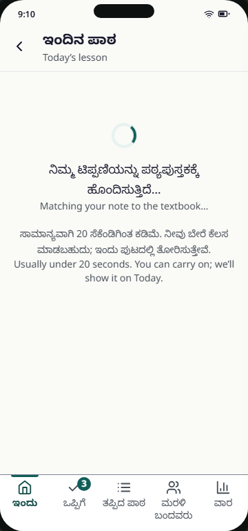
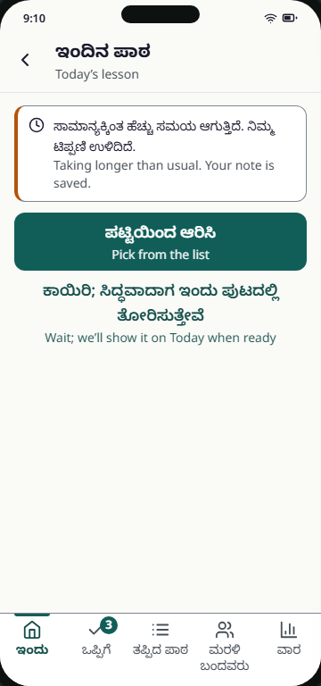
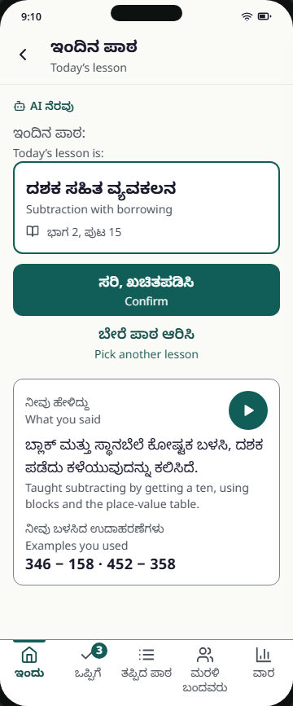
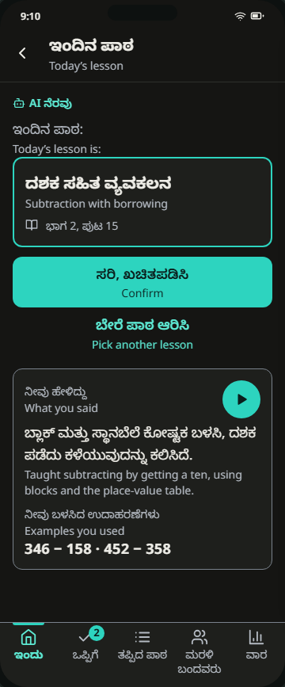
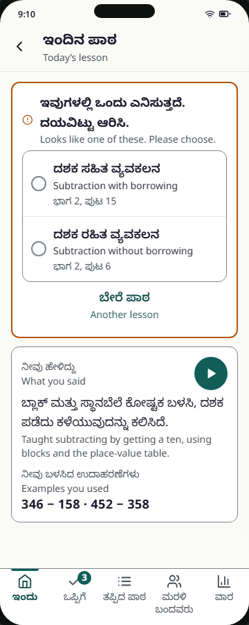
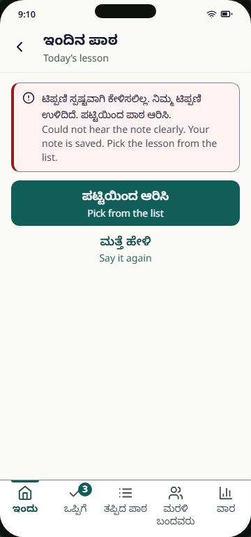
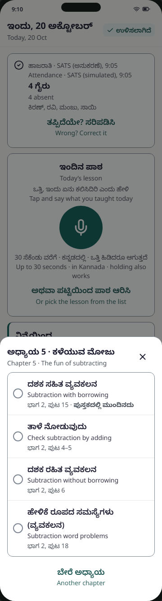

# T2 Lesson confirm (+ pick-lesson sheet)

Spec: FR-03, FR-04, NFR-07, NFR-08 · Tier: MVP · Task: T-07 (A1 mapping + picker fallback), T-05 (curriculum, chapter list, next-in-book), T-12 (screen) · Prototype: prototype/index.html (step 4) · PNG: screenshots/T2-lesson-confirm-confident-360-light.png
Decisions: D-14, D-22, D-31, D-17

Opens after she stops recording on T1. Shows what Claude matched her note to; she confirms with one tap or picks another lesson. The pick-lesson sheet is shared with T1 ("Or pick the lesson from the list", "Change").

## 1. User voice

- Says: "Just show me what you think I taught. If it's right I'll tap once; if not, let me pick it from the book."
- Unsaid: Will the machine put a wrong lesson in my records, and will parents hear it tonight? Am I being checked against the syllabus?

## 2. Who does what

- Human: confirms the proposed lesson, or picks another from the chapter list; can replay her own note; can say it again.
- AI: Claude via `ILlmClient`, call A1 (model from `Ai:Models:*`, prompt `prompts/a1-lesson-mapping.md`). Input: Sarvam STT transcript + the current chapter's competency list and textbook excerpt. Output (tool-use JSON): `competencyIds[1..3]`, `summaryKn`, `examplesUsed`, `confidence`. Mode: augmentation (she decides).
- Code (no AI): validates IDs against the curriculum enum (invalid → treated as no match → list); applies the confidence threshold; orders the list with "Next in the book" first (curriculum order + last confirmed lesson); stores `Lesson.Source` (voice/picked), `Confidence`, `Status`; logs every A1 call to `AiCall`; 20 s timeout switch to "slow".

## 3. Always / never

- Always: label AI output "AI-assisted" (NFR-08). Show what she said (summary, examples) and let her play her own note (A-31).
- Always: offer the list in every state: confident, low confidence, slow, could not hear (FR-04).
- Always: a lesson change from the sheet saves at once and says so ("Lesson saved. You can change it."); Change stays on T1 (A-07, A-09).
- Never: write an unconfirmed lesson to missed lessons or to tonight's message. The ledger and FR-20 slots use teacher-confirmed lessons only.
- Never: send names to Claude or Sarvam; the transcript goes as-is with no class roster attached (guardrail 1). Never pass an invalid competency ID through (guardrail 2).
- Never: show a confidence number; use words (spec §3.4).
- Uncertainty: `confidence ≥ 0.7` and valid IDs → Confident state. `confidence < 0.7` → Low-confidence state: warning card, top two candidates as radio choices above the fold, "Another lesson". STT empty/unintelligible or no valid ID → Could not hear. No result after 20 s → Slow.
- If it goes wrong: a wrong lesson mis-records every absent child and tonight's message. Limited by: one-tap confirm required, Change on T1 until 6 pm, list always available, AI label.

## 4. States

| State | What the user sees | Copy (en) |
|---|---|---|
| Processing (`proc`) | Spinner (static under reduced motion), line and estimate; she can go back to Today.  | "Matching your note to the textbook…" |
| Slow > 20 s (`slow`) | Warning banner; primary "Pick from the list"; text "Wait; we’ll show it on Today when ready".  | "Taking longer than usual. Your note is saved." |
| Confident (`confident`) | AI label, "Today’s lesson is:", lesson in a 2 px primary-bordered card with book icon + page, primary "Confirm", text "Pick another lesson", note card (play, summary, examples).  Dark:  | "Confirm" |
| Low confidence (`low`) | Warning card (2 px `warning` border, alert icon), two radio choices with pages, "Another lesson"; note card below.  | "Looks like one of these. Please choose." |
| Could not hear (`unclear`) | Error banner `role="alert"`; primary "Pick from the list"; text "Say it again" (back to T1 mic).  | "Could not hear the note clearly. Your note is saved. Pick the lesson from the list." |
| Pick-lesson sheet | Modal bottom sheet: chapter title, close X, radio list ("Next in the book" first, each with page), "Another chapter".  | "Chapter 5 · The fun of subtracting" |
| Changed by teacher | After a pick: returns to T1 with the confirmed lesson card and Change; announcement | "Lesson saved. You can change it." |
| Offline | No T2 while offline: the note is queued on T1 (`queued` state). If the network drops during processing, behave as Slow | see T1 |
| Error (A1 call fails or invalid IDs) | Same as Could not hear (fallback to list, guardrail 2) | as Could not hear |
| Empty / Permission denied | none: T2 is only reached after a recording; mic permission is handled on T1 | — |

## 5. Copy

kn and en from the prototype. te "—" (teacher UI). Reviewed by: needs review (all rows).

| Key | kn | te | ta | en | Reviewed by |
|---|---|---|---|---|---|
| `confirm.title` (app bar, region label) | ಇಂದಿನ ಪಾಠ | — | needs translation | Today’s lesson | needs review |
| `common.back` (aria-label) | ಹಿಂದೆ | — | needs translation | Back | needs review |
| `confirm.processing` | ನಿಮ್ಮ ಟಿಪ್ಪಣಿಯನ್ನು ಪಠ್ಯಪುಸ್ತಕಕ್ಕೆ ಹೊಂದಿಸುತ್ತಿದೆ… | — | needs translation | Matching your note to the textbook… | needs review |
| `confirm.processingHint` | ಸಾಮಾನ್ಯವಾಗಿ 20 ಸೆಕೆಂಡಿಗಿಂತ ಕಡಿಮೆ. ನೀವು ಬೇರೆ ಕೆಲಸ ಮಾಡಬಹುದು; ಇಂದು ಪುಟದಲ್ಲಿ ತೋರಿಸುತ್ತೇವೆ. | — | needs translation | Usually under 20 seconds. You can carry on; we’ll show it on Today. | needs review |
| `confirm.slow` | ಸಾಮಾನ್ಯಕ್ಕಿಂತ ಹೆಚ್ಚು ಸಮಯ ಆಗುತ್ತಿದೆ. ನಿಮ್ಮ ಟಿಪ್ಪಣಿ ಉಳಿದಿದೆ. | — | needs translation | Taking longer than usual. Your note is saved. | needs review |
| `confirm.pickFromList` | ಪಟ್ಟಿಯಿಂದ ಆರಿಸಿ | — | needs translation | Pick from the list | needs review |
| `confirm.wait` | ಕಾಯಿರಿ; ಸಿದ್ಧವಾದಾಗ ಇಂದು ಪುಟದಲ್ಲಿ ತೋರಿಸುತ್ತೇವೆ | — | needs translation | Wait; we’ll show it on Today when ready | needs review |
| `confirm.unclear` | ಟಿಪ್ಪಣಿ ಸ್ಪಷ್ಟವಾಗಿ ಕೇಳಿಸಲಿಲ್ಲ. ನಿಮ್ಮ ಟಿಪ್ಪಣಿ ಉಳಿದಿದೆ. ಪಟ್ಟಿಯಿಂದ ಪಾಠ ಆರಿಸಿ. | — | needs translation | Could not hear the note clearly. Your note is saved. Pick the lesson from the list. | needs review |
| `confirm.sayAgain` | ಮತ್ತೆ ಹೇಳಿ | — | needs translation | Say it again | needs review |
| `confirm.lowConf` | ಇವುಗಳಲ್ಲಿ ಒಂದು ಎನಿಸುತ್ತದೆ. ದಯವಿಟ್ಟು ಆರಿಸಿ. | — | needs translation | Looks like one of these. Please choose. | needs review |
| `confirm.choices` (radiogroup aria-label) | ಇಂದಿನ ಪಾಠ | — | needs translation | Today’s lesson | needs review |
| `confirm.anotherLesson` | ಬೇರೆ ಪಾಠ | — | needs translation | Another lesson | needs review |
| `ai.label` | AI ನೆರವು | — | needs translation | AI-assisted | needs review |
| `confirm.lessonIs` | ಇಂದಿನ ಪಾಠ: | — | needs translation | Today’s lesson is: | needs review |
| `confirm.confirm` | ಸರಿ, ಖಚಿತಪಡಿಸಿ | — | needs translation | Confirm | needs review |
| `confirm.pickAnother` | ಬೇರೆ ಪಾಠ ಆರಿಸಿ | — | needs translation | Pick another lesson | needs review |
| `confirm.note.label` | ನೀವು ಹೇಳಿದ್ದು | — | needs translation | What you said | needs review |
| `confirm.note.play` (aria-label) | ನಿಮ್ಮ ಟಿಪ್ಪಣಿ ಕೇಳಿ | — | needs translation | Play your note | needs review |
| `confirm.note.examples` | ನೀವು ಬಳಸಿದ ಉದಾಹರಣೆಗಳು | — | needs translation | Examples you used | needs review |
| `announce.lessonReady` | ಪಾಠ ಸಿದ್ಧ. ಖಚಿತಪಡಿಸಿ. | — | needs translation | Lesson ready. Please confirm. | needs review |
| `announce.lessonConfirmed` | ಪಾಠ ಖಚಿತವಾಗಿದೆ | — | needs translation | Lesson confirmed | needs review |
| `announce.lessonSaved` | ಪಾಠ ಉಳಿಸಲಾಗಿದೆ. ಬದಲಿಸಬಹುದು. | — | needs translation | Lesson saved. You can change it. | needs review |
| `pick.title` | ಅಧ್ಯಾಯ {n} · {chapter} | — | needs translation | Chapter {n} · {chapter} | needs review |
| `common.close` (aria-label) | ಮುಚ್ಚಿ | — | needs translation | Close | needs review |
| `pick.nextInBook` | ಪುಸ್ತಕದಲ್ಲಿ ಮುಂದಿನದು | — | needs translation | Next in the book | needs review |
| `pick.anotherChapter` | ಬೇರೆ ಅಧ್ಯಾಯ | — | needs translation | Another chapter | needs review |

Data, not locale keys (from `data/curriculum/*.json`, wording approved by Monika under D-14):

| Field | kn (prototype) | en (prototype) |
|---|---|---|
| Chapter 5 name | ಕಳೆಯುವ ಮೋಜು | The fun of subtracting |
| `M3.SUB.CHECK` · page | ತಾಳೆ ನೋಡುವುದು · ಭಾಗ 2, ಪುಟ 4–5 | Check subtraction by adding · Part 2, pages 4–5 |
| `M3.SUB.NOBORROW` · page | ದಶಕ ರಹಿತ ವ್ಯವಕಲನ · ಭಾಗ 2, ಪುಟ 6 | Subtraction without borrowing · Part 2, page 6 |
| `M3.SUB.BORROW` · page | ದಶಕ ಸಹಿತ ವ್ಯವಕಲನ · ಭಾಗ 2, ಪುಟ 15 | Subtraction with borrowing · Part 2, page 15 |
| `M3.SUB.WORD` · page | ಹೇಳಿಕೆ ರೂಪದ ಸಮಸ್ಯೆಗಳು (ವ್ಯವಕಲನ) · ಭಾಗ 2, ಪುಟ 18 | Subtraction word problems · Part 2, page 18 |

AI output (A1, not locale keys): `summaryKn`, e.g. "ಬ್ಲಾಕ್ ಮತ್ತು ಸ್ಥಾನಬೆಲೆ ಕೋಷ್ಟಕ ಬಳಸಿ, ದಶಕ ಪಡೆದು ಕಳೆಯುವುದನ್ನು ಕಲಿಸಿದೆ." / "Taught subtracting by getting a ten, using blocks and the place-value table."; `examplesUsed`, e.g. "346 − 158 · 452 − 358".

## 6. Tokens and sizes

- Page `bg-canvas`; note card `bg-surface border border-border rounded-md`; proposed-lesson card `border-2 border-primary`, lesson name `text-title` weight 700.
- Low-confidence card `border-2 border-warning`; alert icon `text-warning`; text stays `text-ink` (rule 2).
- Slow banner `border-l-4 border-l-warning bg-surface`; could-not-hear banner `bg-error-bg border-l-4 border-l-error`, text `text-ink`, icon `text-error`.
- AI label: `text-primary-strong text-label` + `bot` icon (separate from any reward icon).
- Primary buttons `min-h-target-primary w-full bg-primary text-on-primary rounded-md`; text buttons `min-h-target text-primary-strong w-full`. Play-note button 48 px circle `bg-primary text-on-primary`.
- Radio rows `min-h-[56px]` (≥ `min-h-target`), 22 px radio ring `border-border`, selected dot `bg-primary`; dividers `border-divider` with the list outlined by `border-border`.
- Sheet: scrim `rgba(10,12,12,.5)`, sheet `bg-surface rounded-t-[20px] border-t border-border`, max height 85 %, scrolls inside. Close button `min-h-target min-w-target`.
- Examples: Latin digits, `text-title` weight 700.
- Bottom padding so the last button clears the nav (A-31).

## 7. Acceptance checklist

- [ ] Every state above is built and reachable
- [ ] One primary action per state; one thumb at 360 px; Confirm and both low-confidence choices above the fold (A-17)
- [ ] Status shown as icon + word, never colour alone
- [ ] Targets ≥ 48 px; 8 px apart
- [ ] AI output carries the "AI-assisted" label in Confident; Low-confidence summary card also carries it (NFR-08)
- [ ] Every Indic text has a `lang` attribute; strings exist in kn, en, te, ta
- [ ] axe: 0 serious/critical, in light and dark
- [ ] A1 output parsed with a schema; IDs outside the curriculum enum are dropped; zero valid IDs → Could not hear state (guardrail 2, T-07)
- [ ] `confidence < 0.7` → Low-confidence state; the two choices are the top candidates; no number shown (T-07, spec §5.1)
- [ ] Processing shows "Usually under 20 seconds"; after 20 s switches to Slow with "Pick from the list" primary (A-18, NFR-07)
- [ ] Leaving during processing is safe; when ready, T1 shows "Note saved · Open" and the polite region announces "Lesson ready. Please confirm."
- [ ] Confirm: `PUT /api/lessons/{id}/competencies` (or confirm endpoint) with `clientRequestId`, idempotent; returns to T1, announces "Lesson confirmed"; offline confirm queued in the outbox
- [ ] Picking from the list creates or updates the lesson with `Source = picked`; one tap; ledger updates (FR-04); announces "Lesson saved. You can change it." (A-07)
- [ ] Pick sheet: `role="dialog"`, `aria-modal`, labelled by its title; focus moves in and is trapped; Esc, scrim and Back close it; focus returns to the opener (A-03)
- [ ] List is a `radiogroup` of `role="radio"` rows with `aria-checked` showing the current lesson; "Next in the book" first, computed in code (A-07, A-08)
- [ ] "Another chapter" opens the other chapters of the textbook (not a dead end) (A-08)
- [ ] Note card plays her own recording; summary and examples come from A1 (A-31)
- [ ] Every A1 call logged to `AiCall` with prompt version, model, tokens, latency (NFR-06)
- [ ] No child, teacher or parent names in the A1 prompt or STT request (guardrail 1)
- [ ] Focus moves to the screen title on arrival; never dropped to `<body>` (A-04)

Open items:
- FR-03 allows 1–3 competency IDs; the prototype shows only one lesson. Design how 2–3 matched lessons are shown and confirmed.
- §3.4 copy rule says "Looks like… Please confirm" for low confidence; the prototype says "Looks like one of these. Please choose." Pick one.
- The prototype shows an English caption of `summaryKn`. A1 returns Kannada only; decide whether English is translated (another AI call) or dropped in the en view.
- In Low confidence, tapping a choice commits at once (the "Saved · Change" pattern from A-07), not choose-then-confirm. Confirm this is intended.
- "Another chapter" is a placeholder in the prototype (A-08 not fixed); its list design is open.
- Spec §3.1 lists "changed by teacher" as a T2 state; in the prototype it returns to T1. Confirm no separate T2 state is needed.
