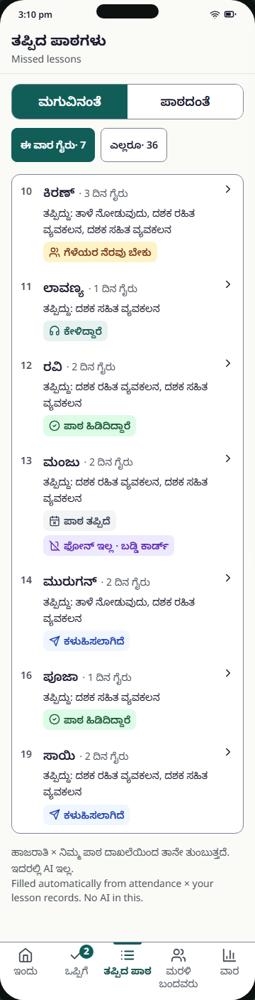
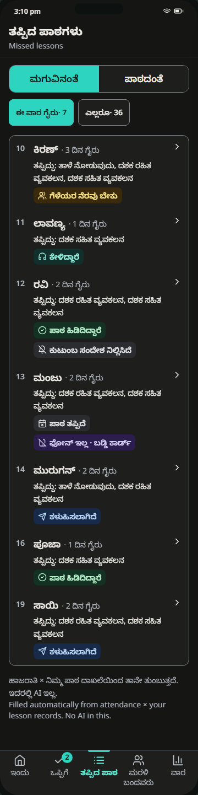
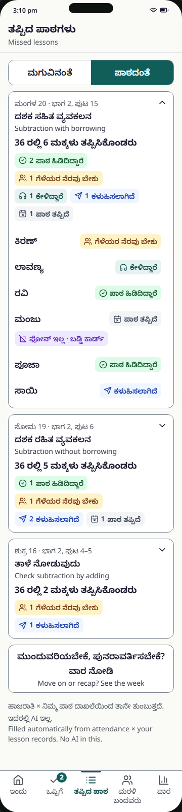
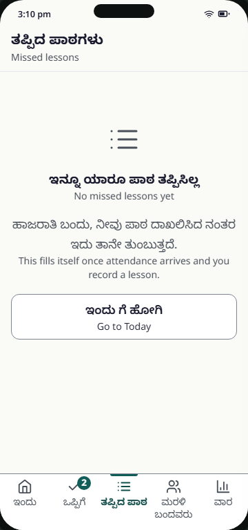
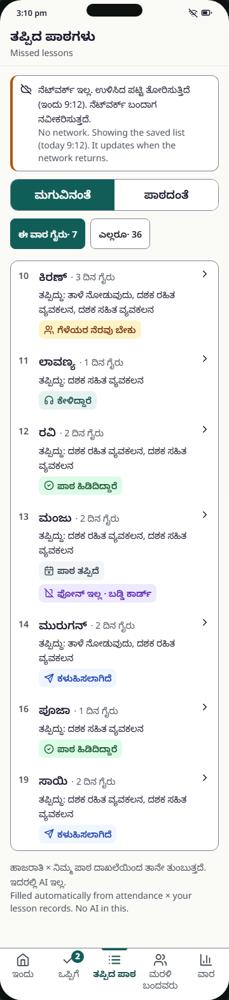
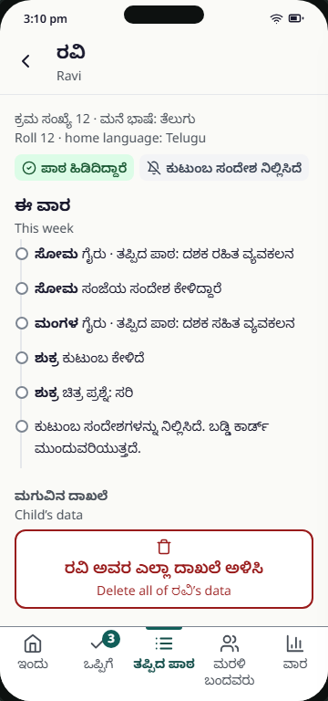
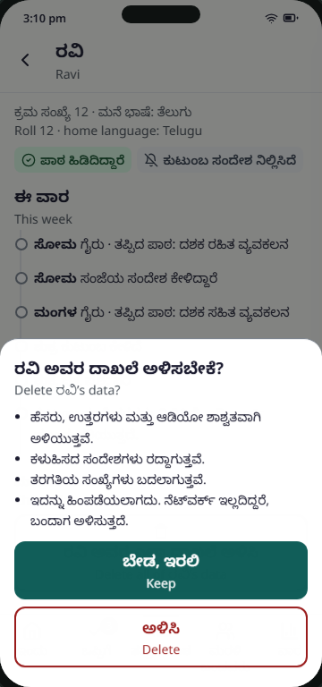

# T4 Missed lessons (ledger, by child, by lesson, child history, delete)

Spec: FR-05, FR-11, FR-15, FR-19 (status), FR-21 (reason, teacher only) · Tier: MVP · Task: T-13 (screen), T-06 (ledger query), T-19 (consent + delete), T-15 (status updates) · Prototype: prototype/index.html (step 10; step 13 for "stopped") · PNG: screenshots/T4-missed-by-child-360-light.png
Decisions: D-19, D-20, D-27, D-30, D-17, D-35 (Missed lesson tag uses stopped colours), D-36 (no "evening message listened" in the history), D-39 (link to Families and consent)

Nav tab "Missed". Segmented control: By child / By lesson. Tapping a child opens child history, which holds the "Child’s data" delete action. A ghost button "Families and consent" at the bottom of the list opens [T8](T8-families.md); the Missed tab stays active there (D-39).

## 1. User voice

- Says: "I can't remember who missed what. Show me which children missed which lesson, and who still needs help."
- Unsaid: Will this list be used against me or the families? Can an officer see it? If a parent asks me to remove their child, can I really do it?

## 2. Who does what

- Human: switches view, filters, opens a child, reads the week's history, deletes a child's data on request, opens Families and consent.
- AI: none. The footer says so ("No AI in this"). Mode: none.
- Code (no AI): ledger query = attendance × confirmed lessons × assignments × check responses × channel; per child × lesson learning status (Missed lesson → Sent → Listened → Caught up / Needs buddy); per child channel status (No phone · buddy card, Stopped by family), a separate field (B-08); "days away"; counts "N of 36 children missed it"; status counts per lesson; offline snapshot with its time; delete cascade.

## 3. Always / never

- Always: numbers equal attendance × lessons exactly (FR-05); counts, never percentages.
- Always: keep learning status and channel status as two tags; a stopped family never hides "Caught up" (B-08).
- Always: show reasons only to the teacher, as a category, labelled "from the parent" (FR-21).
- Never: export, share or show this view to anyone but the teacher (spec §7). Never show a score.
- Never: delete without a modal confirmation that lists consequences; default focus is Keep (B-07, B-24).
- Uncertainty: none (deterministic). Offline → show the cached list with its time, never a blank.
- If it goes wrong: a wrong status sends a child the wrong follow-up (no buddy when needed). Limited by: deterministic query with tests, child history showing each event with its day. Accidental delete is irreversible → modal, Keep focused and primary, Delete secondary.

## 4. States

| State | What the user sees | Copy (en) |
|---|---|---|
| By child (`default`) | Segmented control (By child pressed); filter chips "Absent this week · 7" / "Everyone · 36"; list rows: roll, name, "2 days away", "Missed: …", learning tag + channel tag, chevron; footer; ghost "Families and consent" (users icon, D-39).  Dark:  | "Filled automatically from attendance × your lesson records. No AI in this." |
| By lesson (`lesson`) | One card per lesson this week (newest first): date · page, lesson name, "4 of 36 children missed it", status-count tags; expander (chevron, `aria-expanded`) lists children with tags; "Move on or recap? See the week".  | "4 of 36 children missed it" |
| Everyone filter | All 36 children; rows with no missed lesson show "No missed lessons this week" | "No missed lessons this week" |
| Empty, first week (`empty`) | Large list icon, heading, explanation, ghost "Go to Today".  | "No missed lessons yet" |
| Offline (`offline`) | Warning banner with snapshot time above the list; Wi-Fi-off in status bar.  | "No network. Showing the saved list (today 9:12). It updates when the network returns." |
| Child history (`child` · `default`) | App bar: child's name as title, Back. "Roll 12 · home language: Telugu", tags, "This week" timeline (`<ol>`, day on every event: away and missed lesson, reason, back with homework, catch-up sent, family listened (the catch-up), picture question, stopped; no evening-message event, D-36), "Child’s data" section with outlined Delete.  | "This week" |
| Delete: confirm (`child` · `delete`) | Modal sheet: title, 4 consequence bullets, primary "Keep" (focused), outlined "Delete".  | "Delete Ravi’s data?" |
| Deleted | Back to the list; child removed; counts update; announcement | "Deleted: name, answers and audio" |
| Delete offline | Delete queued; happens when the network returns (copy in the dialog) | "This can’t be undone. If offline, it happens when the network returns." |
| Loading | Not designed. Show the cached snapshot; no blank screen | — |
| Error | Not designed (ledger fetch fails online → treat as offline snapshot) | see Open items |
| Permission denied | none: no mic or camera | — |

## 5. Copy

kn and en from the prototype. te "—" (teacher UI). Reviewed by: needs review (all rows).

| Key | kn | te | ta | en | Reviewed by |
|---|---|---|---|---|---|
| `ledger.title` (app bar, region label) | ತಪ್ಪಿದ ಪಾಠಗಳು | — | needs translation | Missed lessons | needs review |
| `ledger.empty.title` | ಇನ್ನೂ ಯಾರೂ ಪಾಠ ತಪ್ಪಿಸಿಲ್ಲ | — | needs translation | No missed lessons yet | needs review |
| `ledger.empty.body` | ಹಾಜರಾತಿ ಬಂದು, ನೀವು ಪಾಠ ದಾಖಲಿಸಿದ ನಂತರ ಇದು ತಾನೇ ತುಂಬುತ್ತದೆ. | — | needs translation | This fills itself once attendance arrives and you record a lesson. | needs review |
| `ledger.empty.goToday` | ಇಂದು ಗೆ ಹೋಗಿ | — | needs translation | Go to Today | needs review |
| `ledger.offline` | ನೆಟ್‌ವರ್ಕ್ ಇಲ್ಲ. ಉಳಿಸಿದ ಪಟ್ಟಿ ತೋರಿಸುತ್ತಿದೆ (ಇಂದು {time}). ನೆಟ್‌ವರ್ಕ್ ಬಂದಾಗ ನವೀಕರಿಸುತ್ತದೆ. | — | needs translation | No network. Showing the saved list (today {time}). It updates when the network returns. | needs review |
| `ledger.view` (aria-label) | ನೋಟ | — | needs translation | View | needs review |
| `ledger.view.child` | ಮಗುವಿನಂತೆ | — | needs translation | By child | needs review |
| `ledger.view.lesson` | ಪಾಠದಂತೆ | — | needs translation | By lesson | needs review |
| `ledger.filter` (aria-label) | ಫಿಲ್ಟರ್ | — | needs translation | Filter | needs review |
| `ledger.filter.week` | ಈ ವಾರ ಗೈರು · {n} | — | needs translation | Absent this week · {n} | needs review |
| `ledger.filter.all` | ಎಲ್ಲರೂ · {n} | — | needs translation | Everyone · {n} | needs review |
| `ledger.row.daysAway` | · {n} ದಿನ ಗೈರು | — | needs translation | · {n} day away / · {n} days away | needs review |
| `ledger.row.missed` | ತಪ್ಪಿದ್ದು: {lessons} | — | needs translation | Missed: {lessons} | needs review |
| `ledger.row.noneMissed` | ಈ ವಾರ ಯಾವ ಪಾಠವೂ ತಪ್ಪಿಲ್ಲ | — | needs translation | No missed lessons this week | needs review |
| `ledger.lesson.meta` | {day} · {page} | — | needs translation | {day} · {page} | needs review |
| `ledger.lesson.count` | {total} ರಲ್ಲಿ {n} ಮಕ್ಕಳು ತಪ್ಪಿಸಿಕೊಂಡರು | — | needs translation | {n} of {total} children missed it | needs review |
| `ledger.lesson.statusCount` | {n} {status} | — | needs translation | {n} {status} | needs review |
| `ledger.toWeek` | ಮುಂದುವರಿಯಬೇಕೆ, ಪುನರಾವರ್ತಿಸಬೇಕೆ? ವಾರ ನೋಡಿ | — | needs translation | Move on or recap? See the week | needs review |
| `ledger.footer` | ಹಾಜರಾತಿ × ನಿಮ್ಮ ಪಾಠ ದಾಖಲೆಯಿಂದ ತಾನೇ ತುಂಬುತ್ತದೆ. ಇದರಲ್ಲಿ AI ಇಲ್ಲ. | — | needs translation | Filled automatically from attendance × your lesson records. No AI in this. | needs review |
| `ledger.families` | ಕುಟುಂಬಗಳು ಮತ್ತು ಒಪ್ಪಿಗೆ | — | needs translation | Families and consent | needs review |
| `status.missed` | ಪಾಠ ತಪ್ಪಿದೆ | — | needs translation | Missed lesson | needs review |
| `status.sent` | ಕಳುಹಿಸಲಾಗಿದೆ | — | needs translation | Sent | needs review |
| `status.listened` | ಕೇಳಿದ್ದಾರೆ | — | needs translation | Listened | needs review |
| `status.caughtUp` | ಪಾಠ ಹಿಡಿದಿದ್ದಾರೆ | — | needs translation | Caught up | needs review |
| `status.needsBuddy` | ಗೆಳೆಯರ ನೆರವು ಬೇಕು | — | needs translation | Needs buddy | needs review |
| `status.noPhone` | ಫೋನ್ ಇಲ್ಲ · ಬಡ್ಡಿ ಕಾರ್ಡ್ | — | needs translation | No phone · buddy card | needs review |
| `status.stopped` | ಕುಟುಂಬ ಸಂದೇಶ ನಿಲ್ಲಿಸಿದೆ | — | needs translation | Stopped by family | needs review |
| `day.mon` / `.tue` / `.thu` / `.fri` (short; Wed not in prototype, needs copy) | ಸೋಮ / ಮಂಗಳ / ಗುರು / ಶುಕ್ರ | — | needs translation | Mon / Tue / Thu / Fri | needs review |
| `child.meta` | ಕ್ರಮ ಸಂಖ್ಯೆ {roll} · ಮನೆ ಭಾಷೆ: {language} | — | needs translation | Roll {roll} · home language: {language} | needs review |
| `language.te` / `.kn` / `.ta` | ತೆಲುಗು / ಕನ್ನಡ / ತಮಿಳು | — | needs translation | Telugu / Kannada / Tamil | needs review |
| `child.thisWeek` | ಈ ವಾರ | — | needs translation | This week | needs review |
| `child.event.away` | ಗೈರು · ತಪ್ಪಿದ ಪಾಠ: {lesson} | — | needs translation | away · missed: {lesson} | needs review |
| `child.event.reason` | ಕಾರಣ (ಪೋಷಕರು ತಿಳಿಸಿದ್ದು): {reason} | — | needs translation | reason (from the parent): {reason} | needs review |
| `child.event.backHomework` | ಮರಳಿದ · ಮನೆಕೆಲಸ ತಂದಿದ್ದಾರೆ | — | needs translation | back · brought homework | needs review |
| `child.event.catchupSent` | ಪುನರಾವರ್ತನೆ ಕಳುಹಿಸಲಾಗಿದೆ ({language}) | — | needs translation | catch-up sent ({language}) | needs review |
| `child.event.listened` | ಕುಟುಂಬ ಕೇಳಿದೆ | — | needs translation | family listened | needs review |
| `child.event.checkRight` | ಚಿತ್ರ ಪ್ರಶ್ನೆ: ಸರಿ | — | needs translation | picture question: right | needs review |
| `child.event.checkPractice` | ಚಿತ್ರ ಪ್ರಶ್ನೆ: ಇನ್ನೂ ಅಭ್ಯಾಸ ಬೇಕು | — | needs translation | picture question: needs more practice | needs review |
| `child.event.stopped` | ಕುಟುಂಬ ಸಂದೇಶಗಳನ್ನು ನಿಲ್ಲಿಸಿದೆ. ಬಡ್ಡಿ ಕಾರ್ಡ್ ಮುಂದುವರಿಯುತ್ತದೆ. | — | needs translation | family stopped messages. Buddy card continues. | needs review |
| `child.event.none` | ಈ ವಾರ ಯಾವ ಪಾಠವೂ ತಪ್ಪಿಲ್ಲ | — | needs translation | No missed lessons this week | needs review |
| `child.data.heading` | ಮಗುವಿನ ದಾಖಲೆ | — | needs translation | Child’s data | needs review |
| `child.data.delete` | {name} ಅವರ ಎಲ್ಲಾ ದಾಖಲೆ ಅಳಿಸಿ | — | needs translation | Delete all of {name}’s data | needs review |
| `child.delete.title` | {name} ಅವರ ದಾಖಲೆ ಅಳಿಸಬೇಕೆ? | — | needs translation | Delete {name}’s data? | needs review |
| `child.delete.removed` | ಹೆಸರು, ಉತ್ತರಗಳು ಮತ್ತು ಆಡಿಯೋ ಶಾಶ್ವತವಾಗಿ ಅಳಿಯುತ್ತವೆ. | — | needs translation | The name, answers and audio are removed for good. | needs review |
| `child.delete.cancelled` | ಕಳುಹಿಸದ ಸಂದೇಶಗಳು ರದ್ದಾಗುತ್ತವೆ. | — | needs translation | Messages not yet sent are cancelled. | needs review |
| `child.delete.counts` | ತರಗತಿಯ ಸಂಖ್ಯೆಗಳು ಬದಲಾಗುತ್ತವೆ. | — | needs translation | Class counts update. | needs review |
| `child.delete.final` | ಇದನ್ನು ಹಿಂಪಡೆಯಲಾಗದು. ನೆಟ್‌ವರ್ಕ್ ಇಲ್ಲದಿದ್ದರೆ, ಬಂದಾಗ ಅಳಿಸುತ್ತದೆ. | — | needs translation | This can’t be undone. If offline, it happens when the network returns. | needs review |
| `child.delete.keep` | ಬೇಡ, ಇರಲಿ | — | needs translation | Keep | needs review |
| `child.delete.confirm` | ಅಳಿಸಿ | — | needs translation | Delete | needs review |
| `announce.deleted` | ಅಳಿಸಲಾಗಿದೆ: ಹೆಸರು, ಉತ್ತರಗಳು, ಆಡಿಯೋ | — | needs translation | Deleted: name, answers and audio | needs review |
| `common.back` (aria-label) | ಹಿಂದೆ | — | needs translation | Back | needs review |

Reason words reuse `reason.*` (see T1). Lesson names, pages and dates come from data.

## 6. Tokens and sizes

- Page `bg-canvas`; list `bg-surface border border-border rounded-md`, rows `min-h-[56px]` with `border-b border-divider`; lesson cards `bg-surface border border-border rounded-md`.
- Segmented control: 2 columns, `min-h-target`, `border border-border rounded-md`; pressed `bg-primary text-on-primary`, `aria-pressed` (B-16, B-17).
- Filter chips `min-h-target rounded-sm border border-border text-label`; pressed `bg-primary text-on-primary`.
- Status tags (`rounded-sm`, `text-label` ≥ 14 px, icon 16 px, wrap): `text-status-sent bg-status-sent-bg` + `send`; `text-status-listened bg-status-listened-bg` + `headphones`; `text-status-caught-up bg-status-caught-up-bg` + `circle-check`; `text-status-needs-buddy bg-status-needs-buddy-bg` + `users`; `text-status-no-phone bg-status-no-phone-bg` + `smartphone-off`; `text-status-stopped bg-status-stopped-bg` + `bell-off`; "Missed lesson" uses the stopped colours + `calendar-x`, told apart from "Stopped by family" by icon and word (D-35, tokens.md).
- "Families and consent": ghost button `min-h-target w-full border-border bg-surface` with `users` icon, below the footer.
- Type: title `text-title`; names `text-label`; meta `text-caption text-ink-muted`; lesson name 17 px in prototype → `text-body-lg`; section heading `text-caption` bold `text-ink-muted`.
- Timeline: `<ol>` with 2 px `border-divider` rail, 10 px dots `border-border`; day `font-bold`.
- Delete button `min-h-target w-full border-2 border-error text-error bg-surface`; in the sheet Keep is `min-h-target-primary bg-primary text-on-primary`, Delete is the outlined error button below with 8 px gap.
- Offline banner `border-l-4 border-l-warning bg-surface`. Focus ring inset on list rows (`outline-offset: -4px`) so it is not clipped (B-18).

## 7. Acceptance checklist

- [ ] Every state above is built and reachable
- [ ] One primary action per view; one thumb at 360 px
- [ ] Status shown as icon + word, never colour alone
- [ ] Targets ≥ 48 px (segmented control, chips, rows, expander); 8 px apart (B-17)
- [ ] No AI output; footer says "No AI in this"
- [ ] Every Indic text has a `lang` attribute; strings exist in kn, en, te, ta
- [ ] axe: 0 serious/critical, in light and dark
- [ ] Ledger = attendance × confirmed lessons, exactly; Vitest + Playwright check counts (FR-05, T-13)
- [ ] API returns learning status per child × competency and channel status per child as a separate field; UI shows two tags (B-08)
- [ ] By lesson: counts per lesson use the child × lesson status, not the child's latest status (B-08)
- [ ] "Absent this week" filter is the default; counts in chips computed in code
- [ ] Picture tap updates the child's status within 2 s (FR-11); a stop shows "Stopped by family" within 2 s (FR-19)
- [ ] Segmented control uses `aria-pressed`; expander uses a chevron button with `aria-expanded` (B-16)
- [ ] Focus ring visible and not clipped in lists (inset) (B-18); focus kept or moved to the title on re-render and screen change (B-19)
- [ ] Offline: shows cached snapshot with its time; banner says what is safe (B-25, NFR-02)
- [ ] Child history: child's name is the app-bar heading; every event has a day; timeline is an `<ol>` (B-27)
- [ ] Reason shown as category with "from the parent"; only on teacher screens (FR-21)
- [ ] Child history has no evening-message event; "family listened" means the catch-up played to the end (D-36, D-20)
- [ ] "Families and consent" opens T8 with the Missed tab still `aria-current="page"` (D-39)
- [ ] The channel tag (No phone · buddy card) comes from the consent recorded on T8, so a change there shows here (D-39)
- [ ] Delete sits in a "Child’s data" section, not under the thumb (B-24)
- [ ] Delete dialog: `role="dialog"`, `aria-modal`, labelled by title; focus starts on Keep; trapped; Esc and scrim close; focus returns to the Delete button (B-07)
- [ ] `DELETE /api/children/{id}` with `clientRequestId`, idempotent; queued offline and replayed; removes child, responses, assignments, reasons, buddy cards and audio; cancels unsent messages (FR-15, T-19, Db suite test)
- [ ] After delete: child gone from every view and from Today's updates; counts recomputed; "Deleted: name, answers and audio" announced
- [ ] Ledger visible only to the authenticated teacher; no export endpoint (spec §7)

Open items:
- Resolved (D-35): "Missed lesson" reuses the stopped colours with its own icon and word; tokens.md is being updated.
- FR-05 lists one status per child mixing learning and channel; B-08 and the prototype separate them and add "Listened" and "No phone". Update FR-05.
- The prototype's by-lesson view still counts each child's latest status, not child × lesson (B-08 only half applied). Build per child × lesson as specified above.
- Spec §3.1 asks for "Last updated …" offline copy; prototype uses "Showing the saved list (today 9:12)". Prototype copy chosen here.
- The channel tag comes from T8: No phone → "No phone · buddy card", No → "No consent", family stopped → "Stopped by family" (resolved 21 Oct in the prototype).
- `child.event.backHomework` kn ತಂದಿದ್ದಾನೆ is masculine; needs a neutral form.
- Error state for an online ledger fetch failure is not designed.
