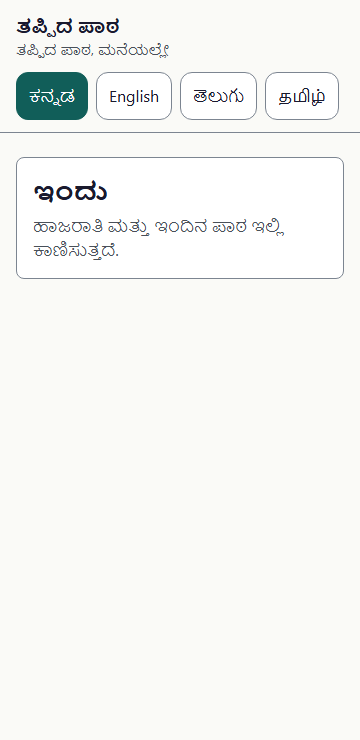
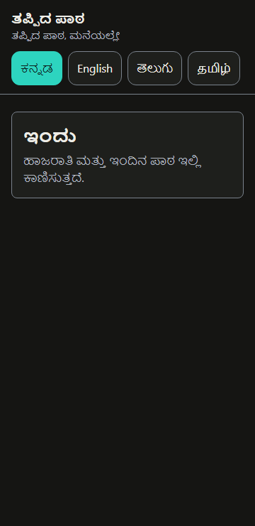

# Design tokens

Owner: Monika · Decisions: D-04, D-17 (`docs/spec.md` §8) · Code: [`src/web/src/styles/tokens.css`](../../src/web/src/styles/tokens.css) · Test: [`tokens.test.ts`](../../src/web/src/styles/tokens.test.ts)

Source: the Build Kit design system (02-DESIGN §2), which continues the Ideate deck's look: warm canvas, deep ink, one teal accent. The kit calls the teal `accent`; in our code it is **`primary`**.

## Targets

- **All text ≥ 7:1** (WCAG 1.4.6, AAA) at every size and weight, in both themes. We don't use the large-text exception, so any token is safe for any text, and Kannada/Telugu/Tamil vowel signs stay crisp in sunlight.
- **UI ≥ 3:1** (1.4.11): borders, icons next to a word, the focus ring.
- **Decorative** (dividers, illustration warm `#F59E0B`): no requirement; never used to carry meaning.

`tokens.test.ts` recomputes every pair below from `tokens.css` and fails `./scripts/verify.sh` if one drops under its target.

## Usage rules

1. **No `primary` text on `panel`** (light: 6.6:1). On panels use `primary-strong`.
2. **`warning` is for icons and borders only**, never text. Alert text stays `ink`.
3. **`panel` and `surface` are almost the same shade (1.15:1)**, so panels and cards always have a `border`. Never rely on shadow or tint alone.
4. **Focus ring: 3 px `focus` outline with a 2 px offset** (set globally in `index.css`). The ring is only 1.1:1 against a primary button, so the gap is what makes it visible.
5. **Status is always icon + word**, never colour alone. In greyscale the tags look alike; the icon and word tell them apart.
6. The original Ideate teal `#0F766E` (5.2:1) is for illustrations only.

## Dark theme

Follows the phone's setting (`prefers-color-scheme`), including phones that switch to dark in battery saver. **No in-app toggle yet** (deferred: in-app System/Light/Dark choice, pre-paint script, Save-Data and forced-colours handling). Dark is designed, not inverted: warm near-black (never `#000`), off-white text (never `#FFF`, to reduce glow for people with astigmatism), and light teal buttons with dark text.

## Slate & chalk (D-77, accepted)

New look for the teacher app, the parent pages (P1–P4, reason) and the demo shell. **Looks only.** Components keep their meaning: teal stays on standard buttons and link text; amber is a new, separate `accent`. Source of the look: Monika's concept mockups (outside the repo); this section is what gets built.

**How it is applied.** Add the tokens below as **new names plus a `.theme-slate` scope** that redefines the existing names (`canvas`, `surface`, `panel`, `ink`, `ink-muted`, `border`, `primary-strong`, `error`, `focus`, `warning`) for its subtree. Screens opt in by wrapping in the class, one PR at a time. The values in the Colours table below change last, when every screen has opted in. `tokens.test.ts` must read the scoped blocks too.

| Token | Light (pale slate) | Ratio on canvas · surface · panel | Dark (slate) | Ratio on canvas · surface · panel | Use |
|---|---|---|---|---|---|
| `canvas` | `#DCE4DF` | — | `#1B201E` | — | Page background (warm near-black in dark, never `#000`) |
| `surface` | `#EEF2EF` | — | `#252B28` | — | Cards, sheets |
| `panel` | `#D6E7E0` | — | `#1A312D` | — | AI panels, tinted sections |
| `ink` | `#14211C` | 12.8 · 14.7 · 12.9 | `#EEEBE0` (chalk) | 13.8 · 12.1 · 11.6 | Primary text |
| `ink-muted` | `#3A4640` | 7.6 · 8.7 · 7.7 | `#C8CEC9` | 10.3 · 9.0 · 8.6 | Secondary text |
| `border` | `#5B6761` | 4.6 · 5.2 · 4.6 (UI) | `#8C968F` | 5.4 · 4.7 · 4.5 (UI) | Input and card borders |
| `primary-strong` | `#0F4A46` | 7.8 · 8.9 · 7.8 | `#5EEAD4` | 11.2 · 9.8 · 9.3 | Teal text and links |
| `error` | `#7F1D1D` | 7.7 · 8.9 · 7.8 | `#FECACA` | 11.4 · 10.0 · 9.5 | Error text and icon |
| `focus` | `#1D4ED8` | 5.2 · 5.9 · 5.2 (UI) | `#93C5FD` | 9.2 · 8.0 · 7.7 (UI) | Focus ring |
| `warning` | `#B45309` | 3.9 · 4.4 · 3.9 (UI) | `#FBBF24` | 9.9 · 8.6 · 8.3 (UI) | Icon and border only |
| `accent` (new) | `#F6C453` | 1.3 · 1.4 · 1.2 | `#F6C453` | 10.2 · 8.9 · 8.5 (UI) | Hero action fill (play, mic), tally stroke, star, underline |
| `on-accent` (new) | `#14211C` | 10.2 on `accent` | `#1B201E` | 10.2 on `accent` | Text or icon on an amber fill |
| `chalk` (new, decorative) | `#8C968F` | no requirement | `#68645A` | no requirement | Doodles, ruling lines, ghost numerals |

`primary`, `on-primary` and the status tag pairs are unchanged; each status tag carries its own background. Ratios were measured with the same formula as `tokens.test.ts` (WCAG relative luminance); the test recomputes them from `tokens.css`, so if a value moves, the test decides. The `chalk` row is decorative only: pick values by eye, keep opacity ≤ 16 % for texture.

### Rules

1. **Amber is never text.** Fills, icons, strokes and the handwriting accent only.
2. **Light mode: an amber fill needs a 3 px `ink` outline** (accent against pale canvas is 1.3:1). Dark mode needs none.
3. **No `primary` text on slate canvas in light** (5.9:1). Use `primary-strong`.
4. **One amber hero per teacher screen.** Parent pages may use more (tally, star, play).
5. **Progress on parent pages is a four-stroke chalk tally (D-08):** done strokes chalk, current stroke amber, remaining strokes dashed; a visible "2/4" beside it and "Step 2 of 4" for screen readers; it only counts up. On Done, a slash crosses the four.
6. **Handwriting (Caveat):** Latin only, ≥ 28 px, for a name or one accent word. It never carries an instruction or a button label. Kannada, Telugu and Tamil accent words use an amber underline or marker instead.
7. **Texture, ruling lines and doodles are decorative:** `aria-hidden`, no meaning, ≤ 16 % opacity. Motion: every transition and draw-on ≤ 300 ms; the play button may breathe (≤ 2.4 s) only while playing; **all of it off under `prefers-reduced-motion`**.
8. **Status is still icon + word** (rule 5 above). Nothing here changes that.

### Fonts

| Language | Headings | Body |
|---|---|---|
| en | Baloo 2 | Noto Sans |
| kn | Baloo Tamma 2 | Noto Sans Kannada (regular, not the "UI" variant) |
| te | Baloo Tammudu 2 | Noto Sans Telugu |
| ta | Baloo Thambi 2 | Noto Sans Tamil |
| accent word (Latin only) | Caveat 700 | — |

Select by `:lang()`. Self-host and subset (Latin + that language's script), `font-display: swap`, load only the family the page needs (parent page budget ≤ 500 KB excluding audio, T-15). Family names and weights 500/700/800 are verified on Google Fonts. Indic scripts keep the type table above: one size step larger, ~1.7 line height, weight ≥ 500 on dark, no letter-spacing, `lang` on every element.

### Three surfaces, one look and feel

| Surface | Screens | Mood | Palette |
|---|---|---|---|
| **A. Teacher app** (slate) | Sign-in, Welcome, Today, Approve, Missed lessons, Back today, Week, set-up | Calm. One amber hero per screen, at most one doodle, no confetti | Slate (this section) |
| **B. Family phone chat** (WhatsApp-like) | The `/demo` family phone's message list: evening message, catch-up link, stopped | Familiar. It copies the *layout* of a chat app so judges see the real hand-off. No logo, no brand name; the header says "Messages" | Chat palette below |
| **C. Parent web pages** (slate, the assignment) | P1 Listen, reason page, P2 Activity, P3 Answer, P4 Done, Stopped, Expired | Warm. Tally, chalk star, up to two doodles, playful amber | Slate (this section) |

The flow is **B → C**: the family taps a link in the chat and a slate page opens inside a thin in-app-browser bar (below). A and C use the same tokens; only the mood rules differ.

### Look and feel, in one paragraph

A dark classroom slate (pale grey-green in light mode) with chalk-white type, faint ruling lines like a notebook, soft smudges, and a few hand-drawn marks in chalk and one amber. Cards are flat, rounded and outlined; type is chunky and friendly (Baloo), with at most one handwritten accent word (Caveat); progress is chalk tally strokes; the hero action is a big amber disc. Nothing here carries meaning by itself: every mark has a word, icon or number beside it.

### Surface texture (all slate screens)

Three layers behind the content, all `pointer-events: none`, none carrying meaning:

1. **Ruling lines:** a 1 px line every 40 px, ink at 7 % (light) or chalk at 6 % (dark). `repeating-linear-gradient(to bottom, transparent 0 39px, var(--rule) 39px 40px)`.
2. **Smudges:** two soft radial highlights, one top-left and one lower-right (white at 35 % in light, 4 % in dark), each about 60–70 % wide and 24–28 % tall.
3. **Chalk grain (optional):** a broad low-frequency noise (`feTurbulence`, `baseFrequency=".035 .6"`, 3 octaves) at ≤ 16 % opacity in light and ≤ 10 % in dark. No fine static.

### Shape, space, elevation

| Token (new) | Value | Use |
|---|---|---|
| `radius-button` | 14 px | Buttons |
| `radius-card` | 20 px | Cards and picture tiles |
| `radius-sheet` | 24 px (top corners) | Bottom sheets and dialogs |
| `radius-pill` | 999 px | Tags, chips, nav badge |
| `edge` | light `#B7C3BC` · dark `#3A423E` | Border of **static** cards (decorative). Interactive things use `border` (≥ 3:1) |

Spacing is a 4 px scale: 16 px screen gutter, 12 px between cards, 8 px minimum between touch targets (unchanged). Cards are flat (border, no shadow). The only shadows: the play button (`0 8px 0 -2px rgba(0,0,0,.14)`) and a sheet's scrim (canvas at 60 %).

### Components

| Component | Spec |
|---|---|
| **Primary button** | Teal `primary` fill, `on-primary` text, 56 px high, full width, `radius-button`, label 18/24 weight 800. Pressed: `scale(.98)` in 200 ms |
| **Secondary button** | `panel` fill, 2 px `primary` border, `primary-strong` text, 48–56 px |
| **Hero (accent) button** | `accent` fill, `on-accent` icon or text. **Light mode: 3 px `ink` outline.** Used for play (P1) and mic (Today), nothing else |
| **Link button** | `primary-strong`, 16 weight 700, underline with 4 px offset, 48 px high |
| **Disabled** | `divider` fill, 2 px dashed `border`, `ink-muted` text, plus a visible hint saying why (e.g. "Tap one picture") |
| **Card** | `surface`, 1.5 px `edge`, `radius-card`, padding 14–16. **Hero card:** 2 px `border`. **Payoff card:** `panel` fill, 2 px `primary` border |
| **Tags and chips** | Pill, ≥ 32 px high, 14/20 weight 700, 18 px icon + word. Status colours from the status table (unchanged). Plain chip: `panel` fill + 1.5 px `primary` border |
| **Header (parent)** | Back (48 px, where the page has one) + title 20/28 weight 800 on the canvas, as built; no white bar and no rule. On P1 the title carries the child's name as the accent word and the teacher's amber avatar sits in the "From" row |
| **App header (teacher)** | Stays on every teacher screen exactly as built: app name, tagline and the four language chips, restyled, in the same place. Today (T-49) adds a title row with the Saved tag; **no greeting and no settings gear** (Settings is not built) |
| **Tally (progress)** | Four 3 px chalk strokes, 28 px tall, 12 px apart, slightly tilted. Done = `ink`, current = `accent` (drawn on in 300 ms), left = dashed `chalk`; on the last step a diagonal slash in `accent`. Beside it "2/4" (16 px, weight 800); screen-reader text "Step 2 of 4". It only counts up, never shows a break |
| **Play button (P1)** | 156 px circle, `accent`, 56 px play/pause icon and the word under it; a 184 px `panel` halo behind. Breathes (scale 1 → 1.04, 2.4 s, ease-in-out, alternate) **only while playing** |
| **Waveform (P1)** | 34 rounded bars, 5 px wide, 3 px gap, heights 8–40 px; unplayed `chalk`, played `ink`. While playing, bars move in 300 ms alternation. Times "0:00" and "1:35" always in text |
| **Mic (Today)** | 112 px `accent` disc, 168 px `panel` halo, dashed 2.5 px `chalk` ring; recording turns the icon into a square and breathes as above; timer "0:12 / 0:30" in text |
| **Picture tiles (reason page)** | Two columns as built, height `target-picture` (120 px, unchanged), 2 px `border`, `radius-card`, chalk-drawn icon (28 px, 2 px stroke) in a 52 px `panel` disc, word under it (16/20 weight 700). Five tiles: Unwell, Family travel or work, Festival or function, Needed at home, Other; the fifth sits alone in the last row, as built. Selected: 3 px `primary` border, `panel` fill, disc turns `accent`, 26 px tick badge. Sticky bar as built: Send (disabled until one is chosen), hint, Skip. "Say it instead" is not built (D-63) and is not added |
| **Sticks (P3)** | Unchanged (D-76, `stick` token). Only the tile frame takes the new card style |
| **Bottom nav** | `surface`, top border `edge`, five equal tabs ≥ 60 px high, icon 24 px + label 14 px. **Labels and order exactly as built** (Today, Approve, Missed, Back today, Week; "Back today" may wrap to two lines). Active = 4 px `primary` bar on top + weight 800 + `primary-strong`. Badge = `ink` disc, 20 px |
| **Sheet / dialog** | `surface`, `radius-sheet` top, scrim = canvas at 60 %. The safe choice ("Keep") is the focused primary. No alarm colours on stop (C-27) |
| **Skeleton** | `divider` bars 14 px high, radius 7 px, opacity .55 ↔ 1 in 300 ms alternation; `role="status"` with hidden "Loading…" |
| **Celebration (P4)** | Amber medal 104 px with a chalk star drawn on in 300 ms, 10–14 small amber and teal confetti pieces popping in with ≤ 120 ms stagger. Not on teacher screens |

### Icons and doodles

- **Icons:** 24 px grid, 2 px stroke, round caps and joins, `currentColor`; the same family as the current Lucide icons, so `Icon.tsx` does not change. Picture-tile icons are the ones already built: thermometer (Unwell), bus (family travel or work), flame (festival or function), house (needed at home), speech bubble (Other).
- **Doodles:** loose chalk loops, a small star, a dashed circle, a squiggle underline (accent, 3.5 px). Drawn with a slight wobble (`feDisplacementMap`, scale 3, `baseFrequency` .03). `aria-hidden`, never beside text that needs reading, **at most two per parent page and one per teacher screen**.
- **Accent word:** Caveat 700 at 1.25× the heading size, with a squiggle underline drawn on in 300 ms. Latin only. Kannada, Telugu and Tamil use a plain heading word with the amber underline marker.

### Motion

| What | Duration | Notes |
|---|---|---|
| State changes (press, select, theme) | 200 ms | ease |
| Draw-on strokes, pop-ins, sheet slide | ≤ 300 ms | ease-out |
| Play and mic breathing | 2.4 s loop | only while playing or recording |
| Waveform bars, skeleton | 300 ms alternation | only while playing or loading |

Everything above is switched off under `prefers-reduced-motion`; state is still shown by icon and word.

### Family phone chat (surface B, demo only)

A stand-in for the real chat app (spec: P0 card). Build it as a demo component, not an inbox. The layout copies a chat app's anatomy; **no logo, no brand name, no brand icon**.

| Part | Spec |
|---|---|
| **Header** | 56 px bar: back arrow, 40 px avatar (teacher initial), "Lakshmi teacher", sub-line "Messages" (never "online"). Light `#075E54` with white text (7.7:1); dark `#1F2C34` with `#E9EDEF` (12.1:1) |
| **Wallpaper** | Light `#EFEAE2`, dark `#0B141A`, with a faint repeating doodle pattern (≤ 6 % opacity). **No text sits directly on the wallpaper**; everything readable is on a bubble or chip |
| **Day separator** | Centred pill, white (light) or `#202C33` (dark), 14/20 weight 600, meta colour |
| **Incoming bubble** | Light `#FFFFFF`, dark `#202C33`; 16 px radius with a 4 px corner on the sender side; max width 86 %; padding 8 × 12; 1 px border `#7F8A85` (light) or `#7A8A93` (dark) so the bubble shows against the wallpaper. Text `#111B21` (17.5:1) or `#E9EDEF` (12.1:1), 16/24 (kn/te/ta 18/30) |
| **Meta (time)** | 14/20, light `#44525A` on white (8.1:1), dark `#AEBAC1` on `#202C33` (7.2:1). No ticks on incoming bubbles |
| **Link text** | Light `#0A5C85` on white (7.3:1), dark `#7DC4E8` on `#202C33` (7.4:1), underlined |
| **Voice-note row** | First inside the evening bubble: 48 px play disc, 28-bar waveform in chalk grey, "0:09", teacher avatar. This is her greeting; nothing else in the bubble is audio (D-70) |
| **Link rows** | "Is everything OK? Tell us" and "Open" are 48 px full-width rows inside the bubble, link colour with a chevron. "Stop these messages" is a smaller underlined row below, never the same weight |
| **Order** | Day separator → evening bubble (each day of absence) → catch-up bubble, only after the teacher approves → stopped bubble with "Start them again" when stopped. After a Reset: "No messages yet" on a bubble |
| **No input bar** | The family cannot type; the footer is blank wallpaper. A reply is the reason page or the stop link, never free text |
| **Family switch** | Not part of this revamp. D-74 (two buttons for Rohan and Ravi) is not built; the demo shows one family, and nothing is drawn for a switch |

**In-app-browser bar:** tapping a link slides a slate page up inside the phone (300 ms) under a 48 px bar: close (X, 48 px target) on the left, the page title ("Lesson", "Is everything OK?") centred, the host name small below. Close slides it back to the chat at the same scroll position. The page below is surface C in full.

### Accessibility for the new look (additions)

- All text pairs in this section are ≥ 7:1 and UI ≥ 3:1 (measured with the `tokens.test.ts` formula; the test is the judge). Where a decorative mark is the only cue, a word or number carries the meaning.
- Focus ring unchanged: 3 px `focus`, 2 px offset, on every surface including chat rows and the browser bar.
- Touch targets ≥ 48 px, 8 px apart; the play button 156 px, the mic 112 px.
- Doodles, texture, confetti, ghost numerals: `aria-hidden`.
- Dark and light are both designed, not inverted. Both follow the phone's setting; there is no in-app toggle.

### What changes, screen by screen

**Looks only everywhere, with two deliberate exceptions: the Today re-layout (T-49) and the demo family phone as a chat view (T-57).** Every element in the reference screens exists in the built page today, except the ones marked "decorative" (tally strokes, waveform, doodles, confetti, texture), which are drawings with no behaviour.

| Screen | Removed | Added (look only) | Stays exactly |
|---|---|---|---|
| **P1 Listen** (T-50) | White header bar and rule; the four step dots | Tally with "n/4"; AI label as a chip; amber play button; decorative waveform; child's name as the accent word | Title text, AI wording, "From … teacher" row, progress bar and times, "Computer voice · Lesson", Read the words, Next, stop link, every state |
| **Reason page** (T-51) | White header bar; boxed tile look | Chalk-drawn icons in discs, amber disc and tick on the chosen tile, accent on "OK?" (English only) | The question, the five tiles and their order (fifth alone in the last row), Send disabled until chosen, hint, Skip, stop link |
| **P2 Activity** (T-52) | White header bar; step dots | Tally; AI chip; card frame | Numeral, sticks, description, instruction, tip, "Next: question", homework card, stop link |
| **P3 Answer** (T-52) | White header bar; step dots | Tally; AI chip; tile frames | Prompt, numeral, the three tiles, the numeral shown on the chosen tile, "Send this one", hint, stop link; stick pictures and sizes (D-76) |
| **P4 Done** (T-53) | White header bar; step dots; flat star | Tally with a slash; celebration banner and amber medal (decorative); accent on the child's name | Header, "Well done", teacher line, homework line, Finish, stop link |
| **Stopped, Link expired** (T-53) | Plain icon and boxes | Slate card styles | No header, icon above the heading, texts, homework card on Expired, Start them again, stop link on Expired |
| **Teacher shell** (T-54) | Nothing | Slate colours, ruling lines, 4 px active nav bar | App name, tagline, the four language chips, the five nav labels and their order, sync badge, offline banner |
| **Sign-in** (T-56) | Nothing | Slate styling | Fields, hints, buttons, lockout |
| **Today** (T-49, the exception) | The stack of equal cards | Day strip; compact attendance; one hero lesson card; merged payoff card; collapsed "Since yesterday"; accent on "Today" | The data, the hooks, every state, the app header, the Saved tag |
| **Approve** (T-55) | Nothing | Card styling | Title, intro, cards (language · count, names, lesson · duration, tag), "See new absences", rules |
| **Missed lessons** (T-55) | Nothing | One selected-state style for the two controls | Every row: roll, name, days away, "Missed: …", tags, chevron; the footer line |
| **Back today** (T-55) | Nothing | Card styling | Card, buddy panel, three numbers, Kannada words, Brought homework, Mark buddy time done |
| **Week** (T-55) | Nothing | Card styling | Return-speed card and bars, reasons card, "Before next week" panel, footer |
| **/demo family phone** (T-57, the exception) | The list of link buttons | Chat view: bubbles, voice-note row, in-app-browser bar | The same messages and links, Reset, Send messages now, the AI panel |

### Reference screens (360 px, light and dark)

These are the target look for every task below. They are **design references, not built screens**: copy and data come from the existing cards; the build must keep its own states and behaviour. Folder: [`screenshots/slate/`](screenshots/slate/). Every screen shows the content and layout of the built page, restyled; the two exceptions are Today (T-49 layout) and the chat view (T-57).

| Screen | Surface | Task | Light | Dark |
|---|---|---|---|---|
| P1 Listen | C parent page | T-50 | [light](screenshots/slate/P1-listen-light.png) | [dark](screenshots/slate/P1-listen-dark.png) |
| P1 Listen, playing | C | T-50 | [light](screenshots/slate/P1-listen-playing-light.png) | [dark](screenshots/slate/P1-listen-playing-dark.png) |
| P1 Listen in Telugu (script check) | C | T-50 | [light](screenshots/slate/P1-listen-te-light.png) | [dark](screenshots/slate/P1-listen-te-dark.png) |
| Reason page | C | T-51 | [light](screenshots/slate/P-reason-light.png) | [dark](screenshots/slate/P-reason-dark.png) |
| Reason page, picture chosen | C | T-51 | [light](screenshots/slate/P-reason-chosen-light.png) | [dark](screenshots/slate/P-reason-chosen-dark.png) |
| Reason page in Telugu (script check) | C | T-51 | [light](screenshots/slate/P-reason-te-light.png) | [dark](screenshots/slate/P-reason-te-dark.png) |
| P2 Activity | C | T-52 | [light](screenshots/slate/P2-activity-light.png) | [dark](screenshots/slate/P2-activity-dark.png) |
| P3 Answer | C | T-52 | [light](screenshots/slate/P3-answer-light.png) | [dark](screenshots/slate/P3-answer-dark.png) |
| P3 Answer, chosen | C | T-52 | [light](screenshots/slate/P3-answer-chosen-light.png) | [dark](screenshots/slate/P3-answer-chosen-dark.png) |
| P4 Done | C | T-53 | [light](screenshots/slate/P4-done-light.png) | [dark](screenshots/slate/P4-done-dark.png) |
| Stopped | C | T-53 | [light](screenshots/slate/P-stopped-light.png) | [dark](screenshots/slate/P-stopped-dark.png) |
| Link expired | C | T-53 | [light](screenshots/slate/P-expired-light.png) | [dark](screenshots/slate/P-expired-dark.png) |
| Chat: evening message | B family phone | T-57 | [light](screenshots/slate/B-chat-evening-light.png) | [dark](screenshots/slate/B-chat-evening-dark.png) |
| Chat: catch-up bubble after approval | B | T-57 | [light](screenshots/slate/B-chat-catchup-light.png) | [dark](screenshots/slate/B-chat-catchup-dark.png) |
| Chat: stopped | B | T-57 | [light](screenshots/slate/B-chat-stopped-light.png) | [dark](screenshots/slate/B-chat-stopped-dark.png) |
| Link opened in the in-app-browser bar | B → C | T-57 | [light](screenshots/slate/B-in-app-browser-light.png) | [dark](screenshots/slate/B-in-app-browser-dark.png) |
| Sign-in | A teacher | T-56 | [light](screenshots/slate/T9-sign-in-light.png) | [dark](screenshots/slate/T9-sign-in-dark.png) |
| Today, lesson to record | A | T-49 | [light](screenshots/slate/T1-today-light.png) | [dark](screenshots/slate/T1-today-dark.png) |
| Today, done | A | T-49 | [light](screenshots/slate/T1-today-done-light.png) | [dark](screenshots/slate/T1-today-done-dark.png) |
| Approve list | A | T-55 | [light](screenshots/slate/T3-approve-light.png) | [dark](screenshots/slate/T3-approve-dark.png) |
| Missed lessons, by child | A | T-55 | [light](screenshots/slate/T4-missed-light.png) | [dark](screenshots/slate/T4-missed-dark.png) |
| Back today | A | T-55 | [light](screenshots/slate/T5-back-today-light.png) | [dark](screenshots/slate/T5-back-today-dark.png) |
| Week | A | T-55 | [light](screenshots/slate/T6-week-light.png) | [dark](screenshots/slate/T6-week-dark.png) |
| `/demo` shell (teacher phone, family phone, Under the hood) | A + B + panel | T-57 | [light](screenshots/slate/demo-shell-light.png) | [dark](screenshots/slate/demo-shell-dark.png) |

Notes for the build:
- Where a reference differs from a card's copy, the card wins; the pictures are for look, spacing and hierarchy.
- Parent pages show one language, the family's. The English references show layout; the Telugu references show how a non-Latin page renders (Baloo Tammudu 2 headings, Noto Sans Telugu body, 1.7 line height). Kannada and Tamil follow the same rule with their own Baloo family.
- The "Show this to your teacher tomorrow" card from earlier concepts is **not** in these screens (not in T-53).

### Rollout

| Order | Task | What |
|---|---|---|
| 1 | T-48 (#114) | Foundation: tokens, fonts, scoped `.theme-slate`, shared parent-page parts |
| 2 | T-50 (#116) | P1 Listen |
| 3 | T-51 (#117) | Reason page |
| 4 | T-52 (#118) | P2 Activity and P3 Answer |
| 5 | T-53 (#119) | P4 Done, Stopped, Expired |
| 6 | T-54 (#120) | Teacher shell: header, language control, nav |
| 7 | T-55 (#121), T-56 (#122) | Teacher screens; sign-in, Welcome, setup |
| 8 | T-49 (#115) | Today re-layout: day strip, hero lesson card, merged tonight card, collapsed "Since yesterday" |
| 9 | T-57 (#123) | Demo shell: family phone as a chat view with an in-app-browser bar; "Under the hood" |
| 10 | T-58 (#124) | Last: switch the base token values, delete `.theme-slate` |

Every PR: class-only where possible, no change to hooks, props, i18n keys or ARIA roles and names (Vitest queries by them); new strings in all four locale files; `./scripts/verify.sh`; 360 px before/after screenshots, light and dark; axe on the changed screen.

## Colours

Ratios measured with the WCAG formula. Background order: canvas · surface · panel.

| Token (Tailwind class) | Light | Ratio | Dark | Ratio | Use |
|---|---|---|---|---|---|
| `canvas` | `#FAFAF7` | — | `#151513` | — | Page background |
| `surface` | `#FFFFFF` | — | `#1E1F1C` | — | Cards, sheets |
| `panel` | `#E6F2F0` | — | `#11302C` | — | AI panels, tinted sections |
| `ink` | `#1A1A2E` | 16.3 · 17.1 · 14.9 | `#EDECE6` | 15.5 · 14.0 · 12.0 | Primary text |
| `ink-muted` | `#495059` | 7.8 · 8.2 · 7.1 | `#B4BAC2` | 9.4 · 8.5 · 7.2 | Secondary text, captions |
| `border` | `#7C8591` | 3.6 · 3.7 · 3.3 | `#7A828C` | 4.7 · 4.3 · 3.6 | Input and card borders |
| `divider` | `#E5E7EB` | decorative | `#2E302C` | decorative | Never the only separator |
| `primary` | `#115E59` | 7.3 · 7.6 · *6.6* | `#2DD4BF` | 9.8 · 8.9 · 7.6 | Primary buttons, links, AI badge |
| `primary-strong` | `#134E4A` | 9.1 · 9.5 · 8.3 | `#5EEAD4` | 12.4 · 11.2 · 9.6 | Pressed state; teal text on panel |
| `on-primary` | `#FFFFFF` | 7.6 on primary | `#0B1F1D` | 9.2 on primary | Text on primary fills |
| `focus` | `#1D4ED8` | 6.4 · 6.7 · 5.9 | `#93C5FD` | 10.1 · 9.2 · 7.9 | Focus ring |
| `error` | `#991B1B` | 8.0 · 8.3 · 7.3; 7.6 on error-bg | `#FCA5A5` | 9.6 · 8.7 · 7.5; 8.5 on error-bg | Error text and icon; danger fill |
| `error-bg` | `#FEF2F2` | — | `#3A1515` | — | Error banner |
| `on-error` | `#FFFFFF` | 8.3 on error | `#2A0A0A` | 9.7 on error | Danger button text |
| `warning` | `#B45309` | 4.8 · 5.0 · 4.4 | `#FBBF24` | 11.0 · 9.9 · 8.5 | Low-quality alert icon and border only |
| `illustration-warm` | `#F59E0B` | decorative | same | decorative | Illustrations only |

### Status tags (`text-status-x` on `bg-status-x-bg`)

| Status | Lucide icon | Word (EN) | Light text / bg | Ratio | Dark text / bg | Ratio |
|---|---|---|---|---|---|---|
| `sent` | `send` | Sent | `#1E40AF` / `#EFF6FF` | 8.0 | `#BFDBFE` / `#172A4A` | 10.1 |
| `listened` | `headphones` | Listened | `#134E4A` / `#E6F2F0` | 8.3 | `#99F6E4` / `#11302C` | 11.2 |
| `caught-up` | `circle-check` | Caught up | `#14532D` / `#DCFCE7` | 8.3 | `#BBF7D0` / `#143223` | 11.5 |
| `needs-buddy` | `users` | Needs buddy | `#78350F` / `#FEF3C7` | 8.2 | `#FDE68A` / `#3A2A0B` | 11.1 |
| `no-phone` | `smartphone-off` + `id-card` | No phone · buddy card | `#5B21B6` / `#EDE9FE` | 7.6 | `#DDD6FE` / `#2B1E4F` | 10.8 |
| `needs-ear` | `ear` | Needs your ear | `#7C2D12` / `#FFEDD5` | 8.2 | `#FED7AA` / `#3D200F` | 11.0 |
| `stopped` | `bell-off` | Stopped by family | `#374151` / `#F3F4F6` | 9.4 | `#E5E7EB` / `#2A2C30` | 11.3 |
| `queued` | `cloud-off` | Saved · will send | `#495059` / `#F1F5F9` | 7.4 | `#CBD2DA` / `#24272B` | 9.8 |
| `error` | `circle-alert` | (sentence) | `#991B1B` / `#FEF2F2` | 7.6 | `#FECACA` / `#3A1515` | 11.2 |
| `missed` | `calendar-x` | Missed lesson | same pair as `stopped` | 9.4 | same as `stopped` | 11.3 |
| `ready` | `circle-check` | Ready | same pair as `listened` | 8.3 | same as `listened` | 11.2 |
| `needs-review` | `circle-alert` | Needs review | same pair as `needs-ear` | 8.2 | same as `needs-ear` | 11.0 |
| `approved` | `check` | Approved | same pair as `caught-up` | 8.3 | same as `caught-up` | 11.5 |
| `generating` | `clock` | Generating… | same pair as `queued` | 7.4 | same as `queued` | 9.8 |
| `generation-failed` | `circle-alert` | Generation failed | same pair as `error` | 7.6 | same as `error` | 11.2 |

The last six rows (D-35) reuse existing pairs, so no new contrast pairs are needed; in `tokens.css` they are aliases of the pair named. The icon and word tell them apart (rule 5). `needs-ear` was for the dropped review queue (FR-18) and is kept only as the colour source for `needs-review`.

**Picture-question sticks (D-07, D-35, D-76):** token `stick` (`text-stick`), same values as `warning` (`#B45309` light, `#FBBF24` dark), with the band in `primary`. Illustration only, never text; both meet 3:1 against `surface` (non-text contrast).

Words are draft English; Kannada, Telugu and Tamil go into the locale files when the components are built.

## Type

Latin sizes by default; Kannada, Telugu and Tamil (`lang="kn|te|ta"`) automatically get one step larger with ~1.7 line height, because conjuncts and vowel signs need room. Classes: `text-display`, `text-title`, `text-body-lg`, `text-body`, `text-label`, `text-caption`.

| Token | Latin (size/line) | Indic (size/line) | Weight | Use |
|---|---|---|---|---|
| `display` | 28/36 | 30/50 | 700 | Screen title, one per screen |
| `title` | 22/30 | 24/40 | 600 | Card titles |
| `body-lg` | 18/28 | 20/34 | 400 | Key sentences, scripts |
| `body` | 16/24 | 18/30 | 400 | Default |
| `label` | 16/20 | 18/26 | 600 | Buttons, chips, status words |
| `caption` | 14/20 | 16/26 | 400 | Hints, English subtitles; never smaller |

No all-caps and no letter-spacing on Indic text. Never fix the height of a text container. Numerals: Latin digits.

## Size and shape

| Token | Value | Class example | Use |
|---|---|---|---|
| `target` | 48 px | `min-h-target` | Every interactive element |
| `target-primary` | 56 px | `min-h-target-primary` | Primary button (full width) |
| `target-mic` | 96 px | `size-target-mic` | Mic button |
| `target-picture` | 120 px | `size-target-picture` | Child's picture choice (NFR-04 says ≥ 96; 120 is the design target) |
| `radius-sm` | 8 px | `rounded-sm` | Chips |
| `radius-md` | 12 px | `rounded-md` | Cards, buttons |

Keep 8 px between adjacent targets.

## Screenshots (360 px)

| Light | Dark |
|---|---|
|  |  |
