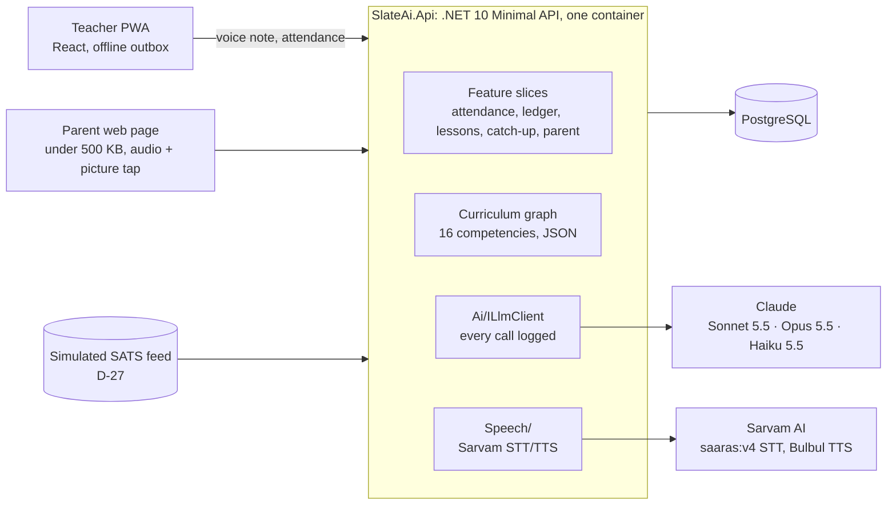

# Technical mentor session — 21 Oct 2026

| | |
|---|---|
| Who | Technical mentor (hackathon panel), Rahul (Monika optional) |
| Length | 40 minutes |
| Parts | **A.** Pre-read (share before or screen-share) · **B.** Agenda and questions · **C.** Notes and decisions (fill in during and after the call) |
| Status | Prepared 21 Oct. Notes to be added after the call; decisions go to `spec.md` §8 |

---

## A. Pre-read (5 minutes)

### What we're building

**Tappida Paatha** ("missed lesson") keeps absent Grade 3 children in Karnataka government schools connected to their class, so they come back sooner and catch up on what they missed.

- **Challenge:** Problem 1C, student absenteeism. About 4 of 36 children are absent on any day. The teacher can't track who missed what or reteach one child.
- **Users:**
  - a Kannada-medium teacher with one Android phone and patchy data
  - families who often speak Telugu or Tamil at home, share one phone in the evening, and have limited literacy
- **Teacher effort:** under 60 seconds a day.
  - Attendance arrives from the school system (simulated feed, D-27); she only corrects it.
  - She records a 20-second Kannada voice note of what she taught.
- **What comes back:**
  - a missed-lesson ledger
  - a 90-second catch-up in the child's home language, which she approves
  - a textbook homework page
  - a 3-picture check the child taps
  - a buddy card on the return day
  - a weekly "recap or move on" nudge
- **Deadline:** submit by Sat 31 Oct (10 days).

### Architecture

Hosting: Azure App Service (B1, Central India) + PostgreSQL Flexible. CI/CD on GitHub Actions; `main` deploys to staging.

### Where AI is used, and where it deliberately isn't

| # | Call | Model | Output | Guardrail |
|---|---|---|---|---|
| A1 | Map the teacher's transcript to curriculum competencies | Sonnet 5.5 | 1–3 IDs, Kannada summary, confidence | IDs restricted to an enum in the JSON schema, then re-checked in code. Confidence < 0.7 → the teacher picks from a list |
| A2 | Compress several missed lessons into ≤ 2 targets that block next week | Sonnet 5.5 | Targets + reasons | Targets must be a subset of the **code-computed** candidate set (missed ∩ prerequisites of next week); otherwise a rule fallback |
| A3 | Write the home-language script, activity, picture check, Kannada gloss, buddy card | Opus 5.5 | Structured JSON | A4 verifier, one retry, then "needs review" |
| A4 | Verify A3 | Code + Haiku 5.5 | Pass/fail + reasons | Code recomputes all arithmetic and checks length, key words and allowed objects. Haiku checks tone and topic |
| A5 | Pacing nudge wording | Haiku 5.5 | One sentence with slots | Numbers filled by code |
| A7 | Classify a parent's optional voice note about the reason for absence | Haiku 5.5 | One of 5 categories | Low confidence → "other". Only the category is stored |

**Never the LLM:** attendance, ledger, candidate set, arithmetic, picture-tap scoring, buddy choice, pacing numbers, the evening message (a template the teacher approves once, slots filled by code).

**Non-negotiables:**
- No child, parent or teacher names go to any AI provider; `{child}` / `{teacher}` placeholders only.
- Nothing reaches a parent without teacher approval, enforced in the API.
- Every call is logged with model, prompt version, tokens, latency and verdict (`AiCalls` table).
- Prompts are versioned files; changing one requires an eval run.

### What exists today (Day 3)

| Done | Next |
|---|---|
| Walking skeleton on Azure, CI, branch protection | **T-07 part 2:** lesson capture + A1 prompt + evals (today) |
| Attendance API + ledger with absence spells and return speed | A2 compression, A3 script, A4 verifier, TTS (Day 3–4) |
| Curriculum loader + graph + candidate set, real Grade 3 data (16 competencies) | Teacher screens, then parent page (Day 4–5) |
| AI plumbing: Claude client (structured outputs, cached system prompt), prompt library, call log, Sarvam STT, fake providers | First end-to-end loop on staging (Day 5) |
| 94 API tests, no Docker needed; small Postgres suite in CI | Usability round 1 with teachers (Day 6) |
| Clickable prototype and 360 px design cards for every screen (Monika) | Demo mode, consent + delete, accessibility pass (Day 7–8) |

**To show during the call:**
1. the clickable prototype (`docs/design/prototype/index.html`)
2. `src/api/SlateAi.Api/Ai/`
3. `data/curriculum/grade3-maths.json`

There's no working UI yet, so a live product demo isn't possible.

---

## B. Agenda and questions (40 minutes)

| Time | What |
|---|---|
| 0–3 | Context: the problem in one sentence; what we want from this call |
| 3–8 | Architecture and the AI table above (screen share) |
| 8–12 | Prototype click-through: teacher Today → lesson confirm → approve → parent steps |
| 12–35 | Questions, in priority order. Stop when time runs out |
| 35–40 | Recap: the 3 things we'll change; anything to send them afterwards |

### Questions (priority order)

**1. Scope for 10 days.** The MVP has about 20 must-have requirements and 5 AI calls. If you had to cut to what wins on "AI use and technical strength" (30%) and "efficacy" (35%), what would you cut or fake? Our candidates:
- the return-speed card
- the reason-for-absence voice note (keep only the buttons)
- a live TTS greeting merge (pre-record it instead)

**2. Making AI quality credible to judges.** Our plan: 10 eval cases per call now, 25 by Day 8, results committed, plus an "Under the hood" panel showing each call, its model and its verifier verdict.
- Is that convincing?
- What evidence do expert reviewers look for: accuracy numbers, failure examples, LLM-as-judge rubrics?
- Our Kannada test transcripts are written by us, not recorded from teachers. How much does that weaken the numbers?

**3. Structured outputs vs tool use.** Sonnet 5.5 and Opus 5.5 reject forced tool choice, so we use JSON-schema structured outputs with the valid competency IDs as an `enum`, and re-validate in code.
- Any pitfalls with large enums, or with schema caching across requests?
- Would you use one big A3 call, or split script / check / buddy card into smaller calls?

**4. Verifier design (A4).** Code checks (arithmetic recomputed, length, key words, allowed objects) plus a Haiku tone/topic check, one auto-retry with the feedback, then "needs review".
- Is one retry right?
- Should the retry go to the same model with the feedback, or to a different model?
- How do we stop the verifier and the writer from agreeing on the same mistake?

**5. Latency and processing model.** Teacher capture runs STT (~30 s clip) + A1 inside the request, with the offline outbox retrying. Package generation (A2 → A3 → A4 → TTS) for 4–8 children happens after the teacher confirms.
- Is in-request processing on a single B1 instance OK for the demo, or do we need a queue now?
- How would you keep the demo safe if Claude is slow during judging? Our plan is pre-generated, approved packages in the demo seed.

**6. Privacy with a voice-first design.** We scrub the class's child names from transcripts before Claude sees them, but the audio itself must go to Sarvam for STT. Mitigations:
- the capture screen asks teachers not to name children
- no audio is stored after transcription
- consent is recorded

Is that defensible under DPDP for a pilot, and what would a reviewer flag first?

**7. Offline on low-end Android.** Voice notes are queued in IndexedDB (Dexie) as audio blobs (~100–300 KB) and replayed with a `clientRequestId` for idempotency. Any known traps with IndexedDB blob storage, service-worker updates or background sync on cheap Android Chrome?

**8. Audio pipeline (if time).** Telugu/Kannada TTS (Bulbul) + the teacher's recorded greeting + a 5-second spoken AI disclosure, target ≤ 300 KB and ≤ 95 s. Concatenate on the server (ffmpeg in a chiseled container?) or play three clips in sequence on the client?

**9. Roadmap credibility (if time).** Attendance is a simulated SATS feed in the demo (no public API exists). What makes a "future integration" slide credible to judges rather than hand-waving?

### What we'll send afterwards

Repo link (public), staging URL, this document. Ask whether a 10-minute follow-up after the first end-to-end loop (Day 5) is possible.

---

## C. Notes and decisions (fill in during and after the call)

### What the mentor said

| # | Point | Question |
|---|---|---|
| 1 | | |
| 2 | | |
| 3 | | |
| 4 | | |
| 5 | | |

### What this changes

| # | Change | Affects (task / FR / D-) | Owner | Decision |
|---|---|---|---|---|
| 1 | | | | |
| 2 | | | | |
| 3 | | | | |

### Follow-ups

- [ ] Log the session in `docs/user-testing.md` as expert input (finding IDs F-T1…), same as the education mentor (F-M1…)
- [ ] Decisions into `spec.md` §8; tasks into `tasks.md`; cuts into `plan.md`
- [ ] If the mentor's input changes the product, add it to `judging-narrative.md` §5 "Expert input that changed the product"
